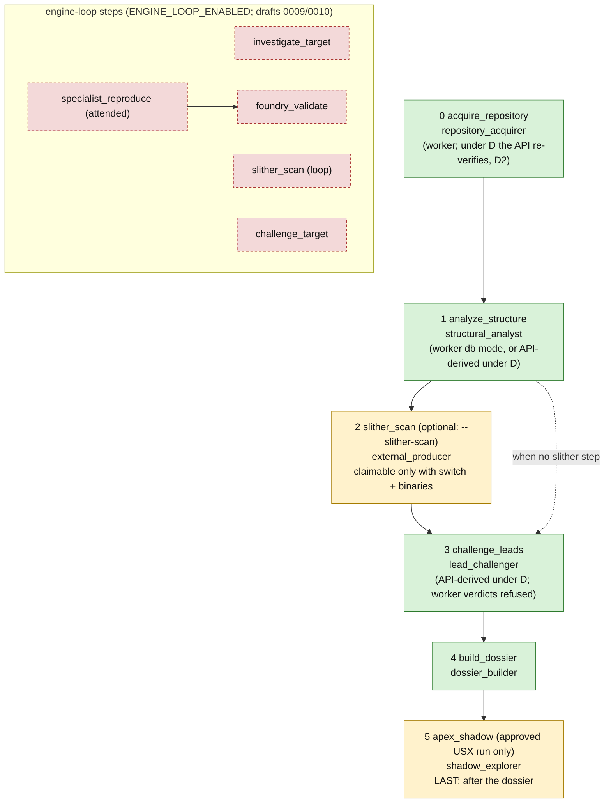
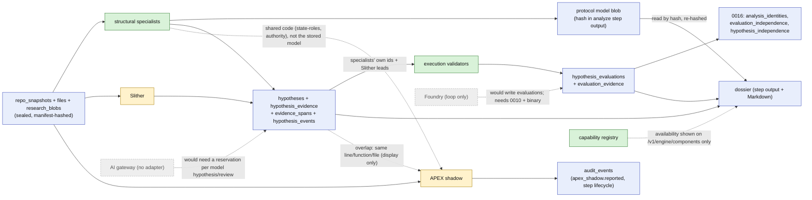
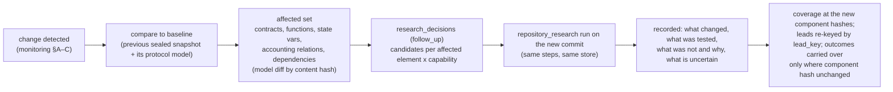

# Engine inventory and coordination design: from separate scanners to one AgentSmith

**Status: assessment and DESIGN only.** Written 2026-11-28 against commit `91cbd3f`. Its application code is byte-identical to
production commit `0d4ee1d`: `git diff --stat 0d4ee1d 91cbd3f` touches only `deploy/release.json` and two documents. Writing it changed no
application code, migration, schema, secret, deployment or `deploy/` file. Nothing was run against production or Fly. No tool was
installed. The frozen held-out corpora (`eval/heldout*`, `eval/benchmark-b`) were not opened: the frozen-corpus numbers below are the
ones the operator recorded.

**Evidence used:**
- the source at `91cbd3f`, cited as `file: function` (and line where it matters);
- the migrations and drafts in `db/`;
- the existing unit tests, run here on 2026-11-28 (below);
- the production facts the operator verified on 2026-11-28 against `0d4ee1d`, quoted as "operator fact".

**Tests run for this document** (worktree `91cbd3f`, the main checkout's `node_modules`, no installs):
- the engine-related unit suites (`apps/api/src/analysis`, `apex`, `engine`, `analysis-identity`, `ai-budget*`,
  `architecture-gaps`): **29 files, 331 passed, 1 skipped**;
- the whole unit suite: **88 of 89 files passed; 1214 passed, 7 skipped**. The one failing file is `build-output.test.ts`. It spawns
  `<repo>/node_modules/.bin/tsc`, which this worktree does not have, so the failure comes from the environment, not the code.
- The integration suites (real Postgres) were **not** run here. Where this document cites an integration test, it says the test
  exists, not that it passed here.

**Status words.** These follow `docs/architecture/integrated-research-architecture.md`:
- *designed*, *implemented*, *tested*, *integrated* (it has an invocation path from the research workflow), *released* (in image
  `0d4ee1d`), *deployed* (running in production where it could execute), *operationally verified* (it executed in production on a
  real input, with a checked result).

Each engine gets exactly one of the six classifications the owner set. A dependency, an interface, a mock, a stand-in, a test or a
design document never counts as integration.

---

## Summary

**One sentence.** AgentSmith today has one research pipeline that works end to end: structural analysis, then its own execution
validators, then the dossier. Around it sit three opt-in or draft attachments (Slither, the APEX shadow, Foundry reproduction) and a
research store that is already shared. The pieces share records, but nothing yet decides which engine should look at what, nothing
passes one engine's hypothesis to another engine as a question, and no execution path outside the AgentSmith parser exists in
production.

**The production fact that frames everything** (operator fact, 2026-11-28, `0d4ee1d`): **no research run has ever executed in
production.**
- **No analysis engine has produced production research.**
- The structural analyzer is deployed and assignable, but unused.
- No worker runs: the worker app is prepared and not created, and `worker_api` is unavailable because its listener is off.
- The only operational component is the **bounty collector** (hourly). It collects programmes. It is not an analysis engine.
- **Real Foundry has never run in this environment.** Every Foundry test result in this repository comes from a shell stand-in
  (`engine/tools/testing/fake-tools.ts: fakeTools().forge`). That is **STAND-IN, not real Foundry.**

### Inventory table

| # | engine / specialist | classification | key evidence |
|---|---|---|---|
| 1 | **Structural analysis**: parser, traces, 7 specialists, protocol model P1–P3, challenge stage, dossier | **Implemented but not deployed** (as a running engine; see note) | On the `repository_research` path (`acquisition/step.ts: createRepositoryResearchRunIn` → `analyze_structure` → `challenge_leads` → `build_dossier`). Its code is released and present in the API image (`0d4ee1d`); `/v1/engine/components` reports `stage:analyze_structure` "deployed and assignable, not yet used". **No production run, no worker, listener off**, so it has never executed in production. Frozen corpora: dev 17/0/0/14, heldout 18/0/0/29, heldout2 31/8/6/51, heldout3 21/1/10/47, heldout4 20/1/18/40, benchmark-b 0/0/8/8 (tp/fp/fn/tn). |
| 1a | **Execution validators** (bounded interpreter: reentrancy plus 5 challenge classes) | **Implemented but not deployed** | `simulate.ts: validateReentrancy`, `challenge.ts: challengeFinding`; run by `pipeline.ts: runChallenge`. Under option D the **API** runs them (`worker-api.ts` D1/D3). Same family as the specialists (`agentsmith-solidity-parser`, 0016). |
| 2 | **APEX** (state explorer, fidelity gate, deep strategy, FP rules, minimisation; shadow stage) | **Integrated but experimental** | `apex/engine/*`, `apex/shadow*.ts`; step `apex_shadow` is created only for the one approved USX target (`shadow-target.ts: assertApexShadowRequestAllowed`). Released in `0d4ee1d`; operator fact: `apex` = experimental. **Never run on real code.** Measurement only: its output is never a hypothesis or an evaluation. |
| 3 | **Slither 0.11.3** | **Integrated but experimental** | `engine/tools/slither.ts: runSlither, recordSlitherLeads`; optional step `slither_scan` (`analysis/solidity/slither-step.ts`). Off by default. Operator fact: `capability:slither` = **unavailable** in production (no slither or solc binary; the tool host is excluded from the build, `tsconfig.build.json`). Projects that need remappings fail as `compile_failed`; submodules are not fetched. |
| 4 | **Foundry 1.5.1** (runner and reproduction round) | **Partially implemented** | `engine/tools/foundry.ts: runForgeTest`; `engine/reproduction.ts: appendReproductionIn, processFoundryValidateStep`. It needs the draft 0010 decision records and an **attended** test author (`claude-reproducer`). There is no automated test author. Tested **only with a stand-in**. Operator fact: `capability:foundry-forge` = **unavailable**. Real Foundry has never run here. |
| 5 | **Echidna** | **Design only** | No code, configuration or test (`grep -ri echidna apps db scripts` finds nothing). One proposed row: R14, "Echidna as an invariant evaluator" (`integrated-research-architecture.md` §1, §5, §8). |
| 6 | **Mythril** | **Not started** | No code or configuration. It appears only in inventories (N2 "NOT IMPLEMENTED"; `apex-status-audit.md`: "inventory only"). |
| 7 | **Semgrep** | **Not started** | No code or configuration. It appears only in inventories (N3). |
| 8 | **Weirdness / anomaly detection** (5.5A) | **Not started** | No code. `research-intelligence-plan.md` §5.5A: "The definition is not yet written." The only related artefact is the attended `claude-assumptions` prompt, described as a "Weirdness precursor" (`engine/capabilities.ts:103`). |
| 9 | **AI reasoning and hypothesis engine** (budget gateway, attended Claude specialists) | **Partially implemented** | The gateway is implemented and tested (`ai-budget-gateway.ts: AiBudgetGateway`, `ai-budget.ts`; tables 0002–0004 applied). It has **no production `ModelAdapter`**, and the reviewed price catalog has no enabled row (`0004`: `enabled DEFAULT false`). The attended specialists (`engine/attended.ts`, `engine/cli.ts`) need the generator kind `attended_model`, which only draft 0010 adds. No model call has ever run in production. |
| 10a | **Capability registry** (`engine/capabilities.ts`) | **Operational in production**, *as a reporting declaration only* | `availability()` runs in the live `/v1/engine/components` (`operations-api.ts: systemComponents`); that is where the operator read `unavailable` for Slither and Foundry. It **selects nothing** in production: its only selecting caller is the engine loop (draft). |
| 10b | **Engine loop, decision records, priority, specialist comparison** | **Partially implemented** | `engine/loop.ts`, `decisions.ts`, `compare.ts`, `priority/*`. The code is released, but its storage is the drafts `db/drafts/t144-research-memory/0009` and `a29-engine-loop/0010`, applied only on throwaway databases. It is claimable only with `ENGINE_LOOP_ENABLED=true` (`engine/steps.ts`). |
| 10c | **Independence layer** (0016) | **Operational in production**, *as schema only* | `0016_research_independence.sql` is applied: the trigger refuses self-evaluation, plus `evaluation_independence` and `hypothesis_independence`. The components endpoint reports `independence` operational because the views exist. Zero research rows have passed through it. |
| 10d | **Legacy intake template pipeline** (`map_attack_surface` → `generate_hypotheses` → `independent_challenge` → `prepare_research_brief`) | **Implemented but not deployed** | `worker-runtime.ts`: path regexes and template questions. It writes `workflow_steps.output`, **not** the 0007 store. `architecture-gaps.test.ts` GAP 1, 2 and 5 mark it for retirement. |
| 10e | **Protocol-invariant detector** (P14) | **Partially implemented** | An unmerged patch, `docs/proposals/protocol-invariant-ae048ad.patch`, with a recorded null result. |
| 10f | **Bounty collector** (not an analysis engine) | **Operational in production** | Operator fact: runs hourly (`deploy/fleet.json`: `bounty-collector`). |

**Note on row 1.** The six labels have no slot for "deployed as code, never executed". I classify by whether the engine can run in
production today. It cannot: no worker claims its steps, and the API's worker listener is off. Its code is released and present on the
deployed API, which is what the operator means by "deployed and assignable". The classification does **not** mean the code is missing
from production.

### Top gaps (detail in Part 3)
1. **No task selection on the production path.** The step order is fixed. The only selector, `loop.ts: chooseCapability`, depends on
   drafts 0009 and 0010.
2. **Engines do not consume each other's hypotheses as questions.** Slither leads are re-checked by the AgentSmith validators, but
   nothing asks APEX, Foundry or a model about a specific lead. APEX's overlaps with leads are display only.
3. **No shared protocol model is read across engines.** The model is stored once by hash. APEX, the engine loop and the dossier each
   **rebuild** it, or parts of it (`state-roles.ts`, `authority.ts`), from sources.
4. **No cross-run lead identity.** `hypotheses.claim_fingerprint` is per snapshot and per generator. Duplicates are clustered only in
   `compare.ts`, which needs 0009.
5. **No cross-family reproduction path in production.** Foundry is unavailable. Slither leads checked by the AgentSmith validators are
   the only cross-family pairs, and the validator is a bounded interpreter, not the EVM.
6. **Non-actions are not recorded.** `research_decisions` and its candidates exist only in draft 0010.
7. **No learning loop.** No outcomes (0009 draft), no adjudications, and `knowledge_items` has no writers.

### Shared workflow in brief (Part 4)
- **Steps 1–4.** One sealed snapshot produces one stored protocol model. The model is extended with state, actors, assets and
  accounting relations. Every engine reads it **by hash**.
- **Step 2.** A Slither lead becomes a 0007 hypothesis with a stable **lead key**.
- **Step 3.** A decision record lists every candidate experiment, including those rejected and why.
- **Steps 5–8.** APEX, then Echidna, then Foundry run as **evaluators** on that hypothesis's question, each in a different analysis
  family. A model reviews assumptions and proposes the next experiment through the gateway; it never evaluates.
- **Steps 9–10.** AgentSmith combines the evidence by family rule: an execution reproduction outranks static agreement, and no
  generator confirms itself. A human records the outcome. The decision, the coverage and the lesson go into the same records.

### Roadmap in brief (Part 5)
1. Release: done.
2. The APEX shadow on USX: four separately approved steps.
3. This inventory.
4. Coordination: C1–C8 make the existing engines cooperate before any new scanner is added.
5. Continuous monitoring, feeding the same loop.
6. Independent capability evaluation: does AgentSmith find what single engines miss, **and** reproduce it?

The verdicts on new tools are:
- **Echidna:** build later, as an evaluator.
- **Mythril:** skip for now.
- **Semgrep:** skip. It duplicates the structural specialists.

---

## Part 1. Inventory, engine by engine

### 1.0 The ten questions (owner requirement), all engines

`Y` = yes, `N` = no, `p` = partly (the row says how). "Real protocol code" means a real third-party protocol repository, not a corpus
fixture, a self-authored contract or educational code.

| question | 1 Structural (+1a validators) | 2 APEX | 3 Slither | 4 Foundry | 5 Echidna | 6 Mythril | 7 Semgrep | 8 Weirdness | 9 AI reasoning | 10b Engine loop |
|---|---|---|---|---|---|---|---|---|---|---|
| Does the code exist? | Y | Y | Y | Y (runner + round) | N | N | N | N | p: gateway Y, adapter N | Y |
| A real execution entry point? | Y: steps `analyze_structure`, `challenge_leads`, `build_dossier` | Y: step `apex_shadow` (bounded child, `compute-child.ts`) | Y: step `slither_scan` | p: step `foundry_validate`, reached only through `appendReproductionIn` (0010) | N | N | N | N | p: `AiBudgetGateway.run` has no caller in any step; attended `engine/cli.ts` only | p: `engine/cli.ts`, steps `investigate_target`, `challenge_target` |
| Can AgentSmith invoke it? | Y (`STRUCTURAL_ANALYSIS_ENABLED=true` on a worker, or the API under D) | p: only for the one approved target and commit, with a recorded approver | p: only with `--slither-scan`, `SLITHER_SCAN_ENABLED=true` and both binaries | N in production (no binary, no 0010, no automated author) | N | N | N | N | N unattended; attended needs a named operator | N in production (drafts not applied) |
| Inputs | sealed snapshot `.sol` bytes (`sealedSnapshot`, `readSnapshotSources`) | in-scope `.sol` files of the sealed snapshot; approval; limits | sealed `.sol` files, pinned solc | the sealed snapshot plus `test/*.sol` written by an attended author | — | — | — | — | the request text, task tier, run id, prompt version | sealed snapshot, coverage memory (0009), capability availability |
| Outputs | protocol model blob, spans, hypotheses (`solidity-structural-specialists@1`), evaluations, dossier JSON and Markdown | one `apex_shadow.reported` audit row: abstentions, suppressions, coverage, candidates, "would have claimed" (unvalidated), overlaps, cost | raw-output blob, spans, hypotheses (`slither@0.11.3`), counts of unmapped or unanchored detections | evaluations by `foundry-forge` (supports, weakens or inconclusive) | — | — | — | — | text, a cost, a reservation id | decisions and candidates, coverage and effort rows |
| Stored in shared research records? | Y: 0007 tables plus step outputs | p: an audit row and step output only. **By design not** in hypotheses or evaluations | Y: 0007 `hypotheses`, `evidence_spans`, `research_blobs` | p: it would write `hypothesis_evaluations` (0007); the round needs 0010 | — | — | — | — | p: `ai_budget_reservations`, `model_usage_events`; a model hypothesis needs `generator_reservation_id` (0007) | p: the tables are draft |
| Can it exchange information with other engines? | p: its hypotheses are read by challenge and dossier; its model is stored but rebuilt by its consumers | p: it reads the run's leads only to compute overlaps (display); it uses `state-roles`/`authority` code, not the stored model | p: its leads are challenged by the AgentSmith validators (`step.ts: challengeInputs`, a cross-family pair) | p: it would evaluate any claim the loop selects | — | — | — | — | p: attended outputs enter as hypotheses or reviews | p: it reads every producer's leads (`compare.ts`) |
| Tested? | Y: unit and integration; frozen corpora via `eval/run-eval.ts` (not in CI) | Y: about 98 APEX unit tests plus `apex-shadow.integration.test.ts`; self-authored contracts only | Y: unit tests plus `slither-research.integration.test.ts` with a **stand-in that replays recorded output**; one real-binary test that is skipped unless installed | p: **stand-in only** (`fakeTools().forge`); `engine-reproduction.integration.test.ts` | N | N | N | N | Y: gateway unit and integration with test adapters | Y: integration on throwaway databases with the drafts applied |
| Deployed? | code in the image; never executed (no worker; listener off) | code in the image; experimental; never executed | code in the image; **unavailable** (no binaries; no tool host) | code in the image; **unavailable** | N | N | N | N | gateway code and tables yes; no adapter, no enabled price | code yes; drafts no |
| Used successfully on REAL protocol code? | **p**: locally, not in production. One run on a real bounty repository at a pinned commit (it first failed on the citation bug, since fixed; `apex-status-audit.md`), and 34 leads on `not-so-smart-contracts@020dbdb`, which is educational code and unadjudicated (`ml-readiness.md` §1) | **N**: only self-authored fixtures, including a "USX-like" shape fixture | **N**: one real run on the frozen dev corpus in a discarded container (dev 10/2/7/12; `apex-status-audit.md`) | **N** through AgentSmith. An attended, hand-run case study in an earlier, discarded container is mentioned (`specialist-capabilities.md` §1) but is not re-verified, and per the operator real Foundry has never run in this environment | N | N | N | N | N unattended; attended work only | N |

### 1.1 Structural analysis (engine 1)

**Source and entry points.**
- `apps/api/src/analysis/solidity/`:
  - parsing and indexing: `lexer.ts`, `parser.ts`, `index.ts`;
  - effects: `trace.ts: Tracer` (inlined effect traces);
  - detection: `specialists.ts: Analyzer, analyzeSources`, with 7 classes: reentrancy, access-control, initializer, delegatecall,
    unchecked-call, selfdestruct, tx-origin;
  - modelling: `protocol-model.ts: buildProtocolModel` (schema `protocol-model/3`, builder `solidity-p3/2`), `state-roles.ts`
    (P2), `authority.ts` (P3);
  - orchestration: `pipeline.ts: runStructuralAnalysis, runChallenge, buildDossier, renderDossierMarkdown`.
- Step handlers are in `step.ts` (`dispatchAnalysisStep`) and claimed through `worker-runtime.ts: intakeStepKeys`. They require
  `STRUCTURAL_ANALYSIS_ENABLED=true`.
- Under option D (`WORKER_STORE=api`), the remote worker computes nothing for these three steps
  (`worker-remote.ts:113 API_DERIVED`). The **API** recomputes the analysis, runs the validators and builds the dossier on `complete`
  (`worker-api.ts` lines 36–38 and 234–241; worker-submitted evaluations are refused at line 425).
- The analyzer version is `structural-solidity/2 (specialists 1 + storage-reference writes, execution validators 1)` (`keys.ts:13`).

**Tests.**
- unit tests: `analysis.test.ts`, `protocol-model.test.ts`, `state-roles.test.ts`, `authority.test.ts`, `challenge.test.ts`,
  `storage-alias.test.ts`, `bounded-compute.test.ts` and more;
- integration tests: `structural-workflow`, `structural-research`, `refutation-dossier`, `challenge-identity`,
  `adversarial-shared`;
- frozen corpora through `eval/run-eval.ts` (`analyzeSources` + `validateReentrancy`). This is **not** a CI step: `ci.yml` runs
  typecheck, unit, integration and the image build.

**Frozen-corpus results** (operator-recorded; tp/fp/fn/tn):

| corpus | tp | fp | fn | tn | reading |
|---|---|---|---|---|---|
| dev | 17 | 0 | 0 | 14 | developed on; not evidence |
| heldout | 18 | 0 | 0 | 29 | first held-out; later used for development |
| heldout2 | 31 | 8 | 6 | 51 | recall 0.84, precision 0.79 |
| heldout3 | 21 | 1 | 10 | 47 | recall 0.68 |
| heldout4 | 20 | 1 | 18 | 40 | recall 0.53: recall falls on each newer, less-inspected corpus |
| benchmark-b | 0 | 0 | 8 | 8 | **recall 0 on semantic classes** (accounting, invariants, state transitions, oracles, economics) |

The trend matters more than the best row. Every held-out corpus is synthetic, single-function and class-balanced
(`ml-readiness.md` §1). None of them measures real-protocol discovery.

**What it can model:**
- single-contract structural patterns over inlined effect traces;
- caller guards and authority (P3: privileged roles, trust boundaries);
- state-variable roles (P2: ledgers, aggregates);
- call edges, with external targets kept as written;
- inheritance linearisation.

**What it cannot model:**
- token, oracle or price semantics; economic incentives;
- multi-transaction accounting;
- cross-contract state, where external calls are `unresolved` unless typed inside the snapshot;
- proxies and diamonds beyond `delegatecall` edges;
- submodule dependencies, which are not fetched (`usx-first-run-readiness.md` §3.1).

Coverage reports "complete" when every in-repository file parsed. It does not yet treat unresolved imports as partial: parsed is not
understood.

### 1.2 Execution validators (1a), the bounded interpreter

**Source.**
- `simulate.ts: Interp, World, validateReentrancy`. It interprets checked 0.8 arithmetic, mappings, modifiers, internal helpers and
  low-level calls with value. It lets an attacker re-enter at depth 1 and compares the result with honest sequences.
- `challenge.ts: challengeReachability, challengeInitializer, challengeUncheckedCall, challengeFinding`.

**Outcome mapping** (`pipeline.ts:170 challengeOutcome`):

| validator result | evaluation outcome |
|---|---|
| validated | `supports` |
| refuted with an executed counterexample trace | `contradicts` |
| refuted without one | `weakens` |
| abstained | `inconclusive` |

A class with no validator gets evaluator `no-independent-validator` and outcome `inconclusive` (`pipeline.ts:197, 218`).

**Independence.** The validators are in family `agentsmith-solidity-parser`, the **same family** as the specialists (0016 seed).
Their support for a specialist lead is **same-family corroboration**, not independent confirmation (`hypothesis_independence`
`corroborated_same_family`).

**Classification:** Implemented but not deployed, for the same reason as row 1.

### 1.3 APEX (engine 2)

**Source.**
- `apex/engine/`, moved byte for byte from the prototype:
  - `state-explorer-prototype.ts`: the engine, invariant candidates of kinds `conservation`, `solvency`, `actor-value`, `one-way`,
    `partition`, and the fixed actors `owner0`, `alice`, `attacker`;
  - `deep-explorer.ts`: the deep strategy;
  - `fidelity.ts`: `FidelityInterp`, which abstains on unsupported features and suppresses approximations;
  - `fp-rules.ts`;
  - `coverage.ts`.
- `apex/shadow.ts`: a pure computation, run in the bounded child (`analysis/solidity/compute-child.ts`, task `apex_shadow`; CPU
  300 s, wall 330 s, heap 1 GiB).
- `apex/shadow-step.ts`.
- `apex/shadow-record.ts`: a strict schema; one `audit_events` row `apex_shadow.reported`; overlaps derived by the recorder.
- `apex/shadow-target.ts`: the single approved target. Repository `scroll-tech/usx-contracts`, commit `9e97…`, the 20 scope paths and
  the page hash.

**Entry point.** `createRepositoryResearchRunIn(..., { apexShadow })` adds `apex_shadow` as the last step, after `build_dossier`
(`acquisition/step.ts:88–96`). No environment switch enables it. The worker claims it wherever analysis is claimable
(`worker-runtime.ts:1036`). Option D adds `report_apex_shadow`.

**Design.** `docs/architecture/apex-first-capability.md`:
- §10: the fidelity gate is mandatory; APEX never validates its own discoveries.
- §11.1 and §11.2, recorded on self-authored sets: set 1 recall 10/10 with 1 FP; set 2 recall 6/7 with 7 FP; false-invariant rates
  3/14 and 6/13.
- §11.3: the shadow stage.

**Tests.** About 98 unit tests in `apex/**`, which passed here as part of the 331, plus `integration/apex-shadow.integration.test.ts`.

**What it can model.** Single-contract, ether-and-mapping state machines. It abstains on:
- external calls, tokens and oracles;
- `delegatecall` and proxies;
- hashing and `abi.*`, `block.*`;
- arrays, structs and enums;
- `try` and assembly.

It suppresses findings that rest on narrow integers and casts, the loop cap, `tx.origin` or foreign balances. Actors are not derived
from authority facts (§10.2.3 is a design note). Independent replay (§10.2.5) is **not started**.

**What it exchanges.**
- It *reads* shared code (`state-roles.ts`, `authority.ts`), not the stored protocol model.
- It *writes* a measurement record, never a hypothesis or an evaluation.
- Its overlaps with the run's leads say only "same line, function or file". The recorder states that an overlap is "neither support
  nor contradiction of the lead" (`shadow-record.ts:128`). This is **shared display, not data flow**.
- APEX has no `analysis_identities` row, so it could not be an evaluator today without a 0016 seed change.

**Classification:** Integrated but experimental (operator fact).

### 1.4 Slither (engine 3)

**Source.**
- `engine/tools/slither.ts: runSlither`:
  - the version must equal `0.11.3`;
  - solc is passed explicitly, so nothing is downloaded;
  - the arguments are fixed and the tool runs once per directory;
  - the environment is minimal, with a private HOME and hard timeouts;
  - the temporary path is normalised out of the output.
- `parseSlitherJson`.
- `recordSlitherLeads`: maps detectors to AgentSmith classes (`SLITHER_DETECTOR_CLASS`). Informational detectors are counted, not
  stored. Every lead is anchored to a hash-verified span.
- `analysis/solidity/slither-step.ts: processResearchSlitherScanStep, slitherScanClaimable, slitherScanLimits`.

**Entry point.**
- The step `slither_scan`, between analyze and challenge. It exists only in runs created with `slitherScan` (`--slither-scan`).
- It is claimable only with `SLITHER_SCAN_ENABLED=true` and both `AGENTSMITH_SLITHER_BIN` and `AGENTSMITH_SOLC_BIN`.
- A failure makes the step *succeed* as `abstained`, with a code.
- `challenge_leads` challenges Slither leads with the AgentSmith validators (`step.ts:117–128`). This is the one real cross-engine data
  flow today, and the pair is `slither-ir` → `agentsmith-solidity-parser`, a **cross-family** relation.

**Tests.**
- `slither-step.test.ts`, `tools.test.ts`;
- `integration/slither-research.integration.test.ts`. Its happy path uses a stand-in that prints the **recorded output** of one real
  run on the dev corpus. The real-binary test is skipped unless the binary is installed.
- `engine-tools-loop.integration.test.ts`.

**Known limits.**
- Solc mode compiles one directory at a time. A project that needs Foundry or Hardhat remappings fails as `compile_failed`
  (`slither.ts:9–14`; `specialist-capabilities.md` §4).
- Submodules are recorded as gitlinks and never fetched (`acquisition/acquire.ts`, `plan.ts`; `acquire.test.ts`). USX has
  submodules (`usx-first-run-readiness.md` §3.1), so imports into them fail, and Slither on USX would very likely abstain.
- The production image cannot spawn tools: `tool-host/**` is excluded from `tsconfig.build.json`, and `run-tool.ts:51` returns
  `TOOL_HOST_UNAVAILABLE`. There, the stage abstains as `tool_unavailable`.

**Classification:** Integrated but experimental. Unavailable in production (operator fact).

### 1.5 Foundry (engine 4)

**Source.**
- `engine/tools/foundry.ts: runForgeTest`:
  - `forge test --offline --json --match-test`;
  - version `1.5.1`;
  - a generated `foundry.toml` with `libs = ["lib"]` and no remappings;
  - tests must be `test/*.sol` and must not overwrite snapshot files.
- `engine/reproduction.ts`:
  - `appendReproductionIn` continues the claims' finished run with `specialist_reproduce` (an **attended** test author) and then
    `foundry_validate`. Each test runs twice.
  - The outcome mapping is fixed: `demonstrate` passing twice gives `supports`; `refute` passing gives `weakens`; everything else is
    `inconclusive`.
  - There is one reproduction round per run. A test author that produced any of the claims is refused.

**Entry point.**
- The only caller is `loop.ts: mapAndAssign`, through `claimsNeedingReproduction`. It needs `research_decisions` (0010),
  `hypothesis_outcomes` (0009) and an attended `claude-reproducer`.
- `foundry_validate` is an `ENGINE_STEP_KEYS` member, so it is claimable only with `ENGINE_LOOP_ENABLED=true` (`steps.ts:24–25`).
- Availability needs `AGENTSMITH_FORGE_BIN` (`capabilities.ts:150`).

**Tests.** `tools.test.ts` and `engine-reproduction.integration.test.ts`. Both use **`fakeTools().forge`, a shell script that prints
a canned forge JSON. STAND-IN, not real Foundry.**

**Evidence of a real run:** none in this environment. `specialist-capabilities.md` §1 and `apex-status-audit.md` mention an attended,
hand-run case study in an earlier container. It was not through AgentSmith, it is not re-verified, and it counts for nothing here.

**Classification:** Partially implemented. The runner and round are code; the automated author, the storage (0010) and the binary do
not exist. Operator fact: unavailable.

### 1.6 Echidna (engine 5)

**Search:** `grep -ril echidna apps db scripts` returns nothing. It appears in documents only:
- `integrated-research-architecture.md` R14, "Echidna as an invariant evaluator" (PROPOSED);
- `apex-first-capability.md` §10.1, as a possible independent replayer;
- `specialist-capabilities.md` §1: "not installed".

**Classification:** Design only. The design is one row, with no input or output contract.

**Capability assessment.** Echidna is property-based fuzzing of compiled EVM bytecode. It is **a different analysis family**
(`evm-execution`, or its own `evm-fuzzing`). It is the natural independent check for APEX's invariant candidates:
- APEX searches a bounded abstract model exhaustively. Echidna searches the real compiled contracts randomly and broadly.
- An APEX invariant violated in Echidna's real-bytecode search is cross-family evidence.
- An invariant that holds under a large Echidna campaign weakens an APEX counterexample.

It needs `solc`, compilable projects (the same remapping and submodule problem as Slither and Foundry), property harnesses written by
someone other than the claim's generator, and a time budget.

**Verdict: BUILD, but after Foundry reproduction (C5) and the tools worker.** It adds real capability: broad multi-transaction
sequences on real bytecode, which no current engine has. It cannot help until compilation of real projects works.

### 1.7 Mythril (engine 6)

**Search:** no code or configuration. It appears in documents only: N2 NOT IMPLEMENTED, and `apex-status-audit.md`: "Mythril and
Semgrep last: they overlap with what exists and are noisy."

**Classification:** Not started.

**Capability assessment.** Mythril is symbolic execution of EVM bytecode with SMT solving. In principle it adds exact path conditions
on real bytecode. In practice, for AgentSmith:
- its classic detectors (reentrancy, unchecked call, `tx.origin`, selfdestruct, delegatecall, integer issues) overlap the 7 structural
  classes and the Slither detectors;
- its transaction depth is usually small (2–3) and path explosion is severe on protocol-sized code;
- it is single-contract-centric.

What it could uniquely add is a solver-backed "this path is feasible on real bytecode" check for a specific lead. Foundry gives the
same answer more cheaply and more convincingly (a concrete passing test), and Halmos, not assessed here, covers symbolic Foundry
tests.

**Verdict: SKIP for now; revisit only if C5 shows many leads where no test author can decide feasibility.**

### 1.8 Semgrep (engine 7)

**Search:** no code or configuration (N3).

**Classification:** Not started.

**Capability assessment.** Semgrep does syntactic pattern matching with taint mode. On Solidity, with community rules, it duplicates
what the structural specialists already do (pattern rules over a parse), with a weaker model:
- no inlined effect traces;
- no state roles;
- no authority facts.

It would add a second family for syntactic claims, but a noisy one, whose agreement means little. Same-shape rules in another engine
are not independent understanding.

**Verdict: SKIP.** It duplicates the structural specialists and Slither. Writing custom rules is cheaper inside `specialists.ts`,
where the trace and authority context already exist.

### 1.9 Weirdness / anomaly detection (engine 8)

**Search:**
- no code (`grep -ri "weird\|anomal" apps` finds only the capability description string);
- `research-intelligence-plan.md` §5.5A: "The definition is not yet written";
- `protocol-representation-design.md` line 59 gives a one-line intent: anomalies relative to the model, such as asymmetric guards
  between twin functions;
- `autonomous-architecture.md` line 95: "unusual structure relative to a corpus of protocols".

**Classification:** Not started.

**What it would need (DESIGNED here, minimal):**

| element | content | source in existing code |
|---|---|---|
| a baseline of normal behaviour | a reference set of protocol models (structural features per component: guard patterns, write sets, role structure, call shapes), built only from **adjudicated or published-safe** code, frozen and versioned like a corpus | `protocol-model.ts` features; the frozen-corpus discipline (`docs/evaluation-protocol.md`) |
| accounting-relationship invariants | asset, share and balance relationships declared or inferred per vault-like component: total assets against the sum of balances, the shares-to-assets monotone ratio, minted against deposited, fees against reserves | P2 `stateVariableRoles` (ledgers and aggregates), plus a new `assets/accounting` section (Part 4.1) |
| state-transition statistics | per function: which variables move, in which direction and with which guards. Twin-function asymmetry (deposit against withdraw, stake against unstake). Transitions with no guard. Never-reverting writers of an aggregate | `trace.ts` effects; APEX coverage (`apex/engine/coverage.ts`) for executed transitions |
| scoring | a deviation from the baseline per feature, with the feature cited (file:line). The output is a **ranked investigation candidate**, never a hypothesis or evidence | — |
| learning | which anomaly kinds led to adjudicated outcomes, evaluated only on held-out sets | 0009 outcomes |

**How it differs from APEX invariants.**
- APEX *infers candidate invariants within one contract from its own honest executions* and then *searches for a violating sequence*.
  Its output is a counterexample: a claim about this code.
- Anomaly detection *compares this code's structure and statistics with other protocols'* and *ranks where to look*. Its output is
  steering: a feature in the decision record that raises a component's priority or proposes a question for APEX, Slither or a model.
- An anomaly is never evidence. It can raise, not settle, a question.

### 1.10 AI reasoning and hypothesis engine (engine 9)

**Code and storage.**
- `ai-budget.ts`: `INITIAL_AI_BUDGET` sets US$25 per month, US$1 per day and US$0.50 per workflow. The per-call caps are tier1
  US$0.01, tier2 US$0.05 and tier3 US$0.10, and the monthly tier caps are 5, 15 and 5. `MODEL_ROUTING` maps 10 tasks to tiers, e.g.
  `conflicting_evidence` and `independent_challenge` to tier3. `checkModelCallBudget` enforces the caps.
- `ai-budget-gateway.ts: AiBudgetGateway`: reservations, worst-case pricing (`estimateWorstCaseCost`), an emergency stop, and the
  `ModelAdapter` interface.
- Migrations 0002 (policies, usage), 0003 (reservations) and 0004 (a reviewed price catalog with `enabled DEFAULT false` and a check
  that an enabled price needs a reviewer) are all applied.
- The research store requires a model-generated hypothesis to carry `generator_reservation_id` (0007 check).
- `hypothesis_evaluations.actor_kind` is `CHECK (actor_kind = 'deterministic_rule')` (0007, line 384). **A model can never write an
  evaluation.** It can only write a `hypothesis_reviews` row (`reviewer_kind = 'model'`, blinded, with provider, model and
  reservation).

**What is missing.**
- There is no class implementing `ModelAdapter` outside tests: `grep "implements ModelAdapter"` finds nothing.
- There is no enabled price.
- No step calls the gateway.
- `docs/claude-runtime-options.md`: "No paid runtime is approved or active."
- `docs/ml-readiness.md`: no ML model can honestly be trained; there are zero decisions with outcomes.

**Attended path.**
- `engine/attended.ts` (`brief`, `exportSnapshot`, `importSpecialist`, `importChallenge`) and `engine/cli.ts`.
- The capabilities are `claude-scoping`, `-accounting`, `-path`, `-assumptions`, `-liveness`, `-hunter`, `-reproducer`,
  `-challenger` and `-prior-art`, gated by `AGENTSMITH_ATTENDED_OPERATOR`.
- They write generator kind `attended_model`, which only draft 0010 adds to the check constraint
  (`0010_engine_loop.sql:134–139`).

**Classification:** Partially implemented.

**A budget fact the design must respect.** The tier3 per-call cap is US$0.10. At the list prices in `claude-runtime-options.md` §2,
a 60k-input, 8k-output Opus-class challenge costs about US$0.40 and **would be refused**. A 25k-input, 5k-output Sonnet-class call
costs about US$0.10, at the cap. AI work must therefore be **narrow**: one hypothesis, a small cited excerpt plus the relevant
protocol-model slice. It is never "read the repository". The daily US$1 cap limits it to roughly 10 tier3 calls a day.

### 1.11 Other engines and specialists (row 10)

| component | code | classification | note |
|---|---|---|---|
| capability registry | `engine/capabilities.ts: CAPABILITIES, ATTENDED_SPECIALISTS, availability, producers, evaluatorsAvailable` | Operational in production (reporting only) | It declares `kind`, `stepKey`, `classes`, `requires`, `status` and `profile` (relevance and cost units). APEX is **not** declared (`operations-api.ts`: "no capability declared"). `foundry-forge` is `status: "active"` but environment-gated. |
| engine loop | `engine/loop.ts: rankOpportunities, selectOpportunity, mapAndAssign, chooseCapability (line 224), ingestInvestigation, outcomeLedger, recordHumanOutcome, trackRecords (245)` | Partially implemented | `chooseCapability` scores `pending × relevance / costUnits`. `trackRecords` is **never used in selection** (`usedInSelection: false`; at least 5 human outcomes are needed). `mapAndAssign` rebuilds the protocol model (line 297). |
| decision records | `engine/decisions.ts: openDecision, addCandidates, RESEARCH_POLICY_V0`; draft `0010: research_decisions, research_decision_candidates` | Partially implemented | Candidate actions: `investigate`, `defer`, `skip_duplicate_risk`, `skip_out_of_scope`, `skip_budget`, `skip_low_value`, `recommend`, `request_human_review`, `complete`. They are written before the work, in the same transaction. Non-actions are first-class, **in the draft**. |
| priority engine | `priority/score.ts`, `component.ts`, `coverage.ts`, `replay.ts`, `outcomes.ts` | Partially implemented | `adaptive-priority-engine-design.md` §11: on a synthetic replay it does not beat round-robin. |
| specialist comparison | `engine/compare.ts: compareSpecialists` | Partially implemented | It clusters leads by `contract|function|class` and reports `examinedNotFoundBy` from `research_coverage` (0009 draft). |
| simulator | `analysis/solidity/simulate.ts` (validators); `apex/engine/fidelity.ts` (`FidelityInterp extends Interp`) | as 1a and 2 | one interpreter, two uses |
| dossier builder | `pipeline.ts: buildDossier, analysisCoverage, addSlitherCoverage, renderDossierMarkdown` | Implemented but not deployed | It re-verifies spans, labels each lead's generator and evidence by family relation, and lists external-tool abstentions. |
| legacy intake pipeline | `worker-runtime.ts: processAttackSurfaceMapping, processHypothesisGeneration (HYPOTHESIS_TEMPLATES), processIndependentChallenge, processResearchBrief`; `repository-mapper.ts` (path regex `SECURITY_PATH`) | Implemented but not deployed | Its hypotheses live in step output, not in 0007 (`architecture-gaps.test.ts` GAP 2). It must not be counted as an intelligence engine. |
| discovery and repository monitor | `discovery/*`, `bounties/monitor-main.ts` (0008, 0013 applied) | Implemented but not deployed | `deploy/fleet.json`: the `bounty-monitor` job is gated on production write. |
| bounty collector | `bounties/collect*.ts` | Operational in production | not an analysis engine |

---

## Part 2. The current architecture: what actually calls what

### 2.1 The research workflow as it exists (`repository_research`)

Created by `acquisition/step.ts: createRepositoryResearchRunIn`. The step sequence is fixed at creation time; there is no runtime
selection.

### 2.2 Data flow between engines (solid = real data flow; dotted = shared display or code reuse only)

**Real data flow today:**
1. sealed snapshot → specialists → hypotheses and the stored model;
2. sealed snapshot → Slither → hypotheses (opt-in);
3. hypotheses (the specialists' ids from the analyze step output and Slither's ids from the Slither step output) → validators →
   evaluations;
4. hypotheses, evaluations, the model blob and the independence view → dossier.

**Shared display or code reuse, not data flow:**
- APEX overlaps with leads;
- APEX's use of `state-roles.ts` and `authority.ts` as code;
- the registry's availability on the Operations page;
- panel 6, which shows the APEX record labelled "unvalidated, not evidence".

### 2.3 Research state

| record | table / view | writers today | readers today |
|---|---|---|---|
| sealed snapshot | `repo_snapshots`, `repo_snapshot_files`, `research_blobs` (0007) | acquisition | every engine |
| protocol model | a blob in `research_blobs`; its hash in the analyze step output (`protocol_model_sha256`); no table (`architecture-gaps.test.ts` GAP 6) | analyze | dossier (by hash). APEX, the loop and the dossier's architecture view rebuild it |
| hypotheses | `hypotheses` (generator kind, id and version; `claim_fingerprint` unique per snapshot), `hypothesis_evidence`, `evidence_spans` | specialists, Slither; attended (needs 0010) | challenge, dossier, loop, compare |
| evaluations | `hypothesis_evaluations` (outcomes `supports`, `weakens`, `contradicts`, `inconclusive`; `deterministic_rule` only) | validators; Foundry (loop) | dossier, `hypothesis_status`, 0016 views |
| reviews | `hypothesis_reviews` (model, human or attended; blinded or disclosed) | attended CLI; humans | `hypothesis_status` |
| status | `VIEW hypothesis_status`: never "confirmed" from evaluations | — | dossier, API |
| independence | 0016 `analysis_identities` (an append-only seed of 16 ids), a trigger (generator ≠ evaluator), `evaluation_independence` (`cross_family`, `same_family`, `unknown_family`, `abstention`), `hypothesis_independence` | migration seed | dossier, timeline |
| analysis-identity families | `analysis-identity.ts: ANALYSIS_IDENTITIES`, mirrored by the 0016 seed | — | `recordEvaluation` refusal, dossier labels |
| outcomes, coverage, effort, missed | draft 0009 (`hypothesis_outcomes` human-only, `research_coverage`, `research_effort`, `missed_in_runs`, `external_references`, `ground_truth_adjudications`); R3b draft (confirmed needs cross-family) | loop (draft) | loop, compare |
| decisions | draft 0010 `research_decisions`, `research_decision_candidates` | loop (draft) | timeline (reports "not applied") |
| knowledge | `knowledge_items`, `knowledge_links` (0001) | **none** (`architecture-gaps.test.ts` "no writers") | none |

### 2.4 Worker modes

| mode | entry | what runs in the worker | what runs in the API | production state |
|---|---|---|---|---|
| `db` (default) | `worker-main.ts` → `worker-db-main.ts` → `runIntakeWorker` | every claimable step, with a direct database connection | — | **not used**: A7, Fly refuses GRANT and REVOKE |
| `api` (option D) | `worker-remote-main.ts` → `executeRemoteStep` | acquisition (untrusted archive), `slither_scan` (tool), `apex_shadow` (bounded child); a token scoped to one run and leased steps | analyze, challenge and dossier are **recomputed by the API** (D1, D3); acquisition is re-verified against GitHub (D2) | **not running**: worker app `agentsmith-worker` prepared only (`fly.worker.toml`); operator fact: `worker_api` unavailable (listener off) |

**Consequence for coordination.** Under D, engines that need binaries (Slither, Foundry, later Echidna) must run **in the worker or a
tools worker**, and their results enter as `worker_reported`. Engines that are deterministic over sealed bytes (the structural analysis
and validators) run in the API and are trusted more. The coordination design keeps this split.

### 2.5 The capability registry today

`CAPABILITIES` (`capabilities.ts:133–157`):

| id | kind | stepKey | status |
|---|---|---|---|
| `solidity-structural-specialists@1` | producer | `investigate_target` | active |
| `slither@0.11.3` | producer | `slither_scan` | active |
| `agentsmith-execution-validators@1` | evaluator | `challenge_target` | active |
| `foundry-forge@1.5.1` | evaluator | `foundry_validate` | active |

`ATTENDED_SPECIALISTS` adds 9 attended Claude capabilities. They are read by `loop.ts` (selection) and `operations-api.ts`
(display). The repository-research path does **not** read the registry: its steps are created by flags.

### 2.6 The dossier

`pipeline.ts: buildDossier` reads:
- the snapshot;
- every hypothesis on it;
- each hypothesis's latest evaluations;
- the evaluations' family relations (D);
- the model blob by hash;
- the Slither step outcome.

It writes the step output and the Markdown. It is the only place where results from several engines appear together, and it **labels
rather than combines** them:
- "agreement is corroboration, never proof";
- Slither leads named by generator;
- "Slither abstained ... NOT evidence that Slither would find nothing".

APEX is deliberately absent from it.

---

## Part 3. Gaps preventing coordinated intelligence

| # | gap | evidence in code | effect |
|---|---|---|---|
| G1 | **No task selection on the production path.** Steps are fixed at run creation by operator flags | `createRepositoryResearchRunIn` inserts a fixed stage list; `chooseCapability` exists only in `loop.ts`, behind `ENGINE_LOOP_ENABLED` and drafts 0009/0010 | every engine runs on everything or on nothing; no information-gain choice |
| G2 | **Engines do not consume each other's hypotheses as questions** | Validators take leads by class only (`pipeline.ts:197 evaluatorOf`); APEX reads leads only for overlaps (`shadow-record.ts:99–128`); Foundry needs an attended test author for each selected claim | a Slither withdrawal lead is never turned into "explore sequences around this function" |
| G3 | **No shared protocol model across engines** | The model is stored once (`pipeline.ts:100`) but rebuilt by `loop.ts:297, 494`, the dossier architecture view (`pipeline.ts:629`) and APEX (`state-explorer-prototype.ts:252`, `fp-rules.ts:43–44` via `stateVariableRoles`/`authorityFacts`) | each engine can see a different model if a builder changes; no place to put unresolved questions or accounting relations |
| G4 | **No assets, accounting, actors-by-role or transitions in the model** | `protocol-model.ts` header: "P1 deliberately contains NO roles, assets, value flows, trust boundaries or transitions"; P2 and P3 add roles and authority only; R5 `protocol-model/4` is PROPOSED | APEX uses fixed actors (`ACTORS`); no engine knows "shares vs assets" |
| G5 | **Duplicate findings without a shared identity** | `claim_fingerprint` hashes snapshot, family, claim text, generator and spans (`research-state.ts:52–66`), so the same issue from Slither and the specialists gives two hypotheses with unrelated identities; hypotheses belong to one run (`UNIQUE (id, workflow_run_id)`); `compare.ts` clusters `contract|function|class` only in memory, on draft tables | the dossier lists duplicates; no cross-run or cross-commit memory of "this lead" |
| G6 | **No cross-family reproduction path in production** | Foundry is unavailable and needs 0010 plus an attended author; APEX has no `analysis_identities` row; the only cross-family evaluation pair is Slither → validators, whose evaluator is a bounded interpreter of the AgentSmith parse | nothing can reach "independently reproduced on the EVM"; R3b's `confirmed` rule could never be satisfied |
| G7 | **Non-actions are not recorded** | `research_decisions` and its candidates exist only in `db/drafts/a29-engine-loop/0010`; the timeline says "migration 0010 ... is not applied" (`operations-api.ts`, `runTimeline`) | "why was Foundry not run here?" is unanswerable; no basis for learning selection |
| G8 | **No learning loop** | No `hypothesis_outcomes` (0009 draft); `trackRecords` has `usedInSelection: false`; `knowledge_items` has no writers; `ml-readiness.md`: zero decisions with outcomes | more runs would not make it better, only bigger |
| G9 | **No automated test author** | `reproduction.ts` requires `specialist_reproduce`, an attended capability; R6 "deterministic test-template author" is PROPOSED | reproduction cannot run unattended even with forge installed |
| G10 | **Real projects do not compile for external tools** | Slither: one directory, no remappings (`slither.ts:9–14`); Foundry: `libs = ["lib"]`, no remappings (`foundry.ts:31`); submodules not fetched (`acquire.ts`) | Slither, Foundry and Echidna would abstain on USX-like repositories |
| G11 | **No tool runtime in production** | `tool-host/**` excluded from the build; `run-tool.ts:51` returns `TOOL_HOST_UNAVAILABLE`; the Dockerfile has no binaries; R1/R2 (tools image, broker) PROPOSED | every external engine is "unavailable" in production |
| G12 | **AI cannot be called, and cannot evaluate** | no `ModelAdapter`; no enabled price (0004); `hypothesis_evaluations.actor_kind = 'deterministic_rule'` (0007:384) | model reasoning can only be reviews, and today none |
| G13 | **Coverage overstates understanding** | coverage "complete" when files parse, whatever the unresolved imports (`usx-first-run-readiness.md` §3.1) | the dashboard or dossier could read "parsed" as "understood" |
| G14 | **Legacy hypotheses outside the store** | `processHypothesisGeneration` writes template hypotheses into step output (`architecture-gaps.test.ts` GAP 2) | a second, disconnected "hypothesis" notion |

---

## Part 4. The coordinated architecture (DESIGNED; no code)

**Rule of reuse.** One workflow (`repository_research`), one store (0007), one independence layer (0016), one decision record (0010
draft), one memory (0009 draft), one dossier. **No new memory, evidence or hypothesis subsystem.** Every new record below is either a
blob schema (no migration) or a minimal extension named as a future migration that needs approval.

### 4.1 Shared protocol state (DESIGNED)

**Principle.** One sealed snapshot produces one protocol model, stored once and **read by hash by every engine**. Engines may add
*sections* in new blobs that reference the base model's hash. They never fork it.

**Model sections** (extending `protocol-model/3`, which becomes `protocol-model/4`, R5):

| section | content | status | built by | consumed by |
|---|---|---|---|---|
| contracts | components, deployability, linearisation, state variables | EXISTING (P1) | `buildProtocolModel` | all |
| functions | entry points, visibility, mutability, modifiers, `callerGuarded`, `stateWrites` | EXISTING (P1) | same | all |
| call edges and dependencies | internal, external, low-level and delegatecall edges; `resolvedCallee`; **unresolved imports and submodule gitlinks with their pinned commit** | P1 plus NEW: unresolved dependencies become explicit entries | builder + acquisition plan (`plan.ts` submodule records) | coverage (G13), Slither/Foundry abstention reasons |
| state | variable roles: ledger, aggregate, phase (P2 `stateVariableRoles`) | EXISTING (P2) | `state-roles.ts` | APEX (today it recomputes), anomaly |
| actors and permissions | privileged roles, holders, trust boundaries (P3 `authorityFacts`); **NEW: the actor set derived for exploration** (deployer, each role holder, an unprivileged EOA, an attacker contract) | P3 plus NEW | `authority.ts` | APEX actors (replacing the fixed `ACTORS`), FP rules, Foundry template |
| assets and accounting | NEW: assets held (ether, ERC-20 via typed interface), share tokens, and **accounting relations** as typed assertions: `sum(ledger) == aggregate`, `balanceOf(this) >= sum(claims)`, `convertToAssets` monotonicity, mint ↔ deposit | NEW (R5) | builder rules from P2 roles + interface signatures; model-proposed relations allowed **only as unresolved questions** | APEX candidates, Echidna properties, anomaly baseline |
| invariants | NEW: candidate invariants with origin (APEX-inferred, rule-derived, model-proposed, human-declared) and status (candidate, survived-N, falsified-by, rejected-rule) | NEW | APEX writes candidates as a section blob | Echidna, Foundry, dossier |
| upgradeability | NEW: proxy and diamond facts (delegatecall targets, `msg.sig` routing, initializer guards) | NEW (part derivable now from call edges and the initializer specialist) | builder | APEX abstention explanation, test author |
| unresolved questions | NEW: explicit `{question, about: ref, raised_by, blocking_engines}`, e.g. "token at `asset` is not in the snapshot", "role X holder unknown" | NEW | any engine or model | task selection (questions are candidate tasks), dossier |

**Storage without a new table.**
- Each section is a canonical-JSON blob in `research_blobs`, schema `agentsmith-model-section/1`, carrying `{base_model_sha256,
  section, builder@version, facts[], evidence[]}`.
- The step that wrote it lists its hash in its output, as `protocol_model_sha256` is listed today.
- Every engine's step input names the `base_model_sha256` it read, and its output repeats it, so the provenance chain is checkable.
- GAP 6's `protocol_models` table stays optional. It is a convenience index, a **future migration requiring approval**, and not needed
  for the first increments.

**Fix for G3** (code, no schema): replace the rebuilds in `loop.ts:297, 494` and `pipeline.ts:629`, and APEX's own role derivation,
with a `readProtocolModel(snapshotId)` that loads the blob by the analyze step's recorded hash and re-hashes it, falling back to a
rebuild only with an explicit `rebuilt: true` note.

### 4.2 Shared hypothesis identity (DESIGNED)

**One identity across engines**, built on the existing `hypotheses` row. It is not a second table of "findings".

| attribute | where it lives | status |
|---|---|---|
| generator (kind, id, version) | `hypotheses.generator_*` | EXISTING |
| analysis family | 0016 `analysis_identities` via `generator_id` | EXISTING; **NEW seed rows** needed for APEX, Echidna and model generators (a 0016-style append, needing **migration approval**) |
| code refs | `hypothesis_evidence` → `evidence_spans` (hash-verified) | EXISTING |
| state refs | NEW: model refs in a canonical finding payload blob (`agentsmith-finding/2`), e.g. `{functions[], state_vars[], actors[], accounting_relation?}`, referencing `base_model_sha256` | NEW blob schema; no migration (the specialists already store `agentsmith-finding/1` payloads) |
| **lead key** (dedup) | NEW: `lead_key = sha256(repository, component content hash, function signature, AgentSmith class, normalised state-ref set)`. It is stable across generators, runs and commits while the component is unchanged | NEW; computed in code and stored in the finding payload |
| supporting and contradicting evidence | `hypothesis_evaluations` + `evaluation_evidence`, with `evaluation_independence.relation` | EXISTING |
| execution history | `hypothesis_events` (registered, evaluation_recorded, review_recorded, withdrawn) | EXISTING |
| failed experiments | an evaluation `inconclusive` with a failure code in the rationale, **plus** a 0010 decision candidate `investigate` whose resulting step abstained | EXISTING plus draft |
| reproduction | an evaluation by a cross-family execution evaluator (`foundry-forge`, later Echidna) | EXISTING table |
| assessment | `hypothesis_status` (derived), `hypothesis_independence`; human `hypothesis_outcomes` (0009) | EXISTING plus draft |
| uncertainty | the derived outcome vocabulary (4.5) plus the model's unresolved questions tied to the lead | NEW (derived) |

**Deduplication.**
- Hypotheses are never merged and never edited (0007 is append-only).
- Two hypotheses with the same `lead_key` are **one lead with several generators**.
- In the first increment the lead key is a derived grouping computed in code from the payloads. It needs no schema change and drives
  the dossier and the dashboard.
- Cross-run memory ("we saw this lead on the previous commit") needs an index. The minimal option is a `lead_key` column on
  `hypotheses` or a `hypothesis_leads(hypothesis_id, lead_key)` table: a **future migration requiring approval**.
- Agreement between generators of **different families** on the same lead key is *independent generation*, shown separately. It is
  still not validation.
- R4 `hypothesis_contributions` (PROPOSED in the integrated architecture) is the natural home for "engine X contributed Y to lead L".
  It is the same migration slot; do not create both.

### 4.3 Each engine's structured inputs and outputs (DESIGNED contracts)

All inputs carry `{run_id, step_id, snapshot_id, manifest_sha256, base_model_sha256, decision_id}`. All outputs carry `{engine@version,
family, limits, wall_ms, cost, coverage: {examined[], abstained[{feature, at}], not_modelled[]}}`.

| engine | role | structured input (beyond the common fields) | structured output | written to |
|---|---|---|---|---|
| structural specialists | producer + model builder | the sealed sources | the model plus sections; findings `agentsmith-finding/2` | blobs, hypotheses (existing) |
| execution validators | evaluator (parser family) | `{hypothesis_id, lead_key, class, function}` | verdict, trace, scenarios | `hypothesis_evaluations` (existing) |
| Slither | producer (`slither-ir`) | sealed sources, solc, **remappings derived from the dependency snapshot** (R13) | detections → hypotheses with `lead_key`; abstention code | hypotheses (existing) |
| APEX | **experiment runner** for a question, and a producer of invariants | `{question: "sequences violating relation R around functions F", hypothesis_id?, model sections: state, actors, accounting}`, budget | per question: `reached`, `violated(R) with minimised sequence`, `held under N transitions`, abstentions and suppressions | measurement (audit, as now). After the gate and replay: an APEX hypothesis (generator `apex-state-explorer@1`, new family `apex-interpreter`, which still shares the parse with the parser family; see 4.6) |
| Echidna | evaluator (`evm-fuzzing`) | `{hypothesis_id or invariant id, property harness by the template author, sequence length, call budget, seed}` | property `falsified` (with call sequence) / `held` (with campaign size) / `abstained` (compile) | `hypothesis_evaluations` (new evaluator id: seed append) |
| Foundry | evaluator (`evm-execution`) | `{hypothesis_id, test files by the template author, intent demonstrate/refute}` | as `reproduction.ts` (supports, weakens, inconclusive), run twice | `hypothesis_evaluations` (existing) |
| test-template author | test author (deterministic) | a minimised sequence (APEX) or a lead (function, actors, expected effect) | `test/*.t.sol` blob(s) | blobs; step output (R6) |
| AI reasoning | reviewer and proposer, never evaluator | `{hypothesis_id, cited excerpt ≤ N lines, model slice, all evaluations with family}` | `{verdict: supports, rejects, needs_more_evidence or inconclusive, challenged_assumptions[], proposed_experiments[{engine, question, expected_information}]}` | `hypothesis_reviews` (existing; a reservation is required); proposed experiments become **decision candidates** (0010) |
| anomaly detection | steering | the model plus a frozen baseline version | ranked features with cites | decision features (0010) |

### 4.4 Task selection and scheduling (DESIGNED)

**The question-to-engine mapping** (the default; a policy version may change it):

| question shape | first engine | second | execution check |
|---|---|---|---|
| a suspicious syntactic or structural pattern (reentrancy, access control, unchecked call, …) | structural + Slither (two families) | validators (parser family) | Foundry |
| multi-transaction accounting (shares and assets, rewards, rebases) | APEX (if the fidelity gate supports the region) | Echidna | Foundry |
| executable exploit claim | Foundry (template author) | — | Foundry *is* the check |
| broad sequence space, invariant survival | Echidna | APEX for minimised explanation | Foundry on the minimised sequence |
| feasibility of one execution path | Foundry test; Mythril only if adopted later | — | — |
| unusual behaviour without a known class | anomaly detection → produces questions for the rows above | AI review | as the resulting question |
| an unclear assumption (who holds a role, an external token's behaviour) | AI review → an unresolved question | human | — |

**Selection criteria.** Each is recorded as a decision feature, citing its source, as `decisions.ts: Feature` already does.

| criterion | source | rule |
|---|---|---|
| capability | registry `classes` + `kind` | it must examine the question's class |
| environment availability | `availability()` → the measured probe (integrated-architecture §1 "declaration vs availability") | unavailable → candidate `defer` or `skip_budget`, with the reason; never assigned |
| modelled-feature support | APEX fidelity gate (abstention map from the shadow or a prior run); Slither/Foundry compile status | a region where APEX abstained is **not** given to APEX; the candidate is recorded `skip_low_value` "unsupported_by_model: <feature>@<file:line>" |
| expected information gain | P(outcome changes the lead's status) × value of the lead (component priority) | the highest goes first; a cross-family execution check scores above a same-family one |
| cost and time | registry `costUnits`, measured `research_effort` (0009), AI reservation estimate | the per-run budget is checked before assignment |
| past performance | `trackRecords` | **shown, not used** until at least 5 human outcomes per capability **and** an evaluated policy version (existing rule) |
| model confidence | the APEX false-invariant rate on frozen controls; the validator's abstention rate | used to discount an engine's expected information |

**Scheduling.**
- Every decision is a 0010 `research_decisions` row written **before** the work, in the same transaction that appends the steps (the
  existing `openDecision` + `appendReproductionIn` pattern).
- Every considered candidate is a `research_decision_candidates` row, selected or not: `investigate`, `defer`,
  `skip_duplicate_risk`, `skip_budget`, `skip_low_value`, `request_human_review`.
- The chosen experiments are appended as steps to the **same run**, as `reproduction.ts` already does: "evaluations live in the
  claim's own run".
- One limit needs a change: today there is one step per key per run (0001) and one reproduction round per run. Multiple rounds per run
  need either step keys with an ordinal (`foundry_validate:2`) or a relaxation of the 0001 unique key. That is a **future migration
  requiring approval**, or a code-only ordinal key.

### 4.5 Independent validation and the outcome vocabulary (DESIGNED)

**Rules.**
1. **No generator confirms its own hypothesis.** The 0016 trigger (id level) is EXISTING. R3b (family level for `confirmed`) is a
   draft.
2. **An execution reproduction on real bytecode outranks any static agreement.** A cross-family `supports` from `evm-execution` or
   `evm-fuzzing` ranks above any number of `slither-ir` and parser-family agreements.
3. **Bounded-model execution (validators, APEX) is not EVM execution.** It shares the AgentSmith parser, so it counts as
   parser-family (4.6).
4. **Contradiction beats support at the same tier.** A cross-family execution `contradicts` (a counterexample) overrides same-tier
   supports pending human review. It mirrors `hypothesis_status`, where `contradicts` dominates.
5. **A human records the outcome** (0009: `decided_by_kind = 'human'`).

**Outcome vocabulary mapped onto existing values:**

| owner's term | derived from (existing) | needs |
|---|---|---|
| **confirmed** | human `hypothesis_outcomes.category = 'confirmed'` whose basis includes a `supports` with `relation = cross_family` from an **execution** family (Foundry, Echidna) | 0009 + R3b (drafts) + a stricter R3b rule "execution family" (a **change to the R3b draft**, approval) |
| **supported-not-reproduced** | `hypothesis_independence.independently_supported` or `corroborated_same_family` true, and no execution-family `supports` | derived in code or a view; **no schema** (a view would be a migration) |
| **weakened** | latest `weakens` (`weakened_by_static_check`) or Foundry `refute` passing | existing |
| **contradicted** | latest `contradicts` (`contradicted_by_static_check`); **refuted** only with a human outcome | existing; `refuted` needs 0009 |
| **inconclusive** | only `inconclusive` evaluations | existing |
| **unsupported-by-model** | today indistinguishable: `inconclusive` from `no-independent-validator`, or a validator or APEX abstention | NEW: a structured abstention reason. Option A (no schema): an `agentsmith-evaluation/1` blob cited by hash in the rationale prefix `abstained:<feature>`. Option B: `hypothesis_evaluations.abstention_reason` (**migration, approval**). Start with A |

### 4.6 Analysis-family independence (DESIGNED extension of 0016)

| family | members (existing) | members (proposed) | shares errors with |
|---|---|---|---|
| `agentsmith-solidity-parser` | specialists, 6 validators | APEX interpreter **if** kept in this family | the parser and index |
| `slither-ir` | slither | — | solc AST, Slither IR |
| `evm-execution` | foundry-forge | — | solc, revm, the test author |
| `evm-fuzzing` | — | echidna | solc, hevm, the harness author |
| `claude-model` | attended Claude | gateway model reviewers | the model family |
| `human` | human generators | — | — |

**Decision needed.** APEX runs on `FidelityInterp extends Interp`, the same parse and interpreter as the validators, so it should be
seeded as `agentsmith-solidity-parser` (method `bounded-state-exploration`). APEX agreement with a structural lead is then
**same-family corroboration**, which is the honest reading.

**The test author is part of the evaluator's error surface.** A test written from the generator's claim can encode the generator's
misunderstanding. The rule "the test author is never the claim's producer" exists in `reproduction.ts`. Extend it: the template
author records which model sections it used, and an AI-written test cannot evaluate an AI-generated claim of the same model family.

### 4.7 Contradiction handling (DESIGNED)

When evaluations disagree, AgentSmith does not average them. It:
1. orders the evidence by tier: EVM execution, then bounded-model execution, then static, then review;
2. within a tier, takes `contradicts` over `supports`;
3. records a **conflict** as a decision (`level = follow_up`) whose candidates are the experiments that could resolve it. Examples:
   "the validator says supports, Foundry says inconclusive (compile failed)" leads to a candidate "fix remappings, rerun"; "APEX says
   violated, Echidna held for 10⁶ calls" leads to a candidate "Foundry replay of the minimised sequence";
4. may assign the AI `conflicting_evidence` task (tier3, one bounded call) to propose which assumption explains the conflict. Its
   output is a review plus proposed candidates, never a verdict;
5. shows the conflict in the dossier and on the dashboard as "unresolved", never as either side.

### 4.8 The owner's example, end to end (practical implementation design)

**Setting.** A vault-like protocol: `Vault.withdraw(shares)` sends assets and burns shares. The table names, for each step, the
**existing code**, the **records**, and what is **new**.

| # | step | what happens | existing code reused | records written | new (D = designed) |
|---|---|---|---|---|---|
| 1 | **Structural analysis builds the understanding** | `analyze_structure` builds `protocol-model/3`, stores it by hash, and runs the 7 specialists | `pipeline.ts: runStructuralAnalysis`, `protocol-model.ts`, `state-roles.ts`, `authority.ts` | blob, spans, specialist hypotheses, step output with `protocol_model_sha256` | D: model sections `assets/accounting` (`totalShares == sum(shares[a])`, `asset.balanceOf(this) >= convertToAssets(totalShares)`), `actors` (derived), `unresolved` ("`asset` is an external ERC-20 not in the snapshot") |
| 2 | **Slither flags a suspicious withdrawal** | `slither_scan` reports `reentrancy-no-eth` in `Vault.withdraw` | `runSlither`, `recordSlitherLeads` | hypothesis H1, generator `slither@0.11.3`, family `slither-ir`, span on `withdraw` | D: remappings from a dependency snapshot (R13), so it compiles |
| 3 | **AgentSmith creates a structured hypothesis** | H1 gets a finding payload `agentsmith-finding/2`: class `reentrancy`, function `Vault.withdraw(uint256)`, state refs `shares`, `totalShares`, `asset`, relation `R1: sum(shares)==totalShares`, and its `lead_key`. If the specialists also flagged it (H0), both group under one lead key | `createHypothesis` (append-only) | payload blob | D: lead-key computation; the payload v2 |
| 4 | **AgentSmith identifies related state, callers and functions** | From the model: writers of `shares` and `totalShares` (`deposit`, `withdraw`, `transfer`), callers and guards (P1 `callerGuarded`, P3 roles), the external call to `asset.transfer` | `protocol-model.ts` call edges, `stateWrites`, `authorityFacts` | a `research_decisions` row (level `function`) with candidates: validators on H1; APEX on {deposit, withdraw, transfer} for R1; Echidna property R1; Foundry demonstrate-test; AI assumption review. Each has features (capability, availability, fidelity support, cost, expected gain) and an action | 0010 (draft, approval); `selectExperiments(lead)` (D), generalising `chooseCapability` |
| 4a | *selection, as recorded* | validators: `investigate` (cheap, available). APEX: **`skip_low_value` "unsupported_by_model: external call to `asset`@Vault.sol:88"** if the gate abstains on the token call, else `investigate`. Echidna: `defer` "tool unavailable here". Foundry: `investigate` after the template author. AI: `investigate` (tier2, est. US$0.05, within caps) | | candidate rows, chosen and rejected | — |
| 5 | **APEX explores multi-transaction sequences** | If supported: APEX gets the question "violate R1 around deposit, withdraw, transfer" with derived actors, and returns a minimised 3-step sequence breaking R1, or "held under 24 000 transitions per search", plus its abstentions | `apex/engine/deep-explorer.ts`, the fidelity gate, minimisation; bounded child | measurement record (audit). After the gate: an evaluation of H1 by `apex-state-explorer@1` (family as 4.6), outcome `supports` (sequence) or `weakens` (held) or `inconclusive` (abstained) | D: question-directed exploration (today it explores whole contracts); an APEX evaluator identity (0016 seed append, approval) |
| 6 | **Echidna explores more where appropriate** | Chosen only if APEX abstained or held and the region compiles: the template author writes property `R1` as an Echidna harness; a campaign with a call budget | — | evaluation by `echidna@x`, family `evm-fuzzing` | D: the Echidna runner (pattern of `foundry.ts`), the tools worker, a seed append |
| 7 | **Foundry independently tests against the actual contracts** | The template author (deterministic, R6) turns APEX's minimised sequence, or the lead's expected effect, into `test/Repro.t.sol` against the **real snapshot**, compiled with pinned solc, offline, run twice | `runForgeTest`, `appendReproductionIn`, `processFoundryValidateStep` | evaluation by `foundry-forge`, family `evm-execution`: `supports` (demonstrated locally, not live exploitability) / `inconclusive` | D: R6 template author replacing the attended `claude-reproducer` for the templated cases; forge in the tools worker |
| 8 | **AI challenges assumptions and suggests experiments** | One bounded gateway call (task `independent_challenge`, tier3 ≤ US$0.10): input H1, the cited `withdraw` excerpt, the model slice and all evaluations with family; blinded per `reviewer_saw`. Output: a review (`needs_more_evidence`: "assumes `asset` is a standard ERC-20; a fee-on-transfer token breaks R2"), plus a proposed experiment "Foundry with a fee-on-transfer mock" | `AiBudgetGateway`, `hypothesis_reviews` (model, reservation) | review row; the proposed experiment as a **new decision candidate** (not auto-run) | D: a production `ModelAdapter` (A31), an enabled reviewed price (approval) |
| 9 | **AgentSmith compares supporting and contradicting evidence** | Tiered (4.7): Foundry `supports` (evm-execution, cross-family to `slither-ir`) > APEX `supports` (parser family) > validators > Slither + specialists agreement (independent generation, not validation). Derived state: **supported-not-reproduced** until Foundry passes; then "independently reproduced, awaiting human outcome" | `hypothesis_independence`, `hypothesis_status`, `buildDossier` | none (derived); the dossier lists the evidence by tier | D: the derived outcome function (4.5) |
| 10 | **The result is recorded in shared memory** | A human records the outcome (`confirmed` / `refuted` / `inconclusive` / `duplicate`); coverage rows per (component, class, method), including APEX `abstained` and Echidna `not_modelled`; effort and cost; the decision's candidates already hold what was not chosen and why. A lesson ("fee-on-transfer assumption unresolved in vaults with external `asset`") becomes a `knowledge_items` row linked to the outcome | `loop.ts: recordHumanOutcome`, `ingestInvestigation` (coverage, effort) | 0009 rows; `knowledge_items` and `knowledge_links` (0001, no writer today) | D: a knowledge writer (R11); 0009 promotion (approval) |

**How AgentSmith decides what to investigate next.** It uses a follow-up decision (existing `level = follow_up` in 0010), built from:
- unresolved questions in the model;
- leads that are supported but not reproduced;
- conflicts (4.7);
- AI-proposed experiments;
- coverage gaps: components with pending (capability, class) pairs, as the existing `COMPONENT_POLICY_V1` scoring does;
- anomaly ranks, once that engine exists.

Each is a candidate with a stated expected gain and cost. The policy picks within the budget and records the rest. It stops at the
existing `stopWhen` rule ("every component examined for every specialist class at its current hash"), extended with "no open
supported-not-reproduced lead has an available execution check".

### 4.9 Evidence provenance (DESIGNED, mostly EXISTING)

Every piece of evidence must answer "what exact input, by which exact engine build, under which decision":
- **input:** `snapshot_id`, `manifest_sha256` (sealed), `base_model_sha256`, `input_sha256` on the evaluation (existing);
- **engine:** `evaluator_id@version` (existing); tool binary version, check and arguments (as `SlitherRun` records); test-file hashes
  (`ForgeRun.testSha256`);
- **trust basis:** `derived_by: "api"` versus `worker_reported` (existing under D); API-recomputed evidence ranks above worker-reported
  evidence at the same tier;
- **decision:** `decision_id` in the step input (existing pattern in `assignmentSchema`);
- **raw output:** a content-addressed blob (existing for Slither).

### 4.10 Experience memory and evidence-gated learning (DESIGNED)

**What is remembered, and where** (no new subsystem):

| memory item | record |
|---|---|
| what was investigated and why | 0010 decision + selected candidates (features, score components, reason) |
| tools chosen and NOT chosen | 0010 candidates with `defer`, `skip_*` and reasons |
| results | 0007 evaluations, reviews; step outputs |
| disproofs | `contradicts` evaluations; human `refuted` outcomes (0009) |
| untestables | 0009 `research_coverage.result = abstained` or `not_modelled` with `reason_code` (e.g. `unsupported_external_call`, `compile_failed_remappings`) |
| wrong assumptions | an AI or human review rationale + a `knowledge_items` lesson linked (`knowledge_links`) to the outcome |
| explored paths | the APEX measurement (coverage numerators and denominators) by hash; Echidna campaign size |
| next steps | open follow-up decision candidates |
| misses | 0009 `missed_in_runs` when a later finding hits a component coverage said was examined |
| ground truth | 0009 `ground_truth_adjudications` (human sign-off) |
| audit trail | `audit_events`, `hypothesis_events` |
| report | the dossier |

**Learning gates (binding).** These reuse `docs/evaluation-protocol.md` and `ml-readiness.md`:
1. A selection policy, rule set or engine change is evaluated **only** against a **frozen baseline** on a **preregistered**
   held-out set. The metric and the threshold are fixed before scoring.
2. **Leakage checks:** a corpus inspected during development is development data (corpora 1–4 are). A lesson learned on a target
   cannot be scored on that target.
3. **More output is not improvement.** Lead volume earns nothing (`trackRecords` rule). Only human-adjudicated outcomes are labels.
4. Track records influence selection only after at least 5 adjudicated outcomes per capability **and** a recorded, evaluated policy
   version (the existing `MIN_ADJUDICATED` and T-192/T-193 rule).
5. APEX's FP rules and fidelity gate are never loosened to raise detection numbers (`apex-first-capability.md` §11).

### 4.11 Continuous monitoring feeds the same process (DESIGNED; references, does not redo)

`docs/architecture/continuous-protocol-security-monitoring.md` (DESIGNED, not implemented) defines change detection: A, repository
and deployment; B, read-only on-chain; C, deployed-code verification. Its §D (change-focused research) and §E (cooperation through
AgentSmith) must enter the **same** loop:

**Mechanics:**
- **Baseline.** The previous sealed snapshot and its stored model, identified by `sameVersionSnapshots`-style version identity
  (commit + manifest).
- **Affected set.** Component content hashes are already in the model (`ComponentFact.contentSha256`). The diff is the set of
  components, functions and state roles whose hash, writes or guards changed, plus everything that calls them (call edges), plus
  changed dependencies (submodule commits).
- **Direction.** Each affected element becomes a decision candidate. Existing coverage at an unchanged hash is kept, which the
  component priority already does ("pending classes at the current content hash"). Leads whose `lead_key` component hash changed are
  re-opened.
- **On-chain signals** (§B) enter as **unresolved questions** or anomaly features (e.g. "aggregate drifted from the sum of ledgers on
  chain"). They are never evidence of a vulnerability by themselves.
- **Record.** The run's dossier gains a "change" section covering what changed, what was re-examined, what was carried over and why,
  and what is uncertain.

There is no separate monitoring store, hypothesis notion or dashboard.

### 4.12 The Operations dashboard evolution (DESIGNED)

The page builds on the existing `/v1/engine/components`, `/v1/research/runs/:id/progress` (panels 1–6) and `/v1/research/timeline`,
and on `docs/research-runs/live-operations-dashboard-spec.md`. **Real telemetry only.** Every number names its source record and its
trust basis (`derived_by: api` or `worker_reported`). A missing source shows "not recorded", never zero.

**Per engine (one row each):**

| column | source |
|---|---|
| availability (declared / assignable / measured available here / operationally verified) | registry + probes (`systemComponents`) |
| working now: on what (run, step, component, lead), with what inputs (snapshot, model hash, decision) | `workflow_steps` running + step input |
| progress (units, not percentages of "understanding") | `workflow_step.progress` audit events |
| time and cost | `research_effort` (0009), `model_usage_events`, step wall time |
| coverage examined / abstained / not-modelled, per class | `research_coverage` (0009); APEX numerators and denominators |
| hypotheses generated / rejected (uncitable, unanchored, suppressed, withheld, reclassified) | hypotheses; step-output counts; APEX record |
| validations performed, with family relation | `evaluation_independence` |
| outcomes | 0009 human outcomes |
| errors and abstentions with codes | step output (`abstention.code`), failures |
| unsupported features (feature@file:line) | APEX abstentions; validator abstentions |
| overlaps with other engines (same lead key / same function) | lead-key grouping |
| novel discoveries: a lead key found by exactly one family **and** reproduced | lead grouping + execution evaluations |
| memory updates | `knowledge_items`, decisions written |
| monitoring alerts | monitoring design §G |

**The investigation view, per lead:**
- which engine is working on it;
- what was discovered;
- what was rejected and why;
- what the engines could not understand (unsupported features, unresolved questions);
- what other engines contributed (by family);
- what was independently validated (cross-family execution only);
- what remains unresolved;
- what was learned.

**Kept separate, never merged into one bar or score:**
1. **execution progress**: steps done out of steps planned;
2. **code coverage**: files parsed out of in-scope files;
3. **modelled coverage**: entry points or statements an engine actually modelled, out of the total, with abstentions shown next to it;
4. **confidence**: an engine's measured reliability on frozen controls, labelled with the corpus;
5. **validation status**: the derived vocabulary of 4.5;
6. **outcomes**: human decisions only.

**Prohibited equations** (enforced by UI tests, as panel 6's "unvalidated, not evidence" label is today):
- files parsed ≠ understanding;
- hypotheses ≠ vulnerabilities;
- tool agreement ≠ validation;
- completed execution ≠ successful research. A run that succeeded with every engine abstaining is shown as "completed; nothing
  examined for classes X".

---

## Part 5. Prioritised roadmap (small, gated increments)

The owner's order is kept. Within increment 4, **making the existing engines cooperate and produce independently verifiable results
comes before any new scanner**.

**Cost and infrastructure overview:**
- **Compute.** A tools worker for Slither, Foundry and Echidna (R1/R2): one Fly machine, about 2 vCPU and 4 GB, started per run and
  stopped afterwards. CPU-bound minutes per run: the APEX child is capped at 300 s CPU; Slither has a 900 s total default; Foundry
  600 s per test.
- **Binaries**, pinned, in a separate tools image, never in the API image: solc (pinned versions), slither 0.11.3 with
  crytic-compile, forge 1.5.1, later echidna.
- **AI.** Within US$25 per month, US$1 per day and US$0.50 per workflow. The tier3 per-call cap of US$0.10 forces narrow calls
  (§1.10). An honest planning figure is 5–10 bounded reviews per run.

### Increment 1. Release (DONE)
`0d4ee1d` is deployed to the API and the collector (`deploy/release.json`). There was no migration.

### Increment 2. The APEX shadow experiment on USX

| field | content |
|---|---|
| capability | a first measurement of APEX on real protocol code: the abstention map, suppressions and coverage. **Not detection** |
| why it matters | it decides what the interpreter must support next, from real structures instead of self-authored ones (`apex-first-capability.md` §11) |
| existing code | `apex/shadow*.ts`, option D (`worker-remote.ts`, `worker-api.ts`), `fly.worker.toml`, `promote-main --apex-shadow`, panel 6 |
| new code | none planned. Fixes only if the dummy-secret test or the run exposes defects |
| dependencies | the worker app; a dummy-secret test; the `WORKER_API_ENABLED` listener; a run-scoped token |
| tests | the existing `apex-shadow.integration.test.ts` and `worker-remote` suites; the dummy-secret test proves the worker sees no other secret |
| risks | most of USX abstains (expected); worker-reported content could be forged by a compromised worker (stated in §11.3); submodules unfetched |
| cost | one worker machine for one run, CPU ≤ 300 s for APEX, plus the structural steps in the API; US$0 AI |
| production approval | **yes, each separately**: (a) create the worker app; (b) the dummy-secret test; (c) enable the listener; (d) mint and stage the token; (e) promote the USX run with `--apex-shadow --apex-approved-by`; (f) start the machine |
| demonstration | the run's four research steps succeed. The snapshot commit is `9e97…`. Panel 6 shows the record with its hash. The dossier contains no APEX content. Zero model-usage events |

### Increment 3. This inventory (DONE with this document)

### Increment 4. Coordination (C1–C8): the existing engines cooperate

| task | capability | why | reuse | new code | deps | tests | risks | cost | prod approval | demonstration |
|---|---|---|---|---|---|---|---|---|---|---|
| **C1 Read the model by hash everywhere** | one shared protocol model | removes divergent rebuilds (G3) | `pipeline.ts` model blob, `research-state.ts` blob reads | `readProtocolModel(snapshotId)`; replace the rebuilds in `loop.ts`, `pipeline.ts:629` and APEX's role derivation (APEX reads roles and authority from the blob) | none | unit: equality with a rebuild; tamper → refusal | an APEX output change, measured on the frozen fresh sets before and after | none | release only | identical APEX fresh-set results; dossier unchanged |
| **C2 Lead key and finding payload v2** | one identity for the same issue across engines | deduplication (G5), cross-engine questions | `agentsmith-finding/1` payloads, `compare.ts` clustering | `leadKey()`, payload v2 with state refs; dossier groups by lead | C1 | unit: same issue from Slither and the specialists → one key; different functions → different keys | over-merging distinct issues; mitigated by including state refs | none | release only | a dossier on the dev corpus with Slither recorded output shows grouped leads |
| **C3 Dependency snapshot and remappings (R13)** | external tools compile real projects | without it Slither, Foundry and Echidna abstain on real code (G10) | acquisition plan's submodule records | fetch submodules at their pinned commits as **separate sealed snapshots**; derive remappings from `foundry.toml`, `remappings.txt` and `hardhat.config` | approval to fetch submodule repositories (network) | integration: a repository with a submodule seals both and compiles under the stand-in; a real compile only in the tools worker | supply-chain (fetched code); bounded by sealing and hashing | small storage | **yes**: a source-access policy change | Slither stops abstaining with `compile_failed` on a remapped project |
| **C4 Tools worker (R1/R2)** | Slither and Foundry can run at all | G11 | `run-tool.ts`, `tool-host/`, option D token model | a tools image with pinned binaries; the worker's tool host; no database, no secrets except the run token | Increment 2's worker plumbing | the image smoke test with the real binaries; `slither-research` real-binary test un-skipped **in that image** | image provenance; resource abuse by snapshot code (compilation runs code-free, but forge executes tests) | one machine per run; image build | **yes**: new image, app or machine | `/v1/engine/components` shows `capability:slither` available in the tools worker; a real Slither run on a sealed public repository |
| **C5 Deterministic test-template author (R6) + Foundry round in `repository_research` (R7)** | cross-family execution reproduction, unattended | the only path to "independently reproduced" (G6, G9) | `reproduction.ts` (outcome mapping, twice-run rule), `runForgeTest` | template author for the classes with validators (reentrancy, access control, initializer, unchecked call), from the lead and the model's actors; a `reproduce_leads` step with an ordinal key | C3, C4; a 0010 decision **or** a code-only recorded decision in the step output for the first slice | integration with the stand-in for flow; **real forge** in the tools image on the dev corpus (labels known) before any real target | a template encodes the generator's misreading; mitigated by recording the sections used and the family | per test ≤ 600 s | **yes** (tools worker) | on dev, a reproduction table: tests written, passed, failed, abstained, against labels. Then one real public repository |
| **C6 Promote 0009 + 0010 (+ R3b)** | decisions with non-actions, outcomes, coverage, effort | G7, G8; prerequisite of selection and learning | the drafts, `decisions.ts`, `loop.ts` | promotion only (move files, merge grants) | owner decisions A4b, A29, R3 | existing draft integration tests, then restricted role | schema in production; rollback scripts exist | none | **yes: production migrations** | the timeline shows decisions; `/v1/engine/components` `engine_loop` available |
| **C7 Question-directed selection on the research path** | engines chosen per lead, rejected actions recorded | G1, G2 | `chooseCapability`, `openDecision`, `addCandidates`, availability | `selectExperiments(lead)` with the 4.4 criteria; APEX given a question (functions plus relation), not a whole contract; APEX abstention map used as `unsupported_by_model` | C1, C2, C6; C5 for Foundry candidates | unit: each criterion recorded as a feature; integration: an unavailable tool → `defer` with a reason | policy complexity; keep the deterministic `research-policy/1` | none | release + C6 | a run's decision lists chosen and rejected experiments with reasons; replayable |
| **C8 Derived outcome vocabulary + dashboard separation** | honest status per lead | the owner's vocabulary; prohibited equations | `hypothesis_status`, `hypothesis_independence`, panels 1–6 | `deriveLeadState()`; dashboard columns per 4.12; abstention reason via an evaluation blob (option A) | C2 | UI tests for the prohibited equations; unit tests per state | none significant | none | release only | the dashboard shows "supported-not-reproduced" separately from "reproduced"; files parsed shown apart from modelled coverage |

After C1–C8, optional additions, each gated:
- **C9:** APEX evaluator identity (0016 seed append; migration approval) and the APEX result entering as an evaluation after
  independent replay (§10.2.5).
- **C10:** a gateway `ModelAdapter` for bounded reviews and experiment proposals. It needs A31, an enabled reviewed price and the
  owner's budget confirmation. Test with a recorded-response adapter; demonstrate on the dev corpus within US$1.
- **C11:** a `knowledge_items` writer for lessons (R11).
- **C12:** Echidna as an evaluator (verdict: build, after C3–C5). It needs the tools image to include echidna and property templates
  for APEX's invariant kinds.
- **Mythril and Semgrep:** skip (§1.7, §1.8).
- **Weirdness:** first write the definition with the owner. Build the baseline only from adjudicated code, so not before outcomes
  exist (C6 plus real runs).

### Increment 5. Continuous monitoring

As designed in `docs/architecture/continuous-protocol-security-monitoring.md`. It is not redone here. Its own §J sets the phases and
its §L the approvals (RPC and explorer providers are not approved).

**Prerequisites from this document:** C1 (a model to diff), C2 (lead keys carried across commits), C6 (decisions and coverage). The
monitoring loop is the §4.11 mechanism.

**Success** is shown by one detected commit change producing a decision whose candidates are exactly the affected components, with
carried-over coverage stated.

### Increment 6. Independent capability evaluation

| field | content |
|---|---|
| capability | evidence of whether AgentSmith **as a system** finds what single engines miss **and reproduces it** |
| why | the milestone that counts (`apex-first-capability.md`, "The milestone that counts") |
| existing | `eval/run-eval.ts`, the frozen-corpus discipline, corpus 5 proposal (A22/A23), `compare.ts` |
| new | a preregistered protocol: each engine alone versus the coordinated system on the same budget, on a new blind corpus of **real** audited code with published findings (R12), scored by a separate author |
| deps | C1–C8; A22/A23; a corpus nobody on the project has inspected |
| tests | preregistration hash before scoring; leakage check (no target or lesson overlap) |
| risks | small corpus; label ambiguity (adjudication via `ground_truth_adjudications`, human sign-off) |
| cost | tools-worker hours; AI within the monthly cap |
| prod approval | no production change; corpus approval yes |
| demonstration | a table per finding: found by which engines alone, found by the system, **reproduced on EVM** yes/no; the system counts only reproduced, adjudicated findings. More leads is not a result |

---

## Part 6. Outstanding safety decisions and approvals

**For increment 2, each separately:**
1. Create the `agentsmith-worker` Fly app.
2. Run the dummy-secret test: the worker machine sees only its token.
3. Enable the API's private worker listener (`WORKER_API_ENABLED`).
4. Mint and stage one run-scoped worker token.
5. Promote the USX run with `--apex-shadow --apex-approved-by <who>`, which is a production write.
6. Start one worker machine for that run (`--restart no`, `WORKER_ONLY_RUN_ID`).

**Schema (production migrations, each needing approval):**

7. Promote draft 0009 (research memory; A4b).
8. Promote draft 0010 (decision records and the `attended_model` kind; A29).
9. Apply R3b (`confirmed` needs cross-family). **New decision:** tighten it to require an **execution** family.
10. Append `analysis_identities` seed rows for APEX, Echidna and model reviewers. **Decision:** which family APEX belongs to. This
    document recommends `agentsmith-solidity-parser`.
11. A cross-run lead index (`lead_key` column or `hypothesis_leads`), or R4 `hypothesis_contributions`. Choose one.
12. Optional: `hypothesis_evaluations.abstention_reason` (versus the blob option A).
13. Optional: per-run multiple reproduction rounds (the step-key ordinal versus relaxing the 0001 uniqueness).

**Infrastructure and access:**

14. The tools image and tools worker, with pinned slither, solc, forge and later echidna; where they run; and their resource limits.
15. Fetching submodule repositories at pinned commits (a source-access policy change).
16. Whether Foundry may ever use a fork RPC. Recommendation: no; offline only, as now.

**AI:**

17. A31: a production model adapter, an API key as a secret, a reviewed and enabled price row, and confirmation that the US$25/1/0.50
    caps and the US$0.10 tier3 per-call cap stand.
18. Whether model reviews may propose experiments that are auto-scheduled. Recommendation: no; they become decision candidates that
    the deterministic policy, or a human, selects.

**Policy:**

19. Adopt the outcome vocabulary mapping in §4.5.
20. Adopt the rule "an execution reproduction outranks static agreement", and the tier order in §4.7.
21. The verdicts: Echidna build later; Mythril skip; Semgrep skip.
22. Write the Weirdness definition with the owner before any code.
23. Retire the legacy intake template pipeline (GAP 2) so that only one hypothesis notion remains.
24. Corpus 5 and the new blind real-code corpus (A22/A23, R12) for increment 6.
25. No learning-driven policy change without preregistration, a frozen baseline, held-out scoring and a leakage check.

**Not approved, and not assumed anywhere in this document:** any run in production, any model call, any tool binary in production,
any RPC or explorer provider, any schema change, any merge to `main`.

---

## Part 7. Status update: C1, C2 and C3 implemented in development (2026-11-28)

**Scope of this update.** Parts 1 to 6 above describe commit `91cbd3f` and are unchanged. This part records what branch `c1-c3`
(development only; not merged, not released, not deployed) adds. Nothing here ran in production, on Fly or against a real repository.
No migration was added. Every result below comes from controlled, self-authored fixtures.

| task | status | where | what it is NOT |
|---|---|---|---|
| **C1** shared protocol model | *implemented, tested, integrated* (both worker modes) | `analysis/solidity/shared-model.ts`; built in `analyze_structure`; read by hash in `slither-step.ts`, `step.ts` (challenge), `pipeline.ts` (dossier), `apex/shadow-step.ts` | not a replacement of the validators' own parse or of APEX's internal role derivation: those engines still build their in-memory index from the sealed sources (the model holds facts, not syntax trees; the APEX engine is unchanged byte for byte). They read the model to check that their inputs are exactly its inputs and record its hash. The engine loop (drafts 0009/0010) still rebuilds. |
| **C2** shared lead identity | *implemented, tested, integrated* | `analysis/solidity/lead-identity.ts`; `lead_keys` in the `analyze_structure` and `slither_scan` step outputs; `investigations` in the dossier | no table: cross-run lookup scans step outputs (`db/drafts/c2-lead-identity`). Hypotheses are never merged. |
| **C3** dependency acquisition | *implemented, tested, integrated* (both worker modes), off by default: only for a run created with `dependencies` (`create-run-main --dependencies`), and claimed only with `DEPENDENCY_ACQUISITION_ENABLED=true` | `acquisition/dependencies.ts`, `acquisition/dependency-step.ts`; step `acquire_dependencies` | git submodules and declared remappings only. Packages are recorded with their lockfile pin and never fetched (`db/drafts/c3-dependency-records`). No remapping is inferred. Tested with local fixtures and a labelled Slither stand-in only: **no real compiler has compiled a project with these dependencies.** |

**Shared model sections** (`agentsmith-shared-protocol-model/1`; it names the unchanged `protocol-model/3` by hash):

| section | status | epistemic status |
|---|---|---|
| contracts and relationships | computed (the base model's components and inheritance) | parsed |
| functions and callers | computed (base functions and call edges; internal callers inverted) | derived |
| state variables and who writes them | computed | derived |
| permissions and guards per function; roles | computed; the actor set is `not_computed` | derived |
| external dependencies: call targets, imports, the dependency set | computed; the dependency set is `not_computed` when the run has no dependency stage | parsed (the dependency set's content identity: verified against git objects) |
| upgradeability markers (delegatecall, proxy boundary, initializer, implementation pointer) | computed | parsed / derived |
| unsupported features (the APEX gate's vocabulary, predicted from syntax) | computed; the gate's own abstentions are read beside it from the shadow record, when APEX ran | parsed |
| unresolved questions | computed | unknown |
| assets and accounting | `not_computed`, with the reason | — |
| invariants | `not_computed`, with the reason | — |

**Record changes** (additive; reported for review):
- `analyze_structure` output: `shared_model_sha256`, `shared_model_stored`, `shared_model_schema`, `shared_model_sections`,
  `dependency_manifest_digest`, `lead_keys`.
- `slither_scan` output: `protocol_model`, `lead_keys`, and `dependencies` when the run has a dependency stage; a new abstention code
  `dependency_unavailable`.
- `challenge_leads` output: `protocol_model`. `build_dossier` output: `protocol_model`, `investigations`; `leads` now counts
  investigations (equal to the hypothesis count unless hypotheses share a lead key), with `hypotheses` beside it when they differ.
- Dossier: `shared_model`, `investigations`, `investigation_summary`; two Markdown sections. `content_sha256` is unchanged for a run
  with no dependency stage and no shared lead.
- APEX shadow report: optional `provenance.protocol_model`. The shadow version label is unchanged.
- Worker API (option D): step key `acquire_dependencies`; operations `snapshot_config_files`, `shared_protocol_model`,
  `dependency_context`, `dependency_solidity_files`; strict completion schemas extended to match. A defect found on the way: the
  strict `slither_scan` completion schema could never accept a completed scan (`tool.args` is a list per directory, the schema took a
  flat list); it now accepts what the stage has always produced.

**Demonstration.** `apps/api/src/integration/c1-c3-coordination.integration.test.ts` (direct and remote modes) and
`scripts/c1-c3-rehearsal.ts`, with its saved record in `docs/research-runs/c1-c3-rehearsal/`.

**Still required before C3 is used on a real repository:** the owner's approval to fetch submodule repositories (Part 6, item 15), and a
real compiler in a tools worker (C4). Until then the stage stays off by default.
