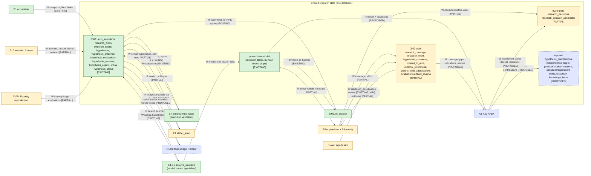

# AgentSmith as one integrated research system: grounded architecture (for owner review)

**Status:** design for review, written 2026-11-28 against commit `8cdd382`. Nothing here is approved for implementation. No
application code, migration or `eval/` file was changed to write it. It is the T-151 input that `docs/apex.md` §5 and §7 require
before any APEX code, and it conforms to T-149 (`docs/unified-research-workflow.md`): one workflow, one store, one protocol model.

**How to read the status words.** Every component carries exactly one class:

| class | meaning |
|---|---|
| **EXISTING** | code exists, is tested, and is on the production research path (`acquire_repository → analyze_structure → challenge_leads → build_dossier`) |
| **PARTIAL** | code exists but is off that path, unassigned, draft-dependent, attended-only, or untested on real repositories |
| **PROPOSED** | designed in this document; no code |
| **NOT IMPLEMENTED** | named in earlier documents; no code and no design here |

and a seven-level vector `D I T G R Dp O` = designed, implemented, tested, integrated (has an invocation path from the
research pipeline), released (in production image `d09d0c2`, digest `b52ce901…`, `docs/activation-record-2026-11-27.md`),
deployed (running on a production machine that executes it), operationally verified (executed in production on a real input with a
checked result). `Y` = reached, `·` = not reached, `p` = partially (explained in the row).

Two facts hold for every EXISTING row: the code is in the released image, but the research worker is not running in production
(A7 is blocked: Fly refuses all GRANT and REVOKE, `docs/a7-worker-grants.md` §9–11), so **no EXISTING component is deployed or
operationally verified on the research path**. The path has run locally on a real bounty repository at a pinned commit
(`docs/apex-status-audit.md`), not in production.

---

## 1. Principle and status today

**Principle.**
- **AgentSmith is the intelligence.** It owns the decisions (what to look at, with which capability, what to do after a result),
  the independence rules, the memory and what is learned. These live in AgentSmith code and in database rules, not in any tool.
- **APEX is its exploration engine.** It is a family of producers and experiment designers working over the shared protocol model.
  It proposes hypotheses and experiments. It never assigns a status to its own output (`docs/apex.md` §4.3).
- **Tools are instruments.** Slither, Foundry, Echidna and model calls are capabilities with a declared identity, inputs, limits and
  evidence of reliability. A tool's output is a claim (producer) or technical evidence (evaluator), never a verdict.
- **Shared research memory connects everything.** Every component reads and writes the same records: the 0007 store, extended by
  the 0009 and 0010 drafts and the small extensions proposed in §4. No component keeps a private model, cache of truth or memory.

**Status of every component** (IDs are used in the rest of the document).

| ID | component | code (file: function/type) | class | D I T G R Dp O |
|---|---|---|---|---|
| E1 | GitHub acquisition, commit-pinned, sealed | `acquisition/acquire.ts: acquireRepository`; `acquisition/github-source.ts: GitHubSource`; `acquisition/step.ts: processAcquireRepositoryStep` | EXISTING | Y Y Y Y Y · p (production live check of a public repository passed, in memory, not through the worker) |
| E2 | Research store (snapshots, blobs, spans, hypotheses, evaluations, reviews, events) | `research-state.ts: ResearchStore`; `db/migrations/0007_research_state.sql` | EXISTING | Y Y Y Y Y · · (0007 applied in production) |
| E3 | Derived status view | `0007: VIEW hypothesis_status`; `ResearchStore.getStatus` | EXISTING | Y Y Y Y Y · · |
| E4 | Protocol model P1–P3 | `analysis/solidity/protocol-model.ts: buildProtocolModel`, `ProtocolModel` (`protocol-model/3`, `solidity-p3/2`); `state-roles.ts: stateVariableRoles`; `authority.ts: authorityFacts` | EXISTING | Y Y Y Y Y · · |
| E5 | Inlined effect traces | `analysis/solidity/trace.ts: Tracer`, `Ev` | EXISTING | Y Y Y Y Y · · |
| E6 | Structural specialists (7 classes) | `analysis/solidity/specialists.ts: Analyzer`, `analyzeSources`; stored by `pipeline.ts: runStructuralAnalysis` | EXISTING | Y Y Y Y Y · · |
| E7 | Execution validators (bounded interpreter) | `simulate.ts: Interp`, `World`, `validateReentrancy`; `challenge.ts: challengeFinding`, `challengeReachability`, `challengeInitializer`, `challengeUncheckedCall` | EXISTING | Y Y Y Y Y · · |
| E8 | Challenge stage | `pipeline.ts: runChallenge`; `step.ts: processChallengeLeadsStep` | EXISTING | Y Y Y Y Y · · |
| E9 | Dossier with coverage status | `pipeline.ts: buildDossier`, `analysisCoverage`, `architectureFromStoredModel`, `renderDossierMarkdown`; `step.ts: processBuildDossierStep` | EXISTING | Y Y Y Y Y · · |
| E10 | Worker claim gates | `worker-runtime.ts: intakeStepKeys` (`STRUCTURAL_ANALYSIS_ENABLED`) | EXISTING | Y Y Y Y Y · · |
| P1 | Slither (pinned runner + optional `slither_scan` stage) | `engine/tools/slither.ts: runSlither`, `recordSlitherLeads`; `analysis/solidity/slither-step.ts: processResearchSlitherScanStep`, `slitherScanClaimable` | PARTIAL: off by default; cannot run in the production image | Y Y Y Y p · · (runner in `d09d0c2`; the stage merged later in `7912db0`) |
| P2 | Tool execution host | `engine/tools/run-tool.ts: runFixed`, `materialise`, `loadToolHost`; `tool-host/exec.ts: execFixed` (excluded by `tsconfig.build.json`) | PARTIAL: absent from production builds by design | Y Y Y · p · · (`run-tool.ts` released; the host excluded) |
| P3 | Foundry runner | `engine/tools/foundry.ts: runForgeTest`, `parseForgeJson` | PARTIAL: prepared, unassigned; tested with a stand-in binary | Y Y Y · Y · · |
| P4 | Reproduction round (test author → `foundry_validate`) | `engine/reproduction.ts: appendReproductionIn`, `processFoundryValidateStep` | PARTIAL: needs `research_decisions` (0010 draft) and an attended test author | Y Y Y · Y · · |
| P5 | Engine research loop | `engine/loop.ts: rankOpportunities`, `selectOpportunity`, `mapAndAssign`, `ingestInvestigation`, `recordHumanOutcome` | PARTIAL: depends on drafts 0009 and 0010 | Y Y Y · p · · (code released; the drafts are removed from the image) |
| P6 | Decision records | `engine/decisions.ts: openDecision`, `addCandidates`, `RESEARCH_POLICY_V0`; `db/drafts/a29-engine-loop/0010_engine_loop.sql` | PARTIAL: draft migration | Y Y Y · p · · |
| P7 | Research memory (outcomes, coverage, effort, missed, external references, ground-truth adjudications) | `db/drafts/t144-research-memory/0009_research_memory.sql`; code-level policy `priority/outcomes.ts: assertWellFormed`, `splitForLearning` | PARTIAL: draft migration | Y Y Y · p · · |
| P8 | Capability declarations | `engine/capabilities.ts: CAPABILITIES`, `availability`, `pinnedVersion` | PARTIAL: read only by the engine loop | Y Y Y · Y · · |
| P9 | Priority engine | `priority/score.ts: scoreOpportunity`, `allocate`; `priority/component.ts: scoreComponent`; `priority/coverage.ts: assessCoverage`; `priority/replay.ts: replay` | PARTIAL: fixtures and the loop only | Y Y Y · Y · · |
| P10 | Attended Claude capabilities | `engine/capabilities.ts: ATTENDED_SPECIALISTS`; `engine/attended.ts: brief`, `exportSnapshot`, `importSpecialist`, `importChallenge`; `engine/cli.ts` | PARTIAL: interactive only; `attended_model` kinds are in 0010 | Y Y Y · Y · · |
| P11 | Gateway-routed model calls | `ai-budget-gateway.ts: AiBudgetGateway`, `ModelAdapter`; `ai-budget.ts: MODEL_ROUTING`, `checkModelCallBudget` | PARTIAL: no production adapter; reviewed price catalog empty | Y Y Y · Y · · |
| P12 | Specialist comparison | `engine/compare.ts: compareSpecialists`, `LeadCluster` | PARTIAL: loop only | Y Y Y · Y · · |
| P13 | Evaluation harness and frozen corpora | `eval/bench/` runner and adjudication; `eval/heldout*`, `eval/benchmark-b` (read, not changed here) | PARTIAL: evaluation only, by design | Y Y Y · · · · |
| P14 | Protocol-invariant detector | `docs/proposals/protocol-invariant-ae048ad.patch` (`challengeInvariant`) | PARTIAL: not merged; null result | Y Y Y · · · · |
| R1 | Isolated tools image | §8 | PROPOSED | Y · · · · · · |
| R2 | Tool broker (snapshot in, result out, no database for the tool) | §8 | PROPOSED | Y · · · · · · |
| R3 | Enforced evaluator independence (trigger + capability family and substrate) | §6.2 | PROPOSED | Y · · · · · · |
| R4 | `hypothesis_contributions` (origin and contribution chain) | §4; shape first named in `docs/research-memory-design.md` §2, deferred to T-151 | PROPOSED | Y · · · · · · |
| R5 | Protocol model `protocol-model/4` sections (assets, integrations, assertions, transitions) | §4, §7 | PROPOSED | Y · · · · · · |
| R6 | Deterministic test-template author | §9 | PROPOSED | Y · · · · · · |
| R7 | `reproduce_leads` stage inside `repository_research` | §9 | PROPOSED | Y · · · · · · |
| R8 | Sequence and experiment specification schemas | §4 | PROPOSED | Y · · · · · · |
| R9 | Capability registry fields (substrate, can-validate, reliability, state writes) | §5 | PROPOSED | Y · · · · · · |
| R10 | Information-value selection policy (`research-policy/1`) | §6.1 | PROPOSED | Y · · · · · · |
| R11 | Lessons as `knowledge_items` linked to outcomes | §10 | PROPOSED | Y · · · · · · |
| R12 | New blind corpus, preregistered | §7.3 | PROPOSED | Y · · · · · · |
| R13 | Dependency snapshots and remappings | §8.5 | PROPOSED | Y · · · · · · |
| R14 | Echidna as an invariant evaluator | §5, §8 | PROPOSED | Y · · · · · · |
| A1–A12 | APEX components (§7.1) | none | PROPOSED | Y · · · · · · |
| N1 | Weirdness Engine (5.5A) | none | NOT IMPLEMENTED | · · · · · · · |
| N2 | Mythril | none | NOT IMPLEMENTED | · · · · · · · |
| N3 | Semgrep | none | NOT IMPLEMENTED | · · · · · · · |
| N4 | Medusa, Halmos, Aderyn, Solhint | none | NOT IMPLEMENTED | · · · · · · · |
| N5 | Unattended model producer (T-195, model adapter) | none (the gateway exists, P11) | NOT IMPLEMENTED | · · · · · · · |
| N6 | Learned policies ML-1 to ML-3 | none (`docs/autonomous-architecture.md` §4) | NOT IMPLEMENTED | · · · · · · · |
| N7 | Separate role or function for human decisions (T-061) | none (`docs/research-memory-design.md` §3, S1) | NOT IMPLEMENTED | · · · · · · · |

**Counts:** EXISTING 10, PARTIAL 14, PROPOSED 26 (R1–R14 and A1–A12), NOT IMPLEMENTED 7.

**One discrepancy to resolve.** `engine/capabilities.ts` declares `foundry-forge` with `status: "active"`, while
`docs/specialist-capabilities.md` calls it "prepared". In practice it is unassignable everywhere: `availability` requires
`AGENTSMITH_FORGE_BIN`, which no environment sets, and its only caller is `mapAndAssign → appendReproductionIn`, which needs the
0010 draft. This document treats it as prepared and unassigned (P3, P4).
**Resolution (2026-11-28):** the declaration stays `active`. Its availability is already gated on the environment: it is assignable
only where pinned `forge` and `solc` are configured. The engine-reproduction integration tests rely on exactly that, and setting it
to `prepared` would make it unassignable even there. The fix is in reporting: wherever its status is shown, it reads "active where
installed; unavailable in production (no binary, 0010 not applied)". Increment 1 is therefore declarations and documentation only.

---

## 2. Component connections through the shared research state

Edges are reads (`R`) and writes (`W`) of the named records. The label after each edge is the edge's class.

**Rules visible in the diagram.**
- Only the worker holds a database credential. The tools image (R1) never connects to the database; the broker (R2) hands it a
  snapshot bundle and returns a result bundle that the worker writes under its step lease (`ResearchStore` methods take a `StepLease`).
- Every write goes through a `workflow_steps` row of the one `repository_research` workflow (`acquisition/step.ts:
  REPOSITORY_RESEARCH_WORKFLOW`). No component writes outside a step except the human paths (`ResearchStore.recordReview` with an
  operator actor, `ResearchStore.withdraw`, `loop.ts: recordHumanOutcome`).
- The protocol model is written once per analysis step and read by hash. Today `loop.ts: mapAndAssign` rebuilds it with
  `buildProtocolModel` instead of reading the stored blob. The rebuild is deterministic and yields the same hash, but it is a second
  derivation; §4 proposes reading by hash everywhere.

---

## 3. How AgentSmith generates and validates hypotheses independently

### 3.1 Today: one reentrancy lead through the code

| step | function (file) | record written | rule that holds |
|---|---|---|---|
| 1. Sealed input | `sealedSnapshot` (`analysis/solidity/step.ts`) | none | refuses unless `verifySnapshot` returns `ok` and `sealed` |
| 2. Produce | `analyzeSources` → `Analyzer` (`specialists.ts`) over `Tracer` events (`trace.ts`) | in memory: `Finding` with `class`, `spans`, `chain`, `assumptions` | deterministic; a lead, never a verified issue |
| 3. Reject uncitable | `rejectUncitableFindings` (`pipeline.ts`) | a `problems` entry | a finding citing a line absent from the snapshot is dropped and reported |
| 4. Spans | `ResearchStore.createEvidenceSpan` | `evidence_spans` | `research_span_check`: hash-verified against the blob; ≤ 400 lines |
| 5. Hypothesis | `runStructuralAnalysis` → `ResearchStore.createHypothesis` | `hypotheses` (`generator_kind = deterministic_rule`, `generator_id = solidity-structural-specialists`, version `1`), `hypothesis_evidence`, `hypothesis_events(registered)` | DB: `hypotheses_guard` (sealed snapshot), deferred `hypotheses_require_primary_evidence`, span and hypothesis on the same snapshot (`hypothesis_evidence_guard`), append-only |
| 6. Step record | `processAnalyzeStructureStep` | step output: `analyzer`, `analyzer_build`, `protocol_model_sha256`, `hypothesis_ids`, `problems` | attribution of the exact build |
| 7. Reload | `processChallengeLeadsStep` → `loadStoredHypotheses` | none | re-runs `analyzeSources` and matches stored rows by claim text and `generator_id` |
| 8. Challenge | `runChallenge` → `validateReentrancy` (`simulate.ts`) | `hypothesis_evaluations` (`evaluator_id = reentrancy-execution-validator`), `evaluation_evidence`, `hypothesis_events(evaluation_recorded)` | mapping: validated → `supports`; refuted → `weakens` (never `contradicts`); abstained → `inconclusive` with no spans; DB: only `inconclusive` may cite nothing (`evaluations_require_evidence`) |
| 9. Status | `VIEW hypothesis_status` via `ResearchStore.getStatus` | none (derived) | a `supports` evaluation alone leaves status `unreviewed` with `static_outcome = supports`; `weakens` gives `weakened_by_static_check`; only reviews move it further |
| 10. Dossier | `buildDossier` → `renderDossierMarkdown` | step output `content_sha256` | every span re-resolved and re-verified, fail closed; status from the view; inconclusive is never shown as absence |

Other classes follow the same path with `challengeFinding` and evaluator `execution-challenge-<class>`; `tx-origin` and any class
without a method get `no-independent-validator` / `inconclusive` (`runChallenge`). Slither leads (P1) enter at step 5 with generator
`slither` and are challenged by the same evaluators (`externalLeadsAsStored`, `processChallengeLeadsStep`).

Two consequences of the code as written:
- The pipeline never produces `contradicts`. Under the 0009 rule (`hypothesis_outcome_rules`), `refuted` then needs a human `rejects`
  review. That is deliberate (the interpreter is a bounded model) and should stay.
- Step 7 couples the challenge stage to the analyzer being byte-identical between steps. A changed analyzer between steps silently
  finds fewer stored rows. §11 increment 2 proposes reading `hypothesis_ids` from the analysis step output instead.

### 3.2 Where independence is enforced, and where it is a convention

| rule | enforced in code or database | only a convention |
|---|---|---|
| A model or tool cannot write technical evidence | DB: `hypothesis_evaluations.actor_kind` CHECK = `deterministic_rule` only (0007) | — |
| A blinded review is not by the generator | DB: `hypothesis_reviews_guard` (same `kind` and `id` refused) | same-model reviewers with different ids (`claude-challenger` vs `claude-hunter`) pass; `ATTENDED_SPECIALISTS` lists "same-model bias" as a failure mode |
| A blinded review saw no generator identity or rationale | DB: CHECK on `reviewer_saw` for `blinded_independent_assessment` | the attended prompt content itself (`attended.ts: brief`) |
| Only a human adjudicates | DB: `disclosed_adjudication` requires `reviewer_kind = human` (0007); `withdrawn` events are human only | the human row is only as trustworthy as the runtime role (S1; N7 not built) |
| Evaluator ≠ generator | **Draft only:** 0009 `hypothesis_outcome_rules` for `confirmed`; code: `reproduction.ts: appendReproductionIn` refuses a test author who produced a claim; `loop.ts: trackRecords` and `claimsNeedingReproduction` filter `evaluator_id <> generator_id` | **in `runChallenge` it is a convention**: the evaluator ids are hard-coded strings that differ from `SPECIALIST_ID`; nothing in 0007 refuses an evaluation whose `evaluator_id` equals the hypothesis's `generator_id` |
| Status comes from the database | DB: `VIEW hypothesis_status`; dossier reads it (`buildDossier`) | — |
| Method independence vs substrate independence | — | the execution validators use the same `ProgramIndex` and parser as the specialists (`challenge.ts` imports `ProgramIndex`; `simulate.ts` imports `Tracer`, `stateVariableRoles`). The method differs (execution vs pattern); a parser misreading is shared by both. Not recorded anywhere |

### 3.3 Proposed: APEX hypotheses that no tool suggested, and how they are validated

**Origin.**
- A deterministic APEX component writes `hypotheses` with `generator_kind = deterministic_rule`, `generator_id = apex-<component>`
  (for example `apex-invariant`), its version, and spans. A model-assisted component writes `generator_kind = model` with a budget
  reservation (the 0007 CHECK already requires one); that path waits for N5. No widening of the `generator_kind` CHECK is needed for
  the first milestones.
- It also writes one `hypothesis_contributions` row (R4) with role `originated`, the protocol-model hash and the model fact the
  hypothesis is about (for example an invariant candidate's id), and a `prior_suggestions` count computed at insertion: hypotheses on
  the same snapshot, function and class by any other generator. **"No external tool suggested it" is that count being 0 at creation
  time**, recorded, not asserted afterwards.

**Validation path.**
1. **Self-challenge (A11)** filters APEX's own candidates before they are stored. Discarded candidates are recorded as
   `research_coverage` rows (`result = examined` or `abstained`, with `reason_code`), never as evaluations.
2. **Independent technical evidence.** APEX builds on `simulate.ts` and `trace.ts`, so the in-process validators share its
   substrate. For APEX hypotheses, an evaluation counts toward status only when it comes from a **different substrate**:
   `foundry-forge` (solc + EVM) running a test written by the template author R6 (not by APEX), or Echidna (R14) checking the same
   property. In-process validator results are still recorded; R3 marks them as same-substrate.
3. **Review.** A blinded review (`claude-challenger` or a human) may follow. It is an opinion, not evidence.
4. **Outcome.** `confirmed` only through 0009 `hypothesis_outcome_rules`: a human `disclosed_adjudication` with `supports`, plus a
   `supports` evaluation by an evaluator independent of the generator. R3 tightens "independent" to "different capability family and
   different substrate".

---

## 4. Shared research state: element by element

All extensions reuse 0007 tables, the 0009 and 0010 drafts, content-addressed `research_blobs`, and the existing append-only trigger
`research_reject_mutation()`. New JSON documents are stored as blobs with a versioned schema name; small index tables are added only
where a query needs them.

| element | what exists now (table / type / file) | gap | smallest extension |
|---|---|---|---|
| Protocol model | `ProtocolModel` (`protocol-model.ts`), stored as a blob by `runStructuralAnalysis`, referenced by step output `protocol_model_sha256`; `research_decisions.protocol_model_sha256` (0010) | a model > 1 MiB is not stored (`MODEL_BLOB_LIMIT`); `mapAndAssign` re-derives it; no P4–P7 | `protocol-model/4`: additive sections (below); per-component chunk blobs plus an index blob when > 1 MiB; every consumer reads by hash, as `architectureFromStoredModel` does |
| Contracts, functions, storage | `ComponentFact.stateVariables`, `FunctionFact.stateWrites`; `repo_snapshot_files`; `evidence_spans` | no storage layout or slots; struct-member writes not modelled by the interpreter (heldout3 hit "inconclusive", `docs/vuln-detection-benchmark.md` §7) | tool output: `solc --storage-layout` from the tools image, stored as a blob keyed by input manifest hash and joined by component id |
| Call graph | `CallEdge` with `resolvedCallee`, `targetProvenance`; `reachableCalls` | calls into code outside the snapshot are `unresolved`; `using L for T` not handled | dependency snapshots (R13) so imported libraries become resolvable; unresolved edges stay in `unknowns` |
| Assets and accounting relations | `stateRoles` ledger and aggregate roles (`state-roles.ts: RoleKind`) | no assets or value flows (P4 not approved) | `protocol-model/4.assets`: asset (ether, token variable), holders (ledger variables), value edges (function → transfer of asset), each with evidence and derivation |
| External integrations and oracles | `AuthorityFacts.externalAssumptions`; `CallEdge.targetProvenance`; `oracle-manipulation` in `NOT_MODELLED_CLASSES` (`engine/classes.ts`) | no integration typing, no oracle facts | `protocol-model/4.integrations`: interface type, target provenance, trust source (from authority), with evidence |
| Assumptions and invariants | `Finding.assumptions` (text inside rationale); `externalAssumptions`; guard events with `assumed`; invariant detector only as a patch (P14) | not first-class; no ids; nothing links a test to an assumption | `protocol-model/4.assertions`: `{id, kind: assumption \| invariant_candidate, subject ids, statement (structured), derivation, evidence, checked_on_honest_sequences}`; hypotheses link to an assertion through R4 |
| State transitions | initialiser facts and lock roles (`authority.ts: Initialiser`); P5–P7 designed in `docs/protocol-representation-design.md` §4 | no transition facts | `protocol-model/4.transitions`: phase variables, guarded transitions per function, derived from `Tracer` writes and guards |
| Hypotheses | `hypotheses`, `hypothesis_evidence`, `hypothesis_events`; `ResearchStore.createHypothesis` | one originator only; deduplication by exact claim text (`UNIQUE (snapshot_id, claim_fingerprint)`) | R4 `hypothesis_contributions(hypothesis_id, component_kind, component_id, component_version, role, model_sha256, model_fact_id, prior_suggestions)`, append-only |
| Attack paths and sequences | `research_decisions.level = 'path'`, candidate kind `path` (0010); validator traces inside `rationale` text | no structured sequence | blob schema `agentsmith-sequence/1`: actors, initial-state recipe, ordered calls with arguments, expected effect; referenced by `research_decision_candidates.candidate_ref` and by `hypothesis_evaluations.artifact_sha256` (0009) |
| Experiments | `workflow_steps` input and output for `challenge_leads`, `slither_scan`, `foundry_validate`; `research_effort` (0009) | no specification or expected result recorded before execution | an experiment is a step whose input holds a spec blob `agentsmith-experiment/1` (hypothesis id, method, sequence blob, **expected result**, budget) written after its decision (0010 rule "decide before acting", `research_decision_candidate_rules`) |
| Tool outputs | step output `tool: {version, args, input_manifest_sha256, raw_output_sha256, raw_output_blob}` (`processResearchSlitherScanStep`); `ForgeRun` | raw output > 1 MiB not stored; tool image digest not recorded | add `tool_image_digest` and `sbom_sha256` to the same output; chunked blobs for large output |
| Evidence | `evidence_spans` (hash-verified), `evaluation_evidence`, `research_blobs`; `artifact_sha256` (0009) | non-span evidence (traces, scenarios) lives only in `rationale` text until 0009 | apply 0009; artifact bundle schema `agentsmith-evidence/1` (test files' hash, input manifest, tool versions, image digest, both runs' results) |
| Validation outcomes | `hypothesis_evaluations`, `hypothesis_reviews`, `VIEW hypothesis_status`; `hypothesis_outcomes`, `ground_truth_adjudications` (0009) | outcomes are draft; evaluator independence not enforced (§3.2) | apply 0009; R3 trigger |
| Prior investigations and lessons | `research_coverage`, `missed_in_runs`, `external_references` (0009); `research_decisions` (0010); `loop.ts: trackRecords`, `compare.ts: compareSpecialists`; `knowledge_items`, `knowledge_links` (0001, empty) | no cross-repository lesson record | R11: lessons as `knowledge_items` with `knowledge_links` to the outcome and coverage rows they rest on; no new table |

**Provenance rules (binding for every new record).**
1. Every row names its `workflow_run_id` and, where a step wrote it, `produced_by_step_id`; composite keys keep a record, its parents
   and its step in the same run (0007 header).
2. Every code-related row names a sealed snapshot and, where it concerns a component, its `component_sha256`
   (`research_coverage_sealed`, `hypotheses_guard`).
3. Every claim cites at least one hash-verified primary span; anything uncitable is rejected, never repaired
   (`rejectUncitableFindings`, `hypotheses_require_primary_evidence`).
4. Every derived document (model, sequence, experiment, evidence bundle) is a content-addressed blob with a schema name and the
   builder's version; consumers re-hash on read and fail closed on mismatch (`architectureFromStoredModel`).
5. Every tool result records tool version, arguments, input manifest hash, raw output hash and (proposed) image digest.
6. Every record is append-only; corrections supersede (`supersedes_id`), never edit.
7. Absence is explicit: `examined`, `abstained`, `not_modelled` and `out_of_scope` are distinct coverage results (0009).
8. Origin and contribution are recorded separately (R4): one originator, any number of contributors.

---

## 5. Capability registry

Builds on `engine/capabilities.ts: Capability` and `CapabilityProfile`. Proposed fields (R9): `substrate`
(`agentsmith-parser`, `solc-evm`, `slither-ir`, `claude`, `human`), `canValidate` (true only for kind `evaluator` on a substrate
different from the producer's), `reliability` (corpus, exposure, TP/FP/FN/TN, source file), `stateWrites` (the tables it writes).
A unit test would fail if a capability claims `canValidate` without being an evaluator, or names reliability without a source.

### 5.1 Identity and scope

| capability | what it does | classes | status |
|---|---|---|---|
| Structural specialists `solidity-structural-specialists@1` | deterministic pattern specialists over traces and the model | reentrancy, access-control, initializer, delegatecall, unchecked-call, selfdestruct, tx-origin | EXISTING (E6) |
| Execution validators (`reentrancy-execution-validator@1`, `execution-challenge-<class>@1`; declared as `agentsmith-execution-validators`) | bounded interpretation of the claimed path as an unprivileged caller or re-entrant attacker | reentrancy, access-control, selfdestruct, delegatecall, initializer, unchecked-call | EXISTING (E7) |
| Protocol model (mapper role) | components, functions, call edges, state roles, authority | n/a (facts, not claims) | EXISTING (E4) |
| Slither `slither@0.11.3` | static detectors; mapped detectors become leads | `SLITHER_DETECTOR_CLASS` targets | PARTIAL (P1) |
| Foundry `foundry-forge@1.5.1` | runs a reproducing test twice, offline | any class with a test | PARTIAL (P3, P4) |
| Echidna | property fuzzing of invariant candidates | accounting-invariant, protocol-invariant, state-transition | PROPOSED (R14) |
| Mythril | symbolic execution | — | NOT IMPLEMENTED (N2) |
| Semgrep | pattern rules | — | NOT IMPLEMENTED (N3) |
| Attended Claude (`claude-scoping`, `-accounting`, `-path`, `-assumptions`, `-liveness`, `-hunter`, `-reproducer`, `-challenger`, `-prior-art`) | method prompts run by a named operator | per `ATTENDED_SPECIALISTS` | PARTIAL (P10) |
| Gateway-routed model calls | one bounded model call per task through the budget | task-based (`MODEL_ROUTING`, e.g. `independent_challenge` → tier3) | PARTIAL (P11) |
| GitHub acquisition | commit-pinned, verified, sealed snapshot | n/a | EXISTING (E1) |
| Priority engine | scores opportunities and components; seeded exploration | n/a | PARTIAL (P9) |

### 5.2 Inputs, outputs, dependencies, execution

| capability | inputs → outputs | dependencies | execution requirements |
|---|---|---|---|
| Structural specialists | sealed `.sol` sources → `Finding[]` → hypotheses with spans | E4, E5 | in process; seconds |
| Execution validators | stored hypothesis + sources → evaluation | E5, `simulate.ts` | in process; seconds |
| Protocol model | sealed sources → model blob | parser, `Analyzer` | in process |
| Slither | sealed `.sol` bytes, pinned solc → hypotheses (generator `slither`), raw-output blob | P2 host, tools image (R1) | `AGENTSMITH_SLITHER_BIN`, `AGENTSMITH_SOLC_BIN`, `SLITHER_SCAN_ENABLED=true` |
| Foundry | sealed snapshot + `test/*.t.sol` by a non-producer → per-test pass/fail, hashes | P2, R1, a test author (R6 or `claude-reproducer`) | `AGENTSMITH_FORGE_BIN`, `AGENTSMITH_SOLC_BIN`; offline |
| Echidna | snapshot + property harness from `protocol-model/4.assertions` → falsified / not falsified within budget, with a call sequence | R1, R5 | pinned binary in R1 |
| Attended Claude | exported snapshot directory → structured JSON imported through `importSpecialist` / `importChallenge` | 0010 (`attended_model`), `AGENTSMITH_ATTENDED_OPERATOR` | a human-attended session |
| Gateway model calls | bounded prompt + model view → structured result | a `ModelAdapter`, a reviewed price | budget reservation (`ai_budget_reservations`) |
| GitHub acquisition | repository + ref → sealed snapshot | GitHub API, token (`docs/github-token.md`) | `AcquisitionLimits` |
| Priority engine | features with sources, coverage records → `PriorityAssessment` with contributions | P6, P7 for real data | in process |

### 5.3 Limits, evidence, validation and state entry

| capability | limits | reliability evidence (cited) | can validate? | how results enter shared state |
|---|---|---|---|---|
| Structural specialists | single-function patterns; no accounting, oracle or economic reasoning | heldout (blind) 18 TP / 0 FP / 0 FN, P = R = 1.000; heldout2 P 0.795 R 0.838; heldout3 P 0.955 R 0.677; heldout4 P 0.952 R 0.526; benchmark-b v3 recall 0 (8 FN) (`docs/vuln-detection-benchmark.md` §1, §7) | no (producer) | `hypotheses` via `createHypothesis` |
| Execution validators | bounded single-contract model; abstains on unmodelled constructs; shares the parser with the specialists | reentrancy validator vs EVM ground truth: 19/19 agree (`eval/results/ground-truth-vs-validator.txt`); B0: 2 validated, 2 refuted of 4 reentrancy leads | yes, for other producers' leads; same-substrate for specialists and APEX (§3.2) | `hypothesis_evaluations` via `recordEvaluation` |
| Protocol model | intra-repository; unknowns listed | P1–P3 evidence documents (`docs/protocol-model-p1-evidence.md`, `-p2-`, `-p3-`) | no (facts) | blob by hash in step output |
| Slither | no remappings (`compile_failed`); 300 s per run, 900 s total, 16 MiB output, 1000 leads (`SLITHER_SCAN_DEFAULTS`) | dev, blind-labels: 10 TP / 2 FP / 7 FN / 12 TN (`eval/results/dev-dual-reading.md`) | no (producer) | `hypotheses` via `recordSlitherLeads`; abstention as step output |
| Foundry | offline, no fork; a passing test shows a local defect, not live exploitability; default timeout 600 s | none in the pipeline; runner tested with a stand-in; one attended case study (`docs/specialist-capabilities.md` §1) | **yes** (different substrate) | `hypothesis_evaluations` with evaluator `foundry-forge` (`processFoundryValidateStep`); artifact via 0009 |
| Echidna | budgeted search; "not falsified" is never a proof (`docs/apex-prior-art-pass2.md` §4 item 2) | none | yes for property violations (a falsifying sequence, replayed in Foundry) | evaluation + sequence blob |
| Mythril, Semgrep | — | none; `docs/apex-status-audit.md` ranks them last (overlap, noise) | — | — |
| Attended Claude | interactive only; same-model bias; safety-classifier stops | `claude-hunter@1` dev, blind-labels: 17 / 2 / 0 / 12, attended (`dev-dual-reading.md`); `claude-reproducer` 4/4 on a probe; `claude-prior-art` 10/10 duplicates, 1 false of 11 (limitation texts in `capabilities.ts`) | no: reviews are opinions; `claude-reproducer` tests become evidence only when Foundry runs them | `attended_model` hypotheses and reviews (0010) |
| Gateway model calls | $25/month, tier caps (`ai-budget.ts: INITIAL_AI_BUDGET`); no adapter | none (adjudication recorded `unavailable`, $0, `docs/vuln-detection-benchmark.md` §6) | no | `hypotheses` with `generator_kind = model` and a reservation; reviews with `reviewer_kind = model` |
| GitHub acquisition | 512 MiB compressed, 64 MiB stored, 20 000 entries, 1 MiB per file (`acquisition/limits.ts`) | production live check passed (`docs/activation-record-2026-11-27.md`) | n/a | `repo_snapshots`, `repo_snapshot_files`, `research_blobs` |
| Priority engine | deterministic v1; no learning | synthetic replay: does **not** beat round-robin on findings per cost (`docs/adaptive-priority-engine-design.md` §11.1) | n/a | `research_decisions`, `research_decision_candidates` (0010) |

---

## 6. Orchestration

### 6.1 Selection: not every tool on every target
Today `loop.ts: chooseCapability` uses `value = pending classes × relevance / costUnits`, a mapper first, ties by declaration order,
with every 5th decision an exploration draw (`pickOne`). The proposed `research-policy/1` (R10) keeps that structure and replaces the
numerator with an **expected information value** built only from recorded quantities:

| term | source | when unknown |
|---|---|---|
| applicability gate | language Solidity; compiles (for tools needing solc); class in the capability's classes; availability (`availability`) | not applicable → candidate recorded with `skip_low_value` and the reason |
| coverage gap | `research_coverage` at the component's current `component_sha256` for (capability, class); an `abstained` row with the same method version blocks a retry | no row → gap |
| resolvability | an evaluator with `canValidate` exists for the class (else a lead would stay "no independent validator") | down-weighted, never zero (leads still have review value) |
| measured yield | per (capability, class): independently supported leads / leads, from `trackRecords`, used only once `adjudicated ≥ MIN_ADJUDICATED` (5) | "unknown", fall back to v0 |
| cost | `research_effort` median per capability, else `costUnits` | `costUnits` |

`value = gate × gap × (1 + resolvability) × yield_or_1 / cost`. Snapshot-scope tools run once per version (`scope: "snapshot"`).
Every alternative, chosen or not, is a `research_decision_candidates` row with its features and sources (0010 trigger requires a
`source` or `unknown_reason` for each feature). A policy version is evaluated on `priority/replay.ts` before it is used; v1 not
beating round-robin is the current baseline to beat.

### 6.2 Enforced independence (R3)
1. **Trigger on `hypothesis_evaluations` insert:** refuse `evaluator_id = hypotheses.generator_id`. `no-independent-validator` stays
   allowed (it is an abstention).
2. **Capability families and substrates:** a small reference table `capability_identity(id, family, substrate)` seeded from
   `CAPABILITIES`. The 0009 `confirmed` rule is tightened from "evaluator ≠ generator" to "different family and different
   substrate". The `hypothesis_reviews_guard` gains the family check for blinded reviews (all `claude-*` are one family).
3. **Same-substrate evaluations are kept and labelled**, so the dossier shows them, but they do not satisfy `confirmed`.
4. **Test author ≠ producer** stays in `appendReproductionIn` and is mirrored in R7.

### 6.3 Tool agreement is supporting evidence only
`compare.ts: LeadCluster.foundBy` already counts producers that found the same (contract, function, class). Rules:
- agreement is shown in the dossier as a corroboration count and may raise a component's priority for **where to look next**;
- it is never written as an evaluation, never read by `hypothesis_status`, and never satisfies a 0009 rule;
- reason: producers share families of patterns (Slither and the specialists both read source structure), so their errors correlate;
  on dev, Slither missed 7 labelled-vulnerable functions (5 access-control, 1 initializer, 1 unchecked-call) and flagged 2 labelled-safe ones (`eval/results/dev-dual-reading.md`), so agreement and
  disagreement both carry information, but neither is a test.

---

## 7. APEX architecture

APEX is a set of producers (plane 1), experiment designers (they write experiment specs, not evaluations) and one internal filter,
all reading the shared model and memory. None of it writes `hypothesis_evaluations`, reviews or outcomes.

### 7.1 Components

| # | component | inputs | outputs | existing substrate (cited) | falsifiable acceptance test |
|---|---|---|---|---|---|
| A1 | Protocol understanding | sealed sources; `protocol-model/3` | `protocol-model/4` assets, integrations | `buildProtocolModel`; `stateVariableRoles`; `authorityFacts` | On the new blind corpus (R12), asset and ledger facts checked against an independently written annotation: precision ≥ 0.9; every fact's evidence passes `research_span_check`. Fails if either is not met |
| A2 | Assumption extraction | model; traces | `assertions` of kind `assumption` with ids | `AuthorityFacts.externalAssumptions`; `Ev` guard `assumed`; `Finding.assumptions`; attended `claude-assumptions` as a precursor | Against a preregistered assumption list for R12 contracts written by the corpus author: recall ≥ 0.6 at precision ≥ 0.8 (thresholds fixed in the preregistration) |
| A3 | Candidate invariants | ledger/aggregate roles; transitions | `assertions` of kind `invariant_candidate` | `state-roles.ts`; P14 patch (conservation inference) | **Honest-sequence check:** every candidate holds on all bounded honest sequences in `Interp`; 0 candidates violated by honest use on dev contracts. Then on R12: ≥ 1 independently confirmed TP in accounting or protocol-invariant classes, or a recorded null result |
| A4 | State-transition exploration | model; `transitions` | reachable abstract states per component; transition graph | `Interp`, `World.clone/restore`; `challenge.ts: attempt` | Distinguishes the vulnerable and secure twin of every state-transition pair in R12 (vulnerable reaches the forbidden phase-action pair, secure does not) |
| A5 | Cross-contract interaction | `CallEdge.resolvedCallee`; `FactoryPath`; integrations | multi-contract world; cross-contract hypotheses | `reachableCalls`; `authority.ts: FactoryPath`, `ProxyBoundary` | On R12 cross-contract pairs: vulnerable flagged, secure not; on frozen corpora 1–4: 0 new false positives |
| A6 | Accounting and economic relations | assets, value edges | value-conservation and extraction relations | `validateReentrancy` (attacker extraction vs best honest sequence) | On R12 economic pairs: attacker extraction > honest best on vulnerable, ≤ on secure; replayed in Foundry |
| A7 | Multi-transaction sequences | A4 graph; assertions | sequences of length ≤ k with traces (`agentsmith-sequence/1`) | `validateReentrancy` (two-call bounded orderings); `challengeReachability` two-step delegatecall probe | On R12: finds every labelled issue that needs ≥ 3 calls within budget k = 4, each replayed by Foundry; reports sequence length and search cost |
| A8 | Ordering and adversarial scenarios | sequences; actors | permuted two-actor schedules (front-run, sandwich, interleaving) | attacker hook in `Interp` (re-entry on value-forwarding calls) | On R12 ordering pairs: victim outcome differs from quote beyond a stated tolerance only on the vulnerable twin |
| A9 | Untested paths | snapshot files classified `test`; coverage | entry points and paths with no test and no coverage row | `repo_snapshot_files.classification`; `research_coverage`; `coverageComponents` | On a controlled repository with known tests: agreement ≥ 0.9 with `forge coverage` run in R1 |
| A10 | Experiment selection by information value | coverage gaps, assertions, evaluator availability, cost | ranked experiment specs with decisions | `chooseCapability`; `pickOne`; `research_decisions` | On a frozen replay scenario: more independently supported leads per cost unit than round-robin and than policy v1; on real runs in shadow mode: not worse than v1 |
| A11 | Self-challenge | APEX candidates | discarded candidates as coverage rows with reasons; survivors stored | `challenge.ts`; `runChallenge` (method reuse, internal only) | On R12 with ground truth: reduces candidates passed on by ≥ 30% while discarding **0** labelled true positives |
| A12 | New directions on failure | refuted / inconclusive outcomes; abstention `reason_code`; `missed_in_runs` | follow-up decisions at level `follow_up` or `path` | 0010 `research_decisions`; `RESEARCH_POLICY_V0.followUp` | Every follow-up decision cites the failure record in its features; on real runs, the share of follow-ups that produce new `examined` coverage is reported (no threshold until data exists) |

### 7.2 Milestones

| milestone | entry criteria | exit criteria (measured) |
|---|---|---|
| **M0** Preconditions | none | production path ran on one approved real repository and its dossier is stored; 0009 and 0010 applied (A4b, A29); R12 corpus frozen with manifest hash and preregistration committed (answer key hashed, not readable by the engine) |
| **M1** Executable evidence | M0; R1 image approved (A39) | on controlled contracts: Foundry verdicts on the 19 reentrancy ground-truth cases agree with EVM ground truth on ≥ 18/19, with 0 `supports` on a not-exploitable case; every test, raw output and image digest stored; two-run determinism on all |
| **M2** Shared-state extensions | M0 | R3 and R4 applied; restricted-role tests show an evaluation by its generator is refused; `protocol-model/4` (data only) leaves every frozen corpus's findings byte-identical |
| **M3** APEX-1: assumptions and invariants | M1, M2; a **development** corpus of realistic contract size distinct from R12 | A2 and A3 acceptance tests; scored **once** on R12 with preregistered gates; result recorded whether positive or null; gates not changed after scoring |
| **M4** APEX-2: transitions, cross-contract, sequences, ordering | M3 | A4–A8 acceptance tests on R12 slices; each confirmed-by-execution lead replayed in Foundry; cost per supported lead reported |
| **M5** APEX-3: selection and failure handling | M2; enough real runs for `research_effort` | A10–A12 acceptance tests; policy promoted only after replay and shadow results |
| **M6** Comparative evaluation (T-162) | M3–M5 | the `docs/apex.md` §6 comparison (tools alone, analyzer, combined tools, APEX off, APEX on) on frozen and real inputs; primary metric: independently confirmed APEX-only discoveries, reported even when 0 |

### 7.3 The null-result lesson and the new blind corpus
The protocol-invariant detector (P14) raised no false and no true positives; its gates were too conservative for small contracts,
and relaxing them afterwards would have been tuning on a scored corpus (`docs/proposals/protocol-invariant.md`). The milestones
therefore require:
- **a sensitivity check before scoring:** a detector must fire on its own synthetic positives **and** on a separate development
  corpus of realistic size; a detector that cannot fire anywhere is not scored;
- **preregistration:** gates, thresholds and the corpus are fixed and hashed before the first score
  (`agentsmith-preregistration/1`, as in `eval/production-cycle-1/expected-findings.json`);
- **score once; a null result is a result:** it closes the milestone as measured and blocks advancement; changed gates need a new
  corpus;
- **a new blind corpus (R12):** benchmark-b class descriptions are published in `docs/vuln-detection-benchmark.md` §4, so it is not
  fully blind. R12 is authored by someone outside this repository's development (the A22 independent-selector arrangement), its
  class descriptions are kept out of the repository until after scoring, only its manifest hash is committed beforehand, it gets an
  `eval/exposure.json` entry, and any model sees it only through `eval/bench/model-view.ts`. The real-CVE layer (`eval/heldout5`,
  B4) remains blocked on A22 and A23.

---

## 8. Isolated tools image (Slither, Foundry, Echidna)

### 8.1 Pinned, reproducible build
- Separate image `agentsmith-tools`, not the API image (the API image keeps excluding `tool-host`, `tsconfig.build.json`).
- Base image by digest. Slither `0.11.3` (`SLITHER_VERSION`) installed with `pip --require-hashes` from a lock file; solc `0.8.28`
  static binary fetched by URL and SHA-256; forge `1.5.1` (`FOUNDRY_VERSION`) from the release archive by SHA-256; Echidna at a
  version to be selected and recorded at build time (none is asserted here).
- Network only at build time. The build writes a manifest of every binary's hash and an SBOM; the image digest and SBOM hash go into
  every tool result (§4, tool outputs). The runners already refuse any other version (`version_mismatch` in `runSlither`,
  `runForgeTest`).

### 8.2 Execution limits
| limit | mechanism | default (existing where cited) |
|---|---|---|
| no network | the tool process runs in a network namespace with no interfaces except loopback; the VM's default egress policy drops everything except replies to the broker on the private network. **Not verified on Fly**; increment 3 must include a test that an outbound connection from the tool process fails | — |
| CPU and time | per-process `RLIMIT_CPU`; wall timeout with `SIGKILL` (`execFixed`) | Slither 300 s / 900 s total (`SLITHER_SCAN_DEFAULTS`); forge 600 s (`runForgeTest`) |
| memory | `RLIMIT_AS` per process; VM size fixed | proposed: 2 GB VM |
| output | `maxBuffer` (`execFixed`, 32 MiB); Slither 16 MiB (`SLITHER_SCAN_DEFAULTS.maxOutputBytes`) | as cited |
| disk | working directory on a size-capped tmpfs; deleted after each run (`materialise` cleanup) | proposed: 512 MiB |
| processes | `RLIMIT_NPROC` | proposed: 64 |
| no secrets | the tool environment is `PATH`, private `HOME`, `LANG` only (`execFixed`); the runner holds no database URL, GitHub token or model key | as cited |

### 8.3 Read-only snapshot and controlled result transfer
1. The worker reads the sealed snapshot (`sealedSnapshot`, `verifySnapshot`) and builds a bundle: file bytes, the snapshot manifest
   hash, test files if any, and the job spec. The bundle's own manifest is `inputManifestSha256`.
2. The broker sends it to the tools machine over the private network with an HMAC over the bundle hash (the key is a runner secret,
   never passed to the tool process).
3. The runner verifies hashes, materialises files read-only (`materialise`, path checks), runs the pinned tool, and returns a result
   bundle: exit codes, stdout JSON, raw output, durations, versions, image digest. It keeps nothing afterwards.
4. The worker validates the result schema and writes hypotheses, evaluations and blobs under its lease. **The tool never touches the
   database.**

### 8.4 Placement on Fly
- A separate machine in the `agentsmith-hub` app (one more entry in `deploy/fleet.json`) or a separate app; no public IP, no
  `[http_service]`, reachable only from the worker on the private network.
- Its own image; deployed explicitly, like the other non-`app` machines (`deploy/fleet.json` note: `fly deploy` only updates `app`).
- Owner approvals: A39 (tools install and image), and the worker activation it depends on (A7/A8).

### 8.5 Foundry and Hardhat remappings, dependencies (R13)
- Today Slither runs per directory and fails as `compile_failed` on remapped imports (`slither.ts` header); `runForgeTest` replaces
  the snapshot's `foundry.toml` with its own (`input.files.filter((f) => f.path !== "foundry.toml")`).
- Proposed: the worker parses, with a strict parser and without executing anything, only `remappings` and the solc version from
  `foundry.toml`, `remappings.txt` and `hardhat.config.*` **as text**; it writes a generated remappings file into the bundle and
  records its hash. `ffi = false` is forced; scripts and plugins in the snapshot are never run.
- Dependencies (`lib/` submodules, `node_modules`) are usually not in the snapshot. Each Git submodule at its pinned commit is
  acquired as its own sealed snapshot through the existing acquisition path and mounted read-only at its path. npm packages would
  need a new acquisition source (npm registry, by lock-file integrity hash) and its own approval; until then the tool abstains with
  a new code `dependencies_unavailable`, which appears in coverage, not as "no findings".

---

## 9. Foundry reproduction design

Builds on `engine/tools/foundry.ts: runForgeTest` and the fixed outcome mapping in `engine/reproduction.ts` (both runs pass with
intent "demonstrate" → `supports`; intent "refute" → `weakens`; any failure, disagreement or tool failure → `inconclusive`). To avoid
the 0010 dependency, the first version is a `reproduce_leads` stage inside `repository_research` after `challenge_leads` (R7),
the same move made for Slither in `7912db0`.

| step | design | existing substrate |
|---|---|---|
| 1. Generate a focused test | **R6 template author** `agentsmith-test-template@1` (kind `test_author`, not a producer): one template per class (reentrancy, access-control, initializer, unchecked-call first). Inputs: the hypothesis's class, contract, function, spans, and the execution validator's trace if any. Output: `test/<Hypothesis>.t.sol` with one test function and an explicit intent | `Finding` fields; validator `trace` strings in `ChallengeOutcome` and `SimOutcome` |
| 2. Reconstruct the initial state | `setUp` deploys deployable components from the model in linearisation order, with constructor arguments sampled as `sampleArgs` does; privileged addresses are a third party; ledgers seeded with their aggregates (as `validateReentrancy` does from P2 roles). A contract needing an external dependency not in the snapshot or its dependency snapshots → abstain `not_reconstructible` | `buildProtocolModel` components; `simulate.ts: sampleArgs`; `freshInterp` in `challenge.ts` |
| 3. Run the sequence | the test executes the `agentsmith-sequence/1` steps as the named actors (`vm.prank`), offline, twice | `runForgeTest` (`--offline`, `--match-test`) |
| 4. Compare expected and actual | the expected effect is written into the experiment spec **before** the run (balance delta, storage value, privileged state reached); assertions encode it; the result is the forge per-test status | `parseForgeJson` |
| 5. Preserve test and evidence | test files and raw output as blobs; an `agentsmith-evidence/1` bundle referenced by `artifact_sha256` (0009); until 0009, the hashes go into the evaluation rationale and step output | `inputManifestSha256`; `testSha256` in `ForgeRun` |
| 6. Independent review | the template set is reviewed once by a human before use; each generated test that yields `supports` gets a blinded review (`claude-challenger` attended, or a human) of whether its assertions match the claim; the review is an opinion, the forge run is the evidence, the human adjudication makes `confirmed` | `hypothesis_reviews` (blinded mode), 0009 outcome rules |

**Start on controlled contracts:** `eval/dev`, the reentrancy ground-truth set (`eval/results/ground-truth-vs-validator.txt`) and
benchmark-b's execution-verified pairs (`eval/benchmark-b/verify-behaviour.mjs`, 8/8), all read-only. Exit for this stage is M1.

---

## 10. Persistent experience memory and evidence-gated learning

| question | design | records |
|---|---|---|
| What is recorded | every claim, evaluation, review, outcome, coverage result (including abstentions with reason codes), decision with all alternatives, effort and cost | 0007, 0009, 0010 |
| Cross-repository links | by component content hash (a component unchanged across commits keeps its coverage: `loop.ts: coverageMemory` queries by `component_sha256` from any snapshot); by external reference (`external_references`); proposed: a normalised function-body hash in the model for near-duplicate code across repositories | `research_coverage_component_idx`; R5 |
| Reusable vs repository-specific | **reusable:** per (capability, class) yield and precision from outcomes; abstention reasons by construct; tool failure modes; lessons (R11) citing outcome rows. **Repository-specific:** coverage, hypotheses and outcomes of that snapshot; never applied to another repository except through the component hash | `trackRecords`; `knowledge_items` |
| Failed investigations | refuted and inconclusive outcomes with their evaluations; abstentions as coverage rows; misses as human hypotheses linked by `missed_in_runs` to the runs whose coverage claimed the component | 0009 |
| Contamination controls | evaluation corpora never enter production memory (evaluation runs use disposable databases, `docs/vuln-detection-benchmark.md` §5); lessons derived from evaluation are tagged and excluded when evaluating a policy on the same corpus; `eval/exposure.json` per capability; models see corpora only through `model-view.ts`; a corpus used for tuning is burned for held-out use (`docs/apex.md` §6) | `agentsmith-exposure/1` |
| Evidence gate | only `confirmed` outcomes are positive labels (`priority/outcomes.ts: splitForLearning`); a capability's record affects selection only after `MIN_ADJUDICATED` human outcomes and an evaluated policy version (`trackRecords.usedInSelection = false` today) | 0009, 0010 `policy_sha256` |
| Preregistered evaluation | every policy or detector change is scored on a corpus fixed before the change, with its thresholds; the result is kept whatever it is | `agentsmith-preregistration/1` |

---

## 11. Implementation plan (dependency-ordered, small increments)

| # | increment | depends on | connects to shared state by | demonstrates |
|---|---|---|---|---|
| 1 | Capability registry fields (R9) and the `foundry-forge` status correction, as declarations and unit tests only | none | none (declarations); later read by R3 and R10 | every registry row in §5 is backed by a cited source; no behaviour change |
| 2 | Challenge stage reads `hypothesis_ids` from the analysis step output instead of re-deriving (`loadStoredHypotheses`) | none | reads `workflow_steps.output` and `hypotheses` | challenge no longer depends on a byte-identical analyzer between steps; frozen corpora unchanged |
| 3 | Isolated tools image and broker (R1, R2) with Slither, solc, forge; image smoke test with the real binaries | A39 approval | the worker writes tool results through the existing `ResearchStore`; the tool has no credential | `slither_scan` completes in the image with output identical to the recorded CI output; the outbound-connection test fails as intended |
| 4 | `reproduce_leads` stage with the template author (R6, R7) on controlled contracts | 3 | `hypothesis_evaluations` by `foundry-forge` (0007 only); hashes in step output | M1: ≥ 18/19 agreement with EVM ground truth, 0 wrong `supports`, two-run determinism |
| 5 | Draft migration for R3 (independence trigger, capability identity) and R4 (`hypothesis_contributions`), in `db/drafts/`, with restricted-role tests | 1 | new append-only rows; trigger on 0007 table | an evaluation by its own generator is refused; same-family blinded review refused |
| 6 | Apply 0009 and 0010, then 5 (owner gates A4b, A29) | worker DB-permission decision | outcomes, coverage, effort, decisions written by the worker role | the loop's records written in production by the restricted worker; `artifact_sha256` used by increment 4 |
| 7 | `protocol-model/4` data sections (assertions: assumptions and invariant candidates; transitions), with the honest-sequence check, shown in the dossier; no detector | 2 | model blob by hash; R4 references assertion ids | frozen corpora findings byte-identical; every assertion span-verified; honest-sequence violations = 0 on dev |
| 8 | APEX-1 producer (`apex-invariant`): invariant-violation hypotheses from 7, validated by 4 (and Echidna once in the image), scored once on R12 | 4, 5, 7, R12 frozen | `hypotheses` + `hypothesis_contributions`; evaluations by `foundry-forge` | M3: a preregistered result on a blind corpus, positive or null |

R12 (the blind corpus) has no code dependency and should start in parallel with increment 1, because it must be frozen before
increment 7's design is final.

**The worker database-permission decision affects increments 3–8.** This repository at `8cdd382` does not define options "B′" and
"D"; the recorded options are in `docs/a7-worker-grants.md` §10 (A refused by Fly; B the Fly `writer` role; C self-managed
Postgres). The dependency is therefore stated by property, and the owner should map it to B′ and D:
- **If the worker gets broad table writes** (a `writer`-like role with INSERT, UPDATE and DELETE on every table): database triggers
  are the only guard, so every new table in increments 5 and 7 must be append-only with `research_reject_mutation()` and the R3
  trigger, and nothing new may rely on grants. `a7-worker-grants.md` §11 notes that such a role also reaches budget and approval
  tables, which no new component should need.
- **If the worker writes only through narrow paths** (per-table grants on a self-managed cluster, or write functions): each new
  write path (contributions, assertions references, evaluation artifacts) needs its own grant or function, added to
  `db/runtime-grants.json` in the same increment.
- In both cases the tools machine (R1) holds no database credential, so the decision does not change §8.

---

## 12. Decisions requested from the owner
1. Approve the principle (§1) and the classification table as the baseline status record.
2. Approve R3: enforcing evaluator ≠ generator in the database and tightening `confirmed` to "different family and substrate".
3. Approve R4 now (with T-151) rather than later, as `docs/research-memory-design.md` §6 decision 4 recommended.
4. Approve the tools image direction (§8) for an A39 request, including the unverified no-egress mechanism that increment 3 must
   prove.
5. Approve commissioning R12 from an independent author, with class descriptions kept out of the repository until scoring.
6. Map options B′ and D to the properties in §11 and decide.
