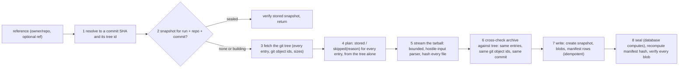

# Task 5.2: repository acquisition (design and threat model)

Status: design, written before the code. Local only: no deployment, no hosted database, no model call, no live third-party target. Builds on the Task 5.1 research-state schema (`docs/research-state.md`); it adds no table and no parallel snapshot model.

## 1. What it does
Given a repository reference, produce one **sealed, commit-pinned snapshot** in the existing research state: `repo_snapshots` (one repository at one commit), `repo_snapshot_files` (the manifest: every entry stored or skipped with a reason), `research_blobs` (content addressed bytes). The acquisition *evidences* a repository; it does not interpret it. Nothing in the repository is executed, installed, built, compiled or followed.

Nothing touches the database before step 7. A failure in steps 1 to 6 leaves **no snapshot row at all** (snapshot rows are append-only and can never be deleted, so a half-created one would be permanent and misleading). A failure inside step 7 or 8 leaves a *building* (unsealed) snapshot, which is explicitly "not evidence", and the retry resumes and completes the same snapshot.

## 2. Inputs and identity
- **Reference:** `{ repository: "owner/name", ref?: string }`. `ref` is a branch, tag or commit; absent means the default branch. Repository and ref are validated against strict patterns before they appear in any URL (no `..`, no control characters, bounded length, URL-encoded per segment).
- **Resolution (`api.github.com` only):** `GET /repos/{o}/{r}` gives the canonical `full_name`, the stable numeric repository id, the default branch and visibility; `GET /repos/{o}/{r}/commits/{ref|HEAD}` gives the commit SHA and its tree id. A 40-hex ref must resolve to exactly that SHA. A private repository, a non-40-hex SHA, or a response whose shape is wrong is refused. The snapshot stores the **canonical** `full_name` and the **commit SHA**; the ref name the operator typed is stored as `ref_name`.
- **Why the SHA is the identity:** branches move. Everything after resolution addresses the SHA, never the ref, so a force-push between steps cannot change what is acquired; at worst the commit disappears and the acquisition fails (`commit_unavailable`).

## 3. Evidence integrity: two independent sources that must agree
GitHub's tarball is the content; GitHub's **git tree** for the same commit is the identity. The tree lists every entry with its git object id (SHA-1 of `blob <size>\0<content>`), size and mode (`100644`, `100755`, `120000` symlink, `160000` submodule).
- Every tree entry must be present in the archive with the same git object id and size, and the archive may contain no file the tree does not list. Any difference fails the acquisition (`archive_tree_mismatch`, listing at most 20 examples), including a corrupted download, a substituted archive, or a missing or extra entry.
- The tree's own id must equal the tree id of the resolved commit, and the archive's `pax_global_header` comment (written by `git archive`) must equal the commit SHA. The comment is checked the moment it is read, so an archive made from another commit is refused before any of its content is processed; an archive that does not state its commit is refused too.
- The SHA-256 of the whole compressed archive is recorded as provenance. It is **not** a verification oracle: GitHub regenerates tarballs and their bytes are not stable. Content integrity rests on the git object ids, which are.
- The manifest hash is computed locally from the plan and recomputed by the database at seal; a difference is refused (existing 5.1 behaviour). `verifySnapshot` then re-hashes every stored blob.

## 4. Every entry is accounted for
Existing skip reasons are used unchanged (`binary`, `oversize`, `symlink`, `submodule`, `excluded_by_policy`, `unreadable_encoding`, `limit_reached`); the schema is not modified.

| Case | Manifest row | Also recorded in the acquisition report |
|---|---|---|
| Text file within the size cap and the byte budget | stored (blob), git id, size, classification | |
| Larger than the per-file cap (default 256 KiB, hard maximum 1 MiB) | skipped `oversize`, git id and size | |
| Contains a NUL byte | skipped `binary`, git id, size | |
| Not valid UTF-8 | skipped `unreadable_encoding`, git id, size | |
| Would exceed the snapshot byte budget (64 MiB, the seal limit) | skipped `limit_reached`; chosen deterministically (see 4.1) | count and bytes |
| Matches an operator exclusion prefix | skipped `excluded_by_policy` | the prefixes |
| **Symlink** (mode 120000) | skipped `symlink`, git id, size = target length; **never followed or resolved** | path, target text (escaped, bounded), `escapes_root` flag |
| **Submodule** (mode 160000) | skipped `submodule`, size 0; **never fetched** | path, pinned commit SHA, URL from `.gitmodules` if present (as inert text) |
| **Git LFS pointer** | stored like any small text file (the pointer *is* the repository's content) | path, pointer oid and size; LFS objects are **not** fetched |
| Case-colliding paths (`A.sol`, `a.sol`) | both stored | collision count (matters on case-insensitive disks, not here: files are never written to a filesystem) |
| Path the manifest cannot represent (tab, newline, CR, over 1,024 characters or 64 levels deep) | **cannot be a row** | escaped path, git id, size, in `completeness.unrepresentable`; **by default the acquisition fails** (`unrepresentable_paths`); an explicit option seals with `completeness: "partial"` stated in the report. A path that is **not valid UTF-8** cannot even be named in a report and always fails the acquisition (`unrepresentable_paths`), whatever the option |
| More than 20,000 entries | | **fails** (`repository_too_large`) before any download: the manifest cannot account for everything, and silently truncating is not allowed |

### 4.1 Deterministic budget
The plan is derived from the tree, before the download, so memory is bounded and the result is reproducible. Candidates are ranked by classification (`source`, `test`, `config`, `docs`, `other`, `generated`, `vendored`), then by path in byte order, and stored while they fit in the 64 MiB budget; a file that does not fit is `limit_reached` and a later, smaller one may still fit (greedy, deterministic). A file later found to be binary or non-UTF-8 is skipped for that reason and its bytes are not counted (the budget is conservative). The same commit with the same options always yields the same manifest hash.

## 5. Idempotency, retries and crash safety
- Snapshot identity is the existing unique key `(workflow run, repository, commit)`. The acquisition report is part of the 5.1 retry identity, so a retry must carry the same report: on retry the stored report (including the original `acquired_at`) is reused verbatim, and the freshly acquired content must reproduce the same manifest or the retry is a `ResearchConflictError`. A changed result is never silently merged.
- A **sealed** snapshot short-circuits: the stored snapshot is verified (every blob re-hashed, manifest recomputed) and returned without downloading.
- A **building** snapshot (a crash after step 7 started) is resumed: blobs are content addressed (re-putting is a no-op), manifest rows must match any existing row exactly, then it is sealed.
- Writes use the existing lease-checked `ResearchStore` methods, so a worker that lost its lease cannot write.
- Failure classes use the existing `StepError`: network errors, timeouts, 5xx and rate limits are retryable (honouring `Retry-After`); everything about the content (mismatch, malformed archive, over a limit, unsupported entry) is permanent.

## 6. Limits (all enforced while streaming; defaults, each lowered or raised only within a hard ceiling)
| Limit | Default | Hard ceiling |
|---|---|---|
| Compressed download | 128 MiB | 512 MiB |
| Uncompressed tar stream | 512 MiB | 2 GiB |
| Tar entries | 40,000 (files, directories, symlinks) | 100,000 |
| Manifest entries | 20,000 | 20,000 (schema) |
| One stored file | 256 KiB | 1 MiB (schema) |
| Stored bytes per snapshot | 64 MiB | 64 MiB (schema) |
| Path length / depth | 1,024 characters / 64 segments | 1,024 / 128 |
| Header-declared entry size | the uncompressed limit | |
| Whole acquisition, wall clock | 10 minutes | 30 minutes |
| API JSON response | 8 MiB | 16 MiB |
| Redirects | 3, https only, host allow-list | |

## 7. Threat model
Acquired content is hostile: the repository may be written by an attacker who knows we will read it. The acquisition layer **parses and stores bytes; it never interprets them**. What it must prevent is harm to the worker, the database, the integrity of the evidence, or later stages.

| # | Threat | Control | Test |
|---|---|---|---|
| T1 | Path traversal or absolute path in an archive (`../x`, `/etc/x`, `a/../../x`, NUL) | No archive entry is ever written to a filesystem. Traversal-shaped paths are refused as `archive_malformed` ("unsafe path"); every path is validated with the manifest's rules (`manifestPathProblem`); entries outside the single top-level directory are rejected. A backslash is an ordinary character in a git path and is recorded faithfully | traversal, absolute and mixed-separator archives |
| T2 | Symlink escape or link-following | Symlinks are recorded, never created, resolved or followed; `escapes_root` is informational | symlink to `/etc/passwd`, to `../..`, to itself, chains |
| T3 | Hardlinks, devices, FIFOs, sparse or GNU long-name entries | Unsupported entry types fail the archive (`unsupported_tar_entry`) | each type |
| T4 | Decompression bomb | Streaming byte counters on compressed and uncompressed data (absolute caps; there is no ratio guard, a legitimate repository can compress very well), entry-count cap, wall-clock timeout; nothing is buffered beyond the stored-file budget | a 1 GiB-of-zeros gzip, deep entry counts |
| T5 | Malformed or lying tar headers (bad checksum, non-octal sizes, size larger than the stream, overflow, overlong pax, truncated entry) | Strict parser: checksum verified, sizes bounded and checked against the remaining stream, pax records bounded; end marker required | table of malformed headers |
| T6 | Corrupted or tampered download, partial transfer | gzip integrity, tar end marker, git object id per file against the tree, commit and tree identity checks | flipped byte, truncated body, wrong archive |
| T7 | Ref confusion, ref moves mid-run, SHA/branch ambiguity | Resolve once, then address only the SHA; a 40-hex ref must resolve to itself | moving-ref fake |
| T8 | SSRF or credential leak through redirects, hostile `Location` | https only, host allow-list (`api.github.com`, `codeload.github.com`), at most 3 hops, no credentials forwarded across hosts, no cookies, no proxy-style URLs | redirect to other host, http, file, userinfo |
| T9 | Resource exhaustion in the worker | The plan is made from the tree before download; per-file and total budgets; memory bounded by the stored-byte budget; limits in 6 | many-files, huge-file repos |
| T10 | Misleading half-built evidence | No database writes before full validation; only sealed snapshots are evidence; a retry resumes the same snapshot; seal is database computed | crash injection after N writes |
| T11 | Duplicate or conflicting writes | 5.1 retry identity and conflict rules; content addressing | identical and changed retries |
| T12 | Hostile text reaching later stages (prompt injection in comments, README, filenames) | Acquisition stores bytes and never interprets them; the dashboard renders only as text; later stages must treat all of it as data (stated in the plan) | n/a here; the UI already renders as text |
| T13 | Secrets committed to the repository | Public repositories only; file content is never logged; the report holds paths and hashes, not content | log scan test |
| T14 | LFS and submodule indirection (pointer or URL that triggers a fetch elsewhere) | Never fetched; recorded as inert text; URLs are stored escaped and bounded | LFS and submodule fixtures |
| T15 | Log and report injection through paths | Every path or URL placed in a log or report is escaped and truncated | control-character paths |
| T16 | GitHub rate limits, outages, a lying API | Retryable errors with backoff hints; the tree/tarball/commit cross-checks detect inconsistent answers | rate-limit and 5xx fakes |
| T17 | Using acquisition to reach private or unauthorised targets | Public repositories only, unauthenticated by default; acquisition is passive reading and does not authorise testing or contact | private-repo fake |

## 8. Integration
- **Code:** `apps/api/src/acquisition/` (limits, errors, path rules, tar reader, GitHub source, planner, orchestrator, step handler). One additive method on `ResearchStore` (`findSnapshot`) and one correction to an existing helper: the 5.1 retry rule that a snapshot retry "must carry the same acquisition report" compared JSON text in key order, but PostgreSQL `jsonb` returns keys in its own order, so a report with the same content could be called a conflict. The comparison is now by value (keys sorted recursively), with a regression test; a changed value is still a conflict. No table, constraint or migration changes.
- **Workflow:** a new `repository_research` workflow type with one step `acquire_repository`, run by the existing lease-based worker; `link_or_idea_intake` and its steps are untouched. The step output is a pointer (snapshot id, manifest hash, counts). Discovery (5.3) will create these runs; nothing creates them automatically in this task, and no HTTP endpoint is added.
- **Dashboard:** already reads snapshots, files and the surface map; no change needed. The report fields above are shown in the existing snapshot detail view.
- **Tests:** a real git repository is built locally for each fixture (`git init`, `git archive`, `git ls-tree`), and a fake GitHub serves the API JSON and the tarball. No third-party host is contacted. Database tests use a disposable loopback Postgres only.

## 9. Known limitations and unresolved decisions
1. **Large repositories.** More than 20,000 entries cannot be represented (schema). Acquisition refuses them rather than truncating. A scoped acquisition (path prefixes, subdirectory snapshots) needs its own decision and probably a schema change.
2. **Unauthenticated API budget.** GitHub allows 60 unauthenticated API requests per hour per address; an acquisition uses four. An optional token is accepted through the environment for higher limits; it is never stored or logged. Whether to provision one is an owner decision.
3. **Submodules and LFS are recorded, not acquired.** Recursing into submodules or fetching LFS objects expands the trust surface and is deferred to a separate decision.
4. **Unrepresentable paths** fail by default; sealing a partial snapshot is an explicit, reported option. Whether partial snapshots should ever feed the dossier is an open product decision.
5. **GitHub tarball format.** Parsed according to `git archive` output (pax global header, ustar entries). A format change would fail closed.
6. **`.gitmodules` and `.gitattributes`** are read as ordinary text to describe submodules; they are never executed or interpreted beyond that.
7. **Case-insensitive collisions and Unicode normalisation** are reported, not resolved.
8. **No GitHub Actions CI** can run (billing); verification is local and is not independent.

10. **The real HTTP client has not met GitHub.** `GitHubSource` is tested against loopback servers that imitate the documented API and against an injected `fetch`, and its response shapes are validated strictly (`zod`). A difference between those shapes and what api.github.com really returns would make the first live acquisition fail closed with `unexpected_response`, not corrupt anything. The first live run is an owner decision (it contacts a third party, passively) and was deliberately not done here.
11. **Memory.** Stored file content is held in memory until the archive is verified (bounded by the 64 MiB stored-byte budget, plus one file at a time while hashing). A tighter bound would need a spill-to-disk or two-pass design; it is not needed at these limits.
12. **Reports are provenance, not evidence.** The acquisition report is stored on the snapshot and compared on retry, but unlike the manifest it is not covered by the seal's hash. The manifest hash recorded inside it is checked against the sealed one.
13. **A worker crash after a successful seal but before the step completes** leaves a sealed snapshot and a step that retries; the retry finds the sealed snapshot, re-verifies it and completes (tested as the sealed short-circuit).

## 11. As implemented
**Code** (all under `apps/api/src/acquisition/` unless noted): `limits.ts`, `errors.ts`, `paths.ts` (manifest path rules, classification, LFS pointer detection, report escaping), `git-hash.ts`, `tar-reader.ts` (strict parser and bounded gunzip), `github-source.ts` (source interface, hardened client), `plan.ts` (every tree entry accounted for before any download), `acquire.ts` (orchestrator), `step.ts` (`repository_research` run, `acquire_repository` step handler with lease heartbeat). Outside the folder: `ResearchStore.findSnapshot`, value-based report comparison in `research-state.ts`, the step key in `worker-runtime.ts`, the Acquisition panel in `apps/web/src/view-repository.ts`. `testing/` holds test-only support (tar writer that can emit hostile archives, a real-git fixture builder, a fake source, an in-memory recording store).

**What the tests use:** real git repositories built locally (`git init`, `git archive`, `git ls-tree`), so archive bytes and git object ids are genuine; loopback HTTP servers for the client; a disposable loopback PostgreSQL for the database tests. No third-party host is contacted by any test.

**Test coverage by risk** (T-numbers are from section 7):
- T1, T2, T3, T5, T6 (hostile and malformed archives): about 60 cases: traversal and dot segments, absolute and empty-segment paths, second top-level directory, duplicate entries, hard links, devices, FIFOs, sparse and GNU long names, bad checksums and sizes, base-256 sizes, truncation at every stage, trailing data, non-UTF-8 names, tampered, missing, extra and swapped entries, a symlink whose target text equals a file's bytes, wrong or absent archive commit, wrong tree id, truncated tree listing.
- T4, T9 (resources): decompression bomb, oversize download, entry and size limits (including many small entries adding up), repository with too many entries refused before any download, stalled download, cancelled step.
- T7, T8, T16, T17 (network): moving ref resolved once, full-SHA verification, redirects to other hosts or with credentials or in loops, token confined to the API host, rate limits and server errors classified, private repository refused, body stall versus slow steady download, mid-download disconnect, refused connection, test origins refused in production.
- T10, T11 (idempotency, crash safety): real-Postgres crash injection at blob storage, before sealing and mid-way through a multi-batch manifest; resume gives the same snapshot and the same manifest as an uninterrupted run; a changed or superset retry is refused without writing; sealed snapshot not re-downloaded; two runs share blobs; lease loss writes nothing; sealed rows cannot be changed or deleted.
- Integration: a snapshot is readable through the existing dashboard API (snapshot, manifest, file text, surface); worker end to end including failure classification and lease loss.
- Database parity: a table of paths checked against the real constraint (anything accepted by the acquisition is accepted by the database; the only two deliberate differences are pinned).

**Mutation check.** `scripts/acquisition-mutation-check.py` breaks one protection at a time (65 mutants: tar and gunzip limits and checks, every orchestrator verification, the planner, path rules, the HTTP client's redirect, token, size and timeout rules, the step handler) and requires a test to fail. Run it in a throw-away worktree (see its header).
