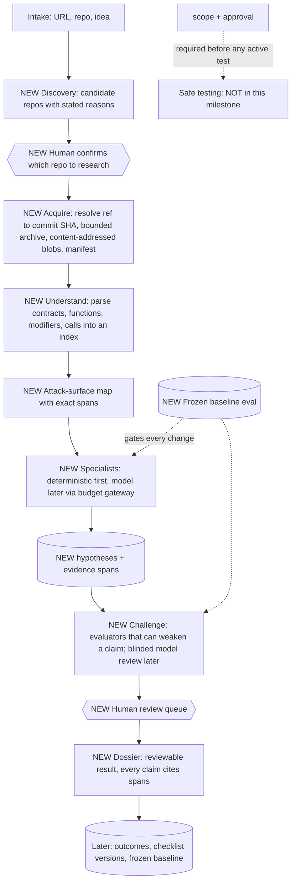

# Research Intelligence: audit of the six-PR stack and the plan for Task 5

> **Canonical roadmap (2026-11-26): `docs/ROADMAP.md`** holds the permanent phase list, decisions and verified status; the task list is `docs/backlog.md`. Where the phase numbering below differs (old 5.3 Discover, 5.9 Control Room), ROADMAP section 1 gives the mapping. This document remains the audit and the dated decision log.

Status: proposal and audit only. No code, resource, credential, deployment or migration is changed by this document. Every statement in section 1 was checked against the code at `3a8a185` (the tip of the stack) or against test and demo runs; anything not run is marked **unverified**.

## 0. The one-paragraph answer
The stack is a sound **durable execution skeleton** with honest labelling: a leased work queue, immutable hash-linked snapshots, a failure/retry policy, a budget gateway, a guarded migration runner and real-Postgres tests. It contains **no security-research intelligence yet**. The "attack-surface map" is ten regular expressions over at most 20 files of a repository (48 KB per file, 512 KB in total; the real run fetched 53 KB); "hypotheses" are one fixed template per rule family; "independent challenge" is a static checklist. On a real intake of this very repository the pipeline reported success with **0 leads and 0 hypotheses**. The next milestone must therefore build the missing layers (discovery, whole-repository acquisition pinned to a commit, structural understanding, evidence-cited hypotheses, evaluators that can genuinely weaken a claim, a recorded review model), and prove them against a frozen baseline, before any model is paid for.

## 1. Factual audit

### 1.1 What the six PRs contain (none merged; `main` is at `b50ff6f`)
| PR | Head | Adds | Nature |
|---|---|---|---|
| #1 | `92ed4ed` | typecheck/test fixes, lockfile, `npm ci` | baseline |
| #2 | `0952663` | low-level-call evidence link fix; honest completeness and review status in the brief | correctness + honesty |
| #3 | `029a23e` | worker loop resilience, failure classification, bounded retries | infrastructure |
| #4 | `149bb3b` | compiled worker entrypoint, Fly process groups, `npm run verify` | infrastructure |
| #5 | `7640094` | connection-safety guard, real-Postgres integration tests | infrastructure + verification |
| #6 | `3a8a185` | pool config for Fly Managed Postgres, `DIRECT_DATABASE_URL`, staging configs and runbook | infrastructure |

About 3,000 lines of production TypeScript and 2,200 lines of tests. Verified locally at the tip: 143 unit tests, 36 real-Postgres integration tests, typecheck and build clean. **Unverified:** CI (never ran; Actions billing), a Docker image build, anything on Fly, independent execution of the tests by anyone but the author.

### 1.2 The pipeline, stage by stage
`POST /v1/intake` creates one `link_or_idea_intake` run with eight fixed steps, executed in order by the worker.

| # | Step key | What it really does | Real research? | Where it stops being real |
|---|---|---|---|---|
| 0 | `resolve_source` | Parses the submitted URL; classifies GitHub repo / X post / web page. No network. | Parsing only | Ideas and non-GitHub URLs go no further |
| 1 | `identify_project` | One GitHub API call for repository metadata (name, default branch, language, stars). | Real source data | Public GitHub repositories only; unauthenticated (60 requests/hour) |
| 2 | `locate_official_repositories` | **Does not locate anything.** Samples the *submitted* repository: first 20 files after sorting (README, SECURITY.md, package.json first, then alphabetical), each under 48 KB, 512 KB total. Fetched by branch name, not commit SHA; blob hashes are recorded but not verified; `lib/`, `test/`, mocks are not excluded; oversize files are dropped silently. | Real bytes, tiny and unpinned sample | Typically misses the contracts (alphabetical order, size cap) |
| 3 | `establish_authorization` | Always records `unverified` and blocks active testing. | Correct and necessary, but not scope resolution | No program, scope or approval can be created by any API |
| 4 | `map_attack_surface` | 10 regex rules (Solidity entry points, `.call`, `tx.origin`, `selfdestruct`, `delegatecall`; JS `eval`/`child_process`/string-built SQL; Rust `unsafe`; Python `eval`) over the sample. Counts matches per file. | Pattern matching, not analysis | No parsing, no inheritance, modifiers, data flow or call graph; line numbers are not recorded |
| 5 | `generate_hypotheses` | Looks up one fixed question/checks/alternatives template per rule family (9 templates). | **Deterministic template, not reasoning** | A hypothesis is a rule hit plus boilerplate; it cites a file, not a line |
| 6 | `independent_challenge` | Applies a fixed counter-question checklist per family; marks evidence-linking status. Reports `independent_review_completed: false`, `reviewer: null`. | Checklist, honestly labelled | It cannot refute or weaken anything; it only lists questions |
| 7 | `prepare_research_brief` | Assembles stage outputs into one JSON snapshot with separate stage-execution, research-completeness and verification fields. | Honest summary | Summarises scaffolding |

**Demonstrated end to end** (disposable local Postgres, real worker and API): a real intake of this repository produced 8/8 steps succeeded, six hash-linked snapshots, and a brief with `research_completeness: no_leads_in_bounded_sample` (0 leads, 0 hypotheses). A **synthetic fixture** (a small invented vault contract, seeded by SQL for steps 0 to 2 and labelled synthetic) produced 4 leads, 4 hypotheses and 4 checklist items. No real third-party repository has ever been analysed: the session's GitHub scope allowed only this repository.

### 1.3 Persistence: what carries research state
| Store | Created by migrations | Written by application code | Notes |
|---|---|---|---|
| `workflow_runs`, `workflow_steps`, `audit_events` | yes | **yes** | the durable queue; **hypotheses, leads and challenges live only as JSON inside `workflow_steps.output`** |
| `source_snapshots` (immutable, SHA-256, trigger-protected) | yes | **yes** | the only evidence store; whole-document granularity, no line or span addressing; content stored inline as JSON |
| `ai_model_prices`, `budget_policies`, `ai_budget_reservations`, `model_usage_events` | yes | gateway only | **the gateway is never called** (0 call sites); no prices enabled |
| `programs`, `program_scope_versions`, `assets`, `program_assets`, `approvals` | yes | **no** | `assertActiveTestingAllowed` exists and is **never called**; nothing can create scope or approvals |
| `findings`, `finding_evidence`, `verification_reviews` | yes | **no** | a finding record is never created; reviews have nowhere to be recorded |
| `knowledge_items`, `knowledge_links` | yes | **no** | no memory or learning store is in use |
| `hunt_gate_definitions`, `hunt_gate_results` | yes | **no** | G0 to G6 criteria are not specified; nothing is seeded |
| `workflow_runs.result` | column | **never written** | |

Disconnected modules (code exists, nothing imports it at runtime): `ai-budget-gateway.ts`, `scope-guard.ts`, `repository-mapper.ts` and `github-research.ts` (a second, unused GitHub client), `resolve-intake-step.ts` (a duplicate of step 0).

### 1.4 API surface
`POST /v1/intake`, `GET /v1/workflows`, `GET /v1/workflows/:id`, health checks. Bearer-token auth for `/v1`. No endpoint to review, approve, create scope, read a hypothesis, or fetch a research result other than the raw workflow JSON. No connection to the Hunt dashboard (by design; the public status projection does not exist).

### 1.5 What is genuinely strong and must be kept
Leased queue with `SKIP LOCKED`, bounded and classified retries, shutdown handling; hash-linked immutable snapshots and fail-closed evidence validation; refusal to claim independent review without one (`reviewer: null`); budget design with atomic reservations and worst-case estimation; connection-safety guard and a migration runner that checks checksums and takes an advisory lock; real-Postgres tests with mutation checks; a staging runbook that stops on failure.

### 1.6 What is misleading or incomplete (still true at the tip)
- Step key `locate_official_repositories` and role `independent_judge` over-promise what the steps do.
- A run is `succeeded` when every handler ran, even when nothing was analysed; the brief now says so, the run status does not.
- The checklist stage is called "challenge"; it cannot change any hypothesis.
- Every discovery, scope, finding, review and learning table is unused.
- No X integration, no website crawling, no package-registry or org-level discovery exists.

## 2. Flow: as built and as intended

### 2.1 As built

### 2.2 Intended (nodes marked NEW are the work of Task 5)

## 3. The most important capability gaps (ranked)
1. **No real repository understanding.** A 20-file alphabetical sample cannot tell what a project is. Needs whole-repository acquisition pinned to a commit SHA and a structural index (contracts, inheritance, functions, modifiers, external calls, state writes).
2. **No exact evidence addressing.** Evidence is a whole JSON document. A hypothesis must cite *commit SHA + path + line range + blob hash*, resolvable and re-verifiable.
3. **No first-class hypotheses.** They exist only inside step output JSON. They need their own append-only records with generator identity (rule, model or human), status history and review records.
4. **No way to weaken or refute.** "Challenge" lists questions. Real evaluators must be able to resolve a modifier chain through inheritance, detect a reentrancy guard or ordering, and record "weakened by static check" with the span that justifies it.
5. **No recorded review model.** `verification_reviews` is keyed to findings that are never created; there is no hypothesis review, no reviewer identity, no blinded-input record, no human queue. Without it "independent" can only ever be a label.
6. **No discovery.** Nothing finds repositories, organisation members, deployments, audits or announcements; X is unsupported; non-GitHub web pages are not read.
7. **No specialist reasoning.** Zero model call sites. The gateway is untested end to end (only its cost arithmetic and reservation SQL have been written; the SQL is not tested).
8. **No evaluation.** No frozen baseline of known-vulnerable and known-benign inputs, so no way to say whether a rule, specialist or model helps or harms.
9. **No scope or approval path**, so no active testing can ever be authorised (correct for now).
10. **No learning loop**, memory use, or checklist versioning.

## 4. Architecture: where I would challenge the current direction
1. **Keep the durable queue; stop using step JSON as the research state.** Steps should be thin orchestration over first-class, append-only research tables. This is the single most important change: otherwise every later capability (review, learning, dossier, projection to the Hunt board) re-parses blobs.
2. **Content-address the evidence.** Store file bytes once in a blob table keyed by SHA-256 (deduplicated across runs); a repository snapshot is a manifest of `path -> blob hash` pinned to a commit SHA. Evidence spans point at `(manifest, path, line range, blob hash)`. This also removes inline whole-repository JSON from `source_snapshots`.
3. **Make "who produced this" and "what did the reviewer see" typed facts.** Every hypothesis records its generator (`actor_kind` in `{deterministic_rule, model, human}`, id, version; a model generator must carry a budget-gateway reservation). Every review records its **mode** and **exactly what the reviewer saw**, and independence is *never a single boolean*:
   - `blinded_independent_assessment` (model or human): the reviewer sees the claim and the cited evidence spans only. It must **not** see the generator's rationale or identity, prior evaluations, or other reviews. The schema rejects a blinded review whose recorded `reviewer_saw` says otherwise, and rejects one whose reviewer is the same actor as the generator.
   - `disclosed_adjudication` (human only for now): a human who needs to see the hypothesis, rationale and prior checks to accept or reject it. Valuable, but it is a different thing and is never reported as a blinded independent assessment.
   - Each review stores `reviewer_saw` (a closed set of six flags), a hash of the exact input shown, and the verdict. Reports state the facts ("blinded; saw claim and spans; distinct from the generator") and let the reader judge; no stored field says "independent: true".
4. **Separate evaluators from reviewers.** Static evaluators that can *weaken* a hypothesis (for example "this function is guarded by `onlyOwner` through an inherited modifier at these lines") are real and valuable, and are labelled `deterministic_analysis`. They never produce "independently reviewed". Only a recorded human or blinded model review does.
5. **Allow fan-out inside the queue.** Dynamic step keys such as `challenge:H-12` need only allowlist prefix matching in `claimNext`; the existing uniqueness and lease semantics already work. Use the existing `awaiting_approval` state (currently unused) for the human gates.
6. **Evaluate before spending.** Build the frozen baseline and eval harness *with* the deterministic specialists. Models then have to beat the baseline to earn their cost.
7. **No hosting until the slice works.** The vertical slice runs on a disposable local Postgres. Fly/Neon staging stays prepared but waits; shipping a scaffold to a server proves nothing about research.
8. **Hunt dashboard stays untouched.** The research state is private; a later one-way, allow-listed projection can feed the dashboard. Nothing in Task 5 changes the public site.
9. **Discovery never asserts "official".** It proposes candidates with stated signals (organisation link from the project website, repository link from a registry package, `SECURITY.md`, deployment addresses in docs) and a human confirms. X is deferred: its API costs money and its terms limit automated access; a manual URL inbox covers it for now.
10. **Append-only events are the authoritative history.** Hypotheses, evaluations and reviews are immutable records; a thin event log points at them; current status is *derived* by a view and never stored or edited. Blobs have explicit size caps (1 MiB each; per-snapshot file and byte limits) and an auditable eviction path that refuses to remove anything cited as evidence. See `docs/research-state.md`.
11. **Treat all fetched code as hostile.** No execution, no install, no compilers on untrusted code in this milestone. Archive extraction needs hardening (path traversal, symlinks, decompression bombs, size and file-count caps) and a host allowlist including the controlled redirect to `codeload.github.com` (the current handlers reject all redirects).

## 5. Task 5 broken into small, testable PRs
Each PR is draft, stacked, and has real-Postgres tests plus mutation checks where behaviour matters. A migration file is written and tested only on a disposable local database; nothing is applied to any hosted database.

| PR | Scope | Key tests / proof | Depends |
|---|---|---|---|
| **5.1 Research state** | Migration `0007`; design in `docs/research-state.md`. Content-addressed blobs with a 1 MiB cap, an auditable eviction function and DB-enforced hash checks; sealed commit-pinned snapshots and manifests with file and byte limits; evidence spans verified at insert; immutable hypotheses; deterministic-evaluator records that may abstain; reviews with mode and `reviewer_saw`; **append-only events as the authoritative history with current status derived by a view** (no mutable status column). | real-Postgres tests: append-only triggers, hash and span verification, size and retention limits, review-mode rules, status derivation, lease-checked writes | #6 |
| **5.2 Acquire** *(implemented in a draft PR stacked on #9: `docs/repository-acquisition.md`; no live GitHub call has been made)* | Resolve ref to commit SHA; download the archive (`api.github.com/.../tarball/<sha>` with a controlled redirect only to `codeload.github.com`); hardened in-memory extraction; classify each path (source, test, vendored, generated, docs) **recording, never silently dropping**; store blobs + manifest. New workflow type `repository_research` alongside the old one. | fixture archives incl. path-traversal, symlink, bomb, oversize; hash round-trip; partial-acquisition honesty; fake GitHub server in tests | 5.1 |
| **5.3 Discover** | Candidate discovery from a URL/idea: GitHub org/repo listing, links on a project page via a hardened fetcher (SSRF controls, DNS and redirect rules), package metadata. Candidates stored with explicit signals and reasons; `awaiting_approval` human confirmation; X bounty-link intake is a retained core requirement, specified in `docs/x-bounty-link-intake.md` (not out of scope). | SSRF suite (reusing and extending `source-resolver`), ranking determinism, "never official without human" test, fixtures for org pages | 5.1 |
| **5.4 Understand (Solidity first)** | Parser-based index with `@solidity-parser/parser` (MIT, pure JS, no execution): contracts, inheritance, functions (visibility, mutability, modifiers), state variables, external and low-level calls, events, with line spans. Derived index stored as an artifact with tool version and input hashes. | golden-file tests on fixtures; inheritance and modifier resolution; parse failures reported, not hidden | 5.2 |
| **5.5 Specialists + attack-surface map v2** | Specialist interface `{id, version, kind}`. First deterministic specialists over the index: unguarded state-changing entry points, external call before state write, unchecked low-level return, `tx.origin` auth, delegatecall to non-constant target, unprotected initializer/selfdestruct. Each emits hypotheses with spans, rationale and required checks. The old regex steps remain for non-Solidity inputs. | per-specialist positive/negative fixtures; every hypothesis has ≥1 resolvable span; generator identity recorded | 5.4 |
| **5.6 Challenge v2 + review model** | Evaluators that can set `weakened_by_static_check` / `contradicted_by_static_check` with cited spans; review records and a human review endpoint (`POST /v1/hypotheses/:id/reviews`); blinded-input contract and a disabled model-review adapter plus a replay provider for tests (never counted as independent). | a guarded function is weakened; a vulnerable one is not; same-actor review is rejected as non-independent; model path cannot run without a gateway reservation | 5.5 |
| **5.7 Dossier** | Assemble the reviewable result from first-class records; `GET /v1/research/:id/dossier`; fails closed if any claim lacks a resolvable span; labels each stage `automation: deterministic|model|human`. | determinism (same input -> same dossier hash), forbidden-claim test, span re-verification | 5.6 |
| **5.8 Frozen baseline + eval** | Corpus of intentionally vulnerable educational contracts and benign controls (licences recorded), expected hypotheses per fixture, metrics (precision, recall, false weakening), `npm run eval`, committed baseline; thresholds a change must not regress. | the eval itself, plus mutation: weakening a specialist must visibly fail the baseline | 5.5, 5.6 |

Later, each behind its own approval: model specialists through the budget gateway (Tier 2 hypotheses, Tier 3 selective challenge), whole-repository support for TypeScript/Rust/Go indexes, scope and approval APIs, safe testing, the learning loop and the Hunt projection.

## 6. First vertical milestone
**Submitted project -> real discovery -> real repository -> structural understanding -> attack-surface map -> evidence-cited hypotheses -> challenge -> reviewable dossier**, on Solidity, with $0 of model spend and no active testing. It is PRs 5.1 to 5.7, with 5.8 as the gate that decides whether the milestone is accepted.

### Acceptance criteria (each testable)
1. **Provenance.** Every artifact is pinned to a commit SHA; every stored file's SHA-256 is recomputed on read and equals the manifest's; the manifest hash is recorded in the dossier.
2. **Whole-repository acquisition.** For a repository within limits (archive <= 25 MB, <= 5,000 files), every file is either stored or listed with an explicit reason it was not. The old silent "first 20 files" behaviour is not used for this workflow.
3. **Evidence linking.** Every hypothesis has at least one span `(commit, path, line range, blob hash)` and re-reading that span from the stored blob reproduces the cited text. Dossier generation fails closed otherwise.
4. **Typed provenance of claims.** Every hypothesis and review records `actor_kind`, actor id and version. No hypothesis is ever `verified` (the status vocabulary has no such value). Reviews record their mode (`blinded_independent_assessment` or `disclosed_adjudication`) and exactly what the reviewer saw; a deterministic evaluator can never produce a review.
5. **Challenge that can change the answer, and can abstain.** Each evaluator returns `supports`, `weakens`, `contradicts` or `inconclusive`; abstaining is a first-class outcome, not a failure. Per-fixture expected outcomes are committed, and results are reported as false weakening, missed weakening and inconclusive rate, on **held-out** controls and contracts that were not used to write the evaluator. Zero false weakening is the initial safety target, not the proof of correctness: with a small corpus it can be met by overfitting, so thresholds are set on the held-out set and reviewed.
6. **Honest labelling.** The dossier states, per stage, `automation: deterministic | model | human` and `independent_review: none` unless a recorded review exists. A test greps the rendered dossier for forbidden phrases ("verified", "independent" without a review record, "confirmed vulnerability").
7. **Discovery is advisory.** Given a project or organisation URL, candidates are returned with explicit reasons; none is marked official without a recorded human confirmation; the SSRF test suite passes.
8. **Zero model spend.** `ai_budget_reservations` and `model_usage_events` stay empty; a test asserts the gateway is not invoked.
9. **Reproducible.** Same input and same code produce a byte-identical dossier hash.
10. **Verified on real Postgres.** The new integration tests pass on a disposable local database; unit and integration counts are reported separately, with mutation checks for the evidence-link, independence and weakening paths.

### How we will prove it works
- **Offline proof (required, deterministic):** a local fake GitHub server serves a pinned archive of educational vulnerable contracts plus benign controls; the full pipeline runs against a real disposable Postgres; the dossier and its hash are committed as a golden file.
- **Frozen baseline:** `npm run eval` scores the specialists and evaluators against labelled fixtures and compares with the committed baseline.
- **Live proof (needs your approval):** the same pipeline on a real public Solidity repository that you add to the session's GitHub scope (the earlier attempt to add one was refused by the classifier; the fix is your explicit approval of that repository, not a workaround). Read-only and passive.
- **Human walkthrough:** you read one dossier and accept or reject each hypothesis through the review endpoint; the recorded reviews appear in the dossier as the first genuine independent-review records.

### Non-goals of this milestone
Model calls, X discovery, active testing, scope or approval handling, learning/checklist evolution, hosting or deployment, any change to the Hunt dashboard or public site, non-Solidity understanding beyond the existing regex rules.

### Evaluation design (5.8)
- Fixtures are split into **development** (used while writing evaluators) and **held-out** (never inspected while writing them; changed only by a reviewed PR that records why).
- Every fixture records expected outcome per evaluator, including an expected `inconclusive` where the evaluator should abstain.
- Metrics: false weakening (a vulnerable fixture weakened), missed weakening (a benign control not weakened), inconclusive rate, and per-specialist precision and recall on hypotheses. A change that improves development results while worsening held-out results is rejected.

## 7. Budget and safety notes
- The slice costs **$0** in model spend. When models arrive they go only through the existing gateway: the policy caps are $25 per month, $1 per day, $0.50 per workflow, and per-call caps of $0.01 / $0.05 / $0.10 for Tier 1 / 2 / 3. A workflow cap of $0.50 limits one investigation to roughly ten Tier 2 calls at the cap, so context must be small and targeted (function slices and cited spans, never whole repositories). Provider prices come from a reviewed catalog; none is enabled and none is assumed here.
- Untrusted code is only read and parsed; nothing is executed, installed or compiled in this milestone.
- No exploit or proof-of-concept content is stored in the public repository; fixtures are educational contracts with recorded licences, and research outputs for real targets stay in the private database.

## 8. Decisions recorded (owner, after review of this document)
> *These rows are the decisions as first recorded and are kept unedited. Several are superseded by later, dated decisions in section 10 (notably: hosting no longer waits: the production hub is live; PR 5.2 is approved and implemented as a draft). Section 10 is the current, canonical decision log.*

| Question | Decision |
|---|---|
| First-class research state | **Approved.** Stop extending workflow-step JSON as the permanent research store. |
| Solidity first with `@solidity-parser/parser` | **Approved**, subject to checking parser coverage against our fixtures. |
| Live third-party repository | **Deferred.** Prove the whole workflow offline first, then bring a proposed target for explicit approval. |
| Hosting (Fly staging) | **Waits** until the offline research slice passes. |

Only the architecture and PR 5.1 are approved. Later PRs (5.2 onwards) are not pre-approved and each needs its own review. No model spend, hosted database, Fly resource, deployment, active testing or public-repository scope is authorised by these decisions.

## 9. Roadmap additions (agreed as capabilities; none designed, approved for implementation or started)
Recorded 2026-11-25 at the owner's direction. Each needs its own design document and explicit approval before any code. They sit after the current Task 5 line and do not change the 5.1-5.8 plan above; none may weaken the safety boundaries in section 7 (nothing untrusted is executed outside an approved sandbox, no model spend outside the gateway, no active testing without current verified scope and approval).

| ID | Capability | What is agreed now | Open before it can start |
|---|---|---|---|
| **5.4B** | **Automated Security Toolchain** | Integrate established static-analysis and security tooling as pluggable, versioned components whose findings enter the research state as *hypotheses and evidence with provenance* (tool name, version, input hashes), never as confirmed findings. Follows 5.4 (Understand). | Sandbox design for any tool that executes code or builds a project (requires its own approval; until then tools may only read and parse); tool selection and licences; result schema. |
| **5.5A** | **Weirdness Engine** | A named engine for surfacing unusual or anomalous behaviour and structure for investigation, feeding the specialist/hypothesis pipeline (5.5). | **The definition is not yet written.** This entry records only that it was agreed as a roadmap capability; scope, inputs and outputs are to be specified with the owner. |
| **-** | **Adaptive Research Priority Engine** | Decides what to research next from recorded outcomes (evaluation results, reviews, cost), within budget caps, with every ranking decision explainable and stored. | Definition, objective function, the data it learns from (needs the 5.8 baseline), and approval to adapt behaviour at all. |
| **5.9** | **Live Engine Control Room** | A real-time view of the research engine in the hub. It must show **genuine** research events, running tools, agent activity, queues, costs, errors and progress, taken only from real records, leases and heartbeats. **No simulated or demo activity in production**; an idle engine shows as idle; stale data is labelled stale (as in `docs/existing-hunt-board-integration.md`); unknown values are shown as unknown. | Event/heartbeat sources for tools and agents (do not exist yet), cost attribution from the gateway ledger, access model, and a test that the UI refuses to render anything not backed by a stored record. |

| **5.5-APEX** | **AgentSmith APEX (Autonomous Path Exploration & Exploitation Research Engine)** | Dedicated workstream under 5.5, alongside 5.5A; eight capabilities (path exploration, assumption breaking, protocol interaction, temporal sequences, novel hypotheses, adaptive search, counterexamples and validation, discovery memory); built on the shared representation and research state; prior art first; measured by independently confirmed APEX-only discoveries (`docs/apex.md`). | Recorded 2026-11-26 as a commitment only. Prior-art research (T-150) and design (T-151) before any implementation. |
| **MD** | **Multi-domain security research** | Shared kernel plus domain packs; Web application, API, cloud, supply chain and identity after a credible, independently evaluated smart-contract engine (`docs/multi-domain-research.md`). | Planning only. |

**Update 2026-11-26 to the Adaptive Research Priority Engine row above:** its detailed design is started (T-050, `docs/adaptive-priority-engine-design.md`): six prioritisation levels, version-aware coverage and audit saturation, event-driven recovery, exploration quota, transparent deterministic scoring v1, learning only from independently confirmed outcomes. The row above is kept unedited.

Status: these rows are committed to this document by the PR that adds them; until that PR is reviewed and merged they are not part of the canonical roadmap on `main`.

## 10. Dated decision log (canonical; newest last)
Each entry is a decision the owner made or an event that changed the plan. "Approval" is for the stated scope only.

| Date | Decision / event | Scope and conditions |
|---|---|---|
| 2026-11 (earlier) | First-class research state; Solidity first; offline slice first (section 8) | Architecture and PR 5.1 approved. |
| 2026-11-25 | **Hosting approved and executed.** Separate Fly app `agentsmith-hub` (region `syd`), one `app` machine, no worker; separate Fly Managed Postgres `agentsmith-hub-db`; permanent hostname `hub.agentsmithdesk.xyz` (three DNS records added by the owner in Porkbun; `hunt.` untouched); bearer-token auth; migrations run manually after confirming the target database. | Supersedes "Hosting waits" (section 8). Image built **without Docker** (`scripts/hub-image.sh`) because no Docker/remote builder was reachable; owner approved that route. Releases: `hub-dd28d27ed085`, then `hub-b5bc4b548c2e` (current). No old resources deleted. |
| 2026-11-25 | **Token custody.** The owner confirmed the bearer token is stored in their password manager; the local copy was deleted. | Rotation requires a new approval. |
| 2026-11-25 | **PR 5.2 Repository Acquisition approved**, with eleven requirements (commit-SHA resolution, complete repository, provenance, content-addressed blobs and manifest in the 5.1 schema, sealing, hostile input, never execute/install/build, size/count/path/archive limits, explicit symlink/submodule/LFS handling, idempotent retries, no partial or misleading snapshots). | Implemented as draft PR #10 (`8e0121d`). **No live GitHub acquisition has run.** No production deployment, hosted migration, paid model call, active testing or external submission authorised. |
| 2026-11-25 | **Stack review of PRs #7-#10** produced ten findings (SSRF validator, auth before body parsing, lockout and proxy trust, database owner role, image contents, plus roadmap, tagging, stale docs, PR breadth, CI). | Owner approved fixing findings 1-5 as separate, test-first draft PRs. |
| 2026-11-25 | **Security fix PRs opened (draft, stacked, unmerged, undeployed):** #11 SSRF-safe outbound requests; #12 authentication before body parsing with default-deny; #13 valid operator never locked out, no trust in spoofable proxy headers; #14 least-privilege runtime database role; #15 production image excludes tests and dev code. | Nothing merged, deployed or migrated; no production role, credential, DNS or Hunt change. A combined stack review precedes any release (`docs/first-production-release-plan.md`). |
| 2026-11-25 | **Roadmap capabilities agreed**: 5.4B Automated Security Toolchain, 5.5A Weirdness Engine, Adaptive Research Priority Engine, 5.9 Live Engine Control Room (section 9). | Agreed as capabilities only; each needs its own design and approval. |
| 2026-11-25 | **Task 5.3 (Discover) is not authorised** and has not been started. | Requires explicit approval. |
| 2026-11-25 | **Release strategy.** Deploy the reviewed security foundation first with the research engine idle; do not wait for 5.3; do not deploy an incomplete or unreviewed security stack. | Plan only: `docs/first-production-release-plan.md`. Execution needs separate approval. |
| 2026-11-26 | **R1 accepted temporarily for Release 1.** The app may keep running as the owner role `schema_admin` for the first release; the least-privilege role rollout (`docs/db-roles.md`) follows as a separate approval. | A compromised application could disable the append-only triggers; the engine stays idle and the surface is the authenticated API only. |
| 2026-11-26 | **Docker-less artifact accepted for Release 1.** Release candidate `7eed70f` built with `scripts/hub-image.sh` and pushed as `rc-7eed70f6c7f3` (digest `sha256:c0eaf87d...`), verified by pulling it back by digest (31/31 smoke, byte-identical `/app`). | Not a genuine Dockerfile build; Fly's remote builder is unreachable from the development environment (TLS interception) and GitHub Actions is unavailable. A permanent genuine-build pipeline is deferred. Deployment still needs separate approval. |
| 2026-11-26 | **Priorities after Release 1:** autonomous bounty discovery (5.0), verify the real status of repository acquisition (5.2) including a first live acquisition decision, then continue the research pipeline. GitHub Actions billing must not block development. | Not started; each needs its own design and approval. |
| 2026-11-26 | **Phase 5.0 Autonomous Bounty Discovery and Source Monitoring implemented as a draft** (migration `0008`, `apps/api/src/discovery/`, `docs/bounty-discovery.md`): one documented-API adapter (`github_org_repos`), append-only observations and events, explained scoring, human approval that queues a passive `repository_research` run. Platform-site adapters are **not** built. | Not deployed, not migrated, off by default; needs owner approval for the migration, a worker, enabling a source and a first live shape check. Phase 5.2 audit: `docs/phase-5-2-status-audit.md`. |
| 2026-11-26 | **Canonical roadmap established** (`docs/ROADMAP.md`, `docs/backlog.md`). Phase list fixed as 5.0 Bounty discovery, 5.1 Research state, 5.2 Repository acquisition, 5.3 Intelligence mapping, 5.4 Structural smart-contract analysis, 5.4B Automated security toolchain, 5.5 Specialist research intelligence, 5.5A Weirdness Engine, 5.6 Independent challenge and review, 5.7 Dossiers and reporting, 5.8 Frozen benchmarks and learning; Adaptive Research Priority Engine as a cross-phase capability; Live Engine Control Room as the operational interface. | Documentation only. No phase removed; old numbering mapped in ROADMAP section 1. Authorises no implementation. |
| 2026-11-26 | **Multi-source discovery is permanent.** Initial sources in priority order: Immunefi, Code4rena, Sherlock, official GitHub organisations and repositories; to investigate: Cantina, HackenProof, official project bounty pages, others. Each source has its own adapter, source verification, provenance, rate limits, health status, failure handling and deduplication; official access methods and terms are verified before implementation. | Immunefi is Blocked pending permission (its Terms forbid automated site access). |
| 2026-11-26 | **General URL intake is permanent.** The operator may paste X posts, GitHub links, Immunefi/Code4rena/Sherlock pages, announcements, disclosures; the system extracts, verifies, normalises, deduplicates and prioritises. **X is a manually supplied channel, not a paid crawler or mandatory API.** Inaccessible content is never fabricated: the system asks for pasted text or official alternatives. | Only classification exists today. X API spending is not approved. |
| 2026-11-26 | **One unified opportunity model.** All sources feed one opportunity/research system preserving provenance, official program links, repository identity, exact commit SHA, scope, reward, deadlines, eligibility, testing restrictions, snapshots, change history and research links; one project must not spawn parallel pipelines. | Design first (backlog T-040). |
| 2026-11-26 | **Adaptive Research Priority Engine recorded as core and cross-phase**, with transparent scores and no invented calibrated probabilities. | Capability only. |
| 2026-11-26 | **Blind Grok rediscovery benchmark added to Phase 5.8.** Reference finding, repository and commit must first be confirmed by the owner; the Alchemix V3 rounding/index investigation is a candidate only; the reference stays hidden until AgentSmith's hypotheses and evidence are sealed; it is a known-positive capability benchmark, not proof of novel discovery. | Not started. |
| 2026-11-26 | **Live Engine Control Room integrates** discovery health, opportunities, acquisition, priorities, runs, specialist/tool activity, hypotheses and evidence, reviews, findings, costs and performance; everything shown is real and database-backed. | Section 9 wording unchanged. |
| 2026-11-26 | **Safety boundaries restated as permanent:** passive discovery is not authorisation; verify scope before active research; no automatic submissions; no bypassing access restrictions or rate limits; no unapproved spend; no production migration, deployment or worker activation and no merge without approval; the Hunt service is preserved; no Vercel. | See ROADMAP section 2G. |
| 2026-11-26 | **Separate-agent review of PR #20** fixed an INSERT bypass of the human-decision guard and seven smaller issues; **recorded limitation:** a compromised runtime role can still forge a "human" event. **Official-source research:** Immunefi's Terms forbid automated access to the site (permission required); other platforms' terms unread. | `pr20-review-and-next-steps.md`, `discovery-sources-official-research.md`. Not deployed or migrated. |
| 2026-11-26 | **Discovery precedes repository scanning; the Immunefi scout is preserved as a permanent requirement.** Investigation (`docs/immunefi-scout.md`): the earlier scout's code is not in this repository or any readable record; its method was recovered from a separate earlier session's history (the Hunt engine `huntd`: hourly reads of the undocumented `public-api/bounties.json`, persistent sqlite backlog; source code not available; Terms review not recorded). Immunefi's `public-api/bounties.json` is undocumented and Immunefi's Terms prohibit automated site access, so **no polling is authorised**; access route is an owner decision (written permission, manual import, or official repositories). Immunefi remains a permanent top-priority source feeding the one unified opportunity model. | No code, migration, deployment or polling. Outstanding security issues S1 (forged human events/source enablement by a compromised runtime role; the approval mechanism is **not** tamper-proof) and S2 (R1) stay open (ROADMAP section 5). |
| 2026-11-26 | **AgentSmith APEX recorded as a permanent workstream (`5.5-APEX`) under 5.5**, with eight capabilities, binding integration rules (shared representation, provenance of origin, independence, cooperation with the Weirdness Engine and specialists, tools as supporting instruments), a mandatory prior-art and novelty review before implementation, and an independent benchmark whose primary metric is independently confirmed APEX-only discoveries. | Commitment only; tasks T-150 to T-162 reserved; no implementation authorised; no renumbering of any phase. |
| 2026-11-26 | **Adaptive Research Priority Engine expanded** (six levels; freshness as a signal; version-aware coverage and saturation; event-driven priority recovery; economics and efficiency; exploration quota; learning separation; no invented probabilities); T-050 and T-051 expanded in place; T-052 to T-058 added; T-050 design draft started. | Documentation only; build T-051 early on fixtures. |
| 2026-11-26 | **Multi-domain security research recorded as a strategic workstream** (Web application, API, cloud, supply chain, identity) on a shared kernel with per-domain packs; smart contracts remain the immediate focus; tasks T-170 to T-179 reserved. | Planning only; no domain beyond smart contracts is built before the engine is independently evaluated. |

| 2026-11-26 | **Owner approvals A16, A17, A4, A20** (recorded at the owner's explicit confirmation in the session). A16: T-149 (`docs/unified-research-workflow.md`) is the architectural authority. A17 (D10): program identity reuses and extends the 0001 `programs`/`program_scope_versions`/`assets`/`approvals` tables. A4: the T-144 research-memory **design**; a migration **draft** may be written and tested on throwaway databases only (applying it anywhere is A4b, separate). A20: protocol model v1 **design and staged plan**, incremental (P1-P3 first, evidence-backed output and at least one real consumer per step). **Deferred:** A18 (intake handover and legacy retirement) until behavioural-equivalence tests pass. **Still separate and not approved:** A2 (corpus 4), A15 (live GitHub API check), A5-A13 (D1-D9), A4b and every production change. Owner conditions: legacy runs, snapshots and template hypotheses stay readable as historical, non-validated records; migrations are approved in stages (draft on throwaway databases, then production as its own decision). |
### Open owner decisions
First live GitHub acquisition target; optional `GITHUB_TOKEN`; policy for partial snapshots; worker deployment for production acquisition; whether the Fly Managed Postgres user can create roles (needed for PR #14); enabling `HUB_TRUSTED_PROXY_CIDRS` after the peer range is observed.
