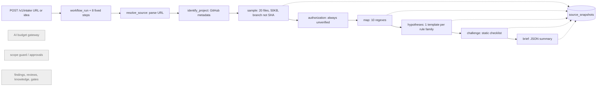
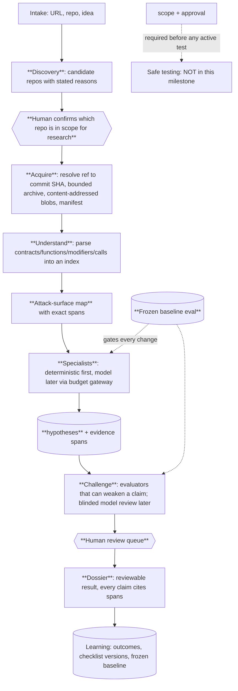

# Research Intelligence: audit of the six-PR stack and the plan for Task 5

Status: proposal and audit only. No code, resource, credential, deployment or migration is changed by this document. Every statement in section 1 was checked against the code at `3a8a185` (the tip of the stack) or against test and demo runs; anything not run is marked **unverified**.

## 0. The one-paragraph answer
The stack is a sound **durable execution skeleton** with honest labelling: a leased work queue, immutable hash-linked snapshots, a failure/retry policy, a budget gateway, a guarded migration runner and real-Postgres tests. It contains **no security-research intelligence yet**. The "attack-surface map" is ten regular expressions over at most 20 files (about 50 KB) of a repository; "hypotheses" are one fixed template per rule family; "independent challenge" is a static checklist. On a real intake of this very repository the pipeline reported success with **0 leads and 0 hypotheses**. The next milestone must therefore build the missing layers (discovery, whole-repository acquisition pinned to a commit, structural understanding, evidence-cited hypotheses, evaluators that can genuinely weaken a claim, a recorded review model), and prove them against a frozen baseline, before any model is paid for.

## 1. Factual audit

### 1.1 What the six PRs contain (none merged; `main` is at `b50ff6f`)
| PR | Head | Adds | Nature |
|---|---|---|---|
| #1 | `92ed4ed` | typecheck/test fixes, lockfile, `npm ci` | baseline |
| #2 | `0952663` | low-level-call evidence link fix; honest completeness and review status in the brief | correctness + honesty |
| #3 | `029a23e` | worker loop resilience, failure classification, bounded retries | infrastructure |
| #4 | `149bb3b` | compiled worker entrypoint, Fly process groups, `npm run verify` | infrastructure |
| #5 | `7640094` | connection-safety guard, real-Postgres integration tests | infrastructure + verification |
| #6 | `3a8a185` | pool config for Fly Managed Postgres, `DIRECT_DATABASE_URL`, staging configs and runbook | infrastructure |

About 3,000 lines of production TypeScript and 2,200 lines of tests. Verified locally at the tip: 143 unit tests, 36 real-Postgres integration tests, typecheck and build clean. **Unverified:** CI (never ran; Actions billing), a Docker image build, anything on Fly, independent execution of the tests by anyone but the author.

### 1.2 The pipeline, stage by stage
`POST /v1/intake` creates one `link_or_idea_intake` run with eight fixed steps, executed in order by the worker.

| # | Step key | What it really does | Real research? | Where it stops being real |
|---|---|---|---|---|
| 0 | `resolve_source` | Parses the submitted URL; classifies GitHub repo / X post / web page. No network. | Parsing only | Ideas and non-GitHub URLs go no further |
| 1 | `identify_project` | One GitHub API call for repository metadata (name, default branch, language, stars). | Real source data | Public GitHub repositories only; unauthenticated (60 requests/hour) |
| 2 | `locate_official_repositories` | **Does not locate anything.** Samples the *submitted* repository: first 20 files after sorting (README, SECURITY.md, package.json first, then alphabetical), each under 48 KB, 512 KB total. Fetched by branch name, not commit SHA; blob hashes are recorded but not verified; `lib/`, `test/`, mocks are not excluded; oversize files are dropped silently. | Real bytes, tiny and unpinned sample | Typically misses the contracts (alphabetical order, size cap) |
| 3 | `establish_authorization` | Always records `unverified` and blocks active testing. | Correct and necessary, but not scope resolution | No program, scope or approval can be created by any API |
| 4 | `map_attack_surface` | 10 regex rules (Solidity entry points, `.call`, `tx.origin`, `selfdestruct`, `delegatecall`; JS `eval`/`child_process`/string-built SQL; Rust `unsafe`; Python `eval`) over the sample. Counts matches per file. | Pattern matching, not analysis | No parsing, no inheritance, modifiers, data flow or call graph; line numbers are not recorded |
| 5 | `generate_hypotheses` | Looks up one fixed question/checks/alternatives template per rule family (9 templates). | **Deterministic template, not reasoning** | A hypothesis is a rule hit plus boilerplate; it cites a file, not a line |
| 6 | `independent_challenge` | Applies a fixed counter-question checklist per family; marks evidence-linking status. Reports `independent_review_completed: false`, `reviewer: null`. | Checklist, honestly labelled | It cannot refute or weaken anything; it only lists questions |
| 7 | `prepare_research_brief` | Assembles stage outputs into one JSON snapshot with separate stage-execution, research-completeness and verification fields. | Honest summary | Summarises scaffolding |

**Demonstrated end to end** (disposable local Postgres, real worker and API): a real intake of this repository produced 8/8 steps succeeded, six hash-linked snapshots, and a brief with `research_completeness: no_leads_in_bounded_sample` (0 leads, 0 hypotheses). A **synthetic fixture** (a small invented vault contract, seeded by SQL for steps 0 to 2 and labelled synthetic) produced 4 leads, 4 hypotheses and 4 checklist items. No real third-party repository has ever been analysed: the session's GitHub scope allowed only this repository.

### 1.3 Persistence: what carries research state
| Store | Created by migrations | Written by application code | Notes |
|---|---|---|---|
| `workflow_runs`, `workflow_steps`, `audit_events` | yes | **yes** | the durable queue; **hypotheses, leads and challenges live only as JSON inside `workflow_steps.output`** |
| `source_snapshots` (immutable, SHA-256, trigger-protected) | yes | **yes** | the only evidence store; whole-document granularity, no line or span addressing; content stored inline as JSON |
| `ai_model_prices`, `budget_policies`, `ai_budget_reservations`, `model_usage_events` | yes | gateway only | **the gateway is never called** (0 call sites); no prices enabled |
| `programs`, `program_scope_versions`, `assets`, `program_assets`, `approvals` | yes | **no** | `assertActiveTestingAllowed` exists and is **never called**; nothing can create scope or approvals |
| `findings`, `finding_evidence`, `verification_reviews` | yes | **no** | a finding record is never created; reviews have nowhere to be recorded |
| `knowledge_items`, `knowledge_links` | yes | **no** | no memory or learning store is in use |
| `hunt_gate_definitions`, `hunt_gate_results` | yes | **no** | G0 to G6 criteria are not specified; nothing is seeded |
| `workflow_runs.result` | column | **never written** | |

Disconnected modules (code exists, nothing imports it at runtime): `ai-budget-gateway.ts`, `scope-guard.ts`, `repository-mapper.ts` and `github-research.ts` (a second, unused GitHub client), `resolve-intake-step.ts` (a duplicate of step 0).

### 1.4 API surface
`POST /v1/intake`, `GET /v1/workflows`, `GET /v1/workflows/:id`, health checks. Bearer-token auth for `/v1`. No endpoint to review, approve, create scope, read a hypothesis, or fetch a research result other than the raw workflow JSON. No connection to the Hunt dashboard (by design; the public status projection does not exist).

### 1.5 What is genuinely strong and must be kept
Leased queue with `SKIP LOCKED`, bounded and classified retries, shutdown handling; hash-linked immutable snapshots and fail-closed evidence validation; refusal to claim independent review without one (`reviewer: null`); budget design with atomic reservations and worst-case estimation; connection-safety guard and a migration runner that checks checksums and takes an advisory lock; real-Postgres tests with mutation checks; a staging runbook that stops on failure.

### 1.6 What is misleading or incomplete (still true at the tip)
- Step key `locate_official_repositories` and role `independent_judge` over-promise what the steps do.
- A run is `succeeded` when every handler ran, even when nothing was analysed; the brief now says so, the run status does not.
- The checklist stage is called "challenge"; it cannot change any hypothesis.
- Every discovery, scope, finding, review and learning table is unused.
- No X integration, no website crawling, no package-registry or org-level discovery exists.

## 2. Flow: as built and as intended

### 2.1 As built

### 2.2 Intended (new work in bold)

## 3. The most important capability gaps (ranked)
1. **No real repository understanding.** A 20-file alphabetical sample cannot tell what a project is. Needs whole-repository acquisition pinned to a commit SHA and a structural index (contracts, inheritance, functions, modifiers, external calls, state writes).
2. **No exact evidence addressing.** Evidence is a whole JSON document. A hypothesis must cite *commit SHA + path + line range + blob hash*, resolvable and re-verifiable.
3. **No first-class hypotheses.** They exist only inside step output JSON. They need their own append-only records with generator identity (rule, model or human), status history and review records.
4. **No way to weaken or refute.** "Challenge" lists questions. Real evaluators must be able to resolve a modifier chain through inheritance, detect a reentrancy guard or ordering, and record "weakened by static check" with the span that justifies it.
5. **No recorded review model.** `verification_reviews` is keyed to findings that are never created; there is no hypothesis review, no reviewer identity, no blinded-input record, no human queue. Without it "independent" can only ever be a label.
6. **No discovery.** Nothing finds repositories, organisation members, deployments, audits or announcements; X is unsupported; non-GitHub web pages are not read.
7. **No specialist reasoning.** Zero model call sites. The gateway is untested end to end (only its cost arithmetic and reservation SQL have been written; the SQL is not tested).
8. **No evaluation.** No frozen baseline of known-vulnerable and known-benign inputs, so no way to say whether a rule, specialist or model helps or harms.
9. **No scope or approval path**, so no active testing can ever be authorised (correct for now).
10. **No learning loop**, memory use, or checklist versioning.

## 4. Architecture: where I would challenge the current direction
1. **Keep the durable queue; stop using step JSON as the research state.** Steps should be thin orchestration over first-class, append-only research tables. This is the single most important change: otherwise every later capability (review, learning, dossier, projection to the Hunt board) re-parses blobs.
2. **Content-address the evidence.** Store file bytes once in a blob table keyed by SHA-256 (deduplicated across runs); a repository snapshot is a manifest of `path -> blob hash` pinned to a commit SHA. Evidence spans point at `(manifest, path, line range, blob hash)`. This also removes inline whole-repository JSON from `source_snapshots`.
3. **Make "who produced this" a typed fact.** Every hypothesis and review records `actor_kind` in `{deterministic_rule, model, human}`, the actor id and version, and (for models) the provider, model, prompt version and gateway reservation id. "Independent" is then *derived*, not asserted: a review is independent only if its actor differs from the generator's actor and its input excluded the generator's conclusion (input hash recorded).
4. **Separate evaluators from reviewers.** Static evaluators that can *weaken* a hypothesis (for example "this function is guarded by `onlyOwner` through an inherited modifier at these lines") are real and valuable, and are labelled `deterministic_analysis`. They never produce "independently reviewed". Only a recorded human or blinded model review does.
5. **Allow fan-out inside the queue.** Dynamic step keys such as `challenge:H-12` need only allowlist prefix matching in `claimNext`; the existing uniqueness and lease semantics already work. Use the existing `awaiting_approval` state (currently unused) for the human gates.
6. **Evaluate before spending.** Build the frozen baseline and eval harness *with* the deterministic specialists. Models then have to beat the baseline to earn their cost.
7. **No hosting until the slice works.** The vertical slice runs on a disposable local Postgres. Fly/Neon staging stays prepared but waits; shipping a scaffold to a server proves nothing about research.
8. **Hunt dashboard stays untouched.** The research state is private; a later one-way, allow-listed projection can feed the dashboard. Nothing in Task 5 changes the public site.
9. **Discovery never asserts "official".** It proposes candidates with stated signals (organisation link from the project website, repository link from a registry package, `SECURITY.md`, deployment addresses in docs) and a human confirms. X is deferred: its API costs money and its terms limit automated access; a manual URL inbox covers it for now.
10. **Treat all fetched code as hostile.** No execution, no install, no compilers on untrusted code in this milestone. Archive extraction needs hardening (path traversal, symlinks, decompression bombs, size and file-count caps) and a host allowlist including the controlled redirect to `codeload.github.com` (the current handlers reject all redirects).

## 5. Task 5 broken into small, testable PRs
Each PR is draft, stacked, and has real-Postgres tests plus mutation checks where behaviour matters. A migration file is written and tested only on a disposable local database; nothing is applied to any hosted database.

| PR | Scope | Key tests / proof | Depends |
|---|---|---|---|
| **5.1 Research state** | Migration `0007`: `research_blobs` (content-addressed, append-only), `repo_snapshots` + `repo_snapshot_files` (manifest pinned to commit SHA), `hypotheses`, `hypothesis_evidence` (span links), `hypothesis_reviews`, `hypothesis_events` (status history). Triggers make them append-only. Typed enums for `actor_kind`, review independence. | integration: append-only triggers, span resolution recomputes hash, independence derivation, rejects a review that claims independence from the same actor | #6 |
| **5.2 Acquire** | Resolve ref to commit SHA; download the archive (`api.github.com/.../tarball/<sha>` with a controlled redirect only to `codeload.github.com`); hardened in-memory extraction; classify each path (source, test, vendored, generated, docs) **recording, never silently dropping**; store blobs + manifest. New workflow type `repository_research` alongside the old one. | fixture archives incl. path-traversal, symlink, bomb, oversize; hash round-trip; partial-acquisition honesty; fake GitHub server in tests | 5.1 |
| **5.3 Discover** | Candidate discovery from a URL/idea: GitHub org/repo listing, links on a project page via a hardened fetcher (SSRF controls, DNS and redirect rules), package metadata. Candidates stored with explicit signals and reasons; `awaiting_approval` human confirmation; X out of scope. | SSRF suite (reusing and extending `source-resolver`), ranking determinism, "never official without human" test, fixtures for org pages | 5.1 |
| **5.4 Understand (Solidity first)** | Parser-based index with `@solidity-parser/parser` (MIT, pure JS, no execution): contracts, inheritance, functions (visibility, mutability, modifiers), state variables, external and low-level calls, events, with line spans. Derived index stored as an artifact with tool version and input hashes. | golden-file tests on fixtures; inheritance and modifier resolution; parse failures reported, not hidden | 5.2 |
| **5.5 Specialists + attack-surface map v2** | Specialist interface `{id, version, kind}`. First deterministic specialists over the index: unguarded state-changing entry points, external call before state write, unchecked low-level return, `tx.origin` auth, delegatecall to non-constant target, unprotected initializer/selfdestruct. Each emits hypotheses with spans, rationale and required checks. The old regex steps remain for non-Solidity inputs. | per-specialist positive/negative fixtures; every hypothesis has ≥1 resolvable span; generator identity recorded | 5.4 |
| **5.6 Challenge v2 + review model** | Evaluators that can set `weakened_by_static_check` / `contradicted_by_static_check` with cited spans; review records and a human review endpoint (`POST /v1/hypotheses/:id/reviews`); blinded-input contract and a disabled model-review adapter plus a replay provider for tests (never counted as independent). | a guarded function is weakened; a vulnerable one is not; same-actor review is rejected as non-independent; model path cannot run without a gateway reservation | 5.5 |
| **5.7 Dossier** | Assemble the reviewable result from first-class records; `GET /v1/research/:id/dossier`; fails closed if any claim lacks a resolvable span; labels each stage `automation: deterministic|model|human`. | determinism (same input -> same dossier hash), forbidden-claim test, span re-verification | 5.6 |
| **5.8 Frozen baseline + eval** | Corpus of intentionally vulnerable educational contracts and benign controls (licences recorded), expected hypotheses per fixture, metrics (precision, recall, false weakening), `npm run eval`, committed baseline; thresholds a change must not regress. | the eval itself, plus mutation: weakening a specialist must visibly fail the baseline | 5.5, 5.6 |

Later, each behind its own approval: model specialists through the budget gateway (Tier 2 hypotheses, Tier 3 selective challenge), whole-repository support for TypeScript/Rust/Go indexes, scope and approval APIs, safe testing, the learning loop and the Hunt projection.

## 6. First vertical milestone
**Submitted project -> real discovery -> real repository -> structural understanding -> attack-surface map -> evidence-cited hypotheses -> challenge -> reviewable dossier**, on Solidity, with $0 of model spend and no active testing. It is PRs 5.1 to 5.7, with 5.8 as the gate that decides whether the milestone is accepted.

### Acceptance criteria (each testable)
1. **Provenance.** Every artifact is pinned to a commit SHA; every stored file's SHA-256 is recomputed on read and equals the manifest's; the manifest hash is recorded in the dossier.
2. **Whole-repository acquisition.** For a repository within limits (archive <= 25 MB, <= 5,000 files), every file is either stored or listed with an explicit reason it was not. The old silent "first 20 files" behaviour is not used for this workflow.
3. **Evidence linking.** Every hypothesis has at least one span `(commit, path, line range, blob hash)` and re-reading that span from the stored blob reproduces the cited text. Dossier generation fails closed otherwise.
4. **Typed provenance of claims.** Every hypothesis and review records `actor_kind`, actor id and version. No hypothesis is ever `verified`. Only a human review endpoint (and, later, a gateway-reserved blinded model review) can create a review that counts as independent; a deterministic evaluator cannot.
5. **Challenge that can change the answer.** On the frozen baseline, deterministic evaluators weaken the known-benign controls and do **not** weaken the known-vulnerable fixtures (zero false weakening; thresholds committed).
6. **Honest labelling.** The dossier states, per stage, `automation: deterministic | model | human` and `independent_review: none` unless a recorded review exists. A test greps the rendered dossier for forbidden phrases ("verified", "independent" without a review record, "confirmed vulnerability").
7. **Discovery is advisory.** Given a project or organisation URL, candidates are returned with explicit reasons; none is marked official without a recorded human confirmation; the SSRF test suite passes.
8. **Zero model spend.** `ai_budget_reservations` and `model_usage_events` stay empty; a test asserts the gateway is not invoked.
9. **Reproducible.** Same input and same code produce a byte-identical dossier hash.
10. **Verified on real Postgres.** The new integration tests pass on a disposable local database; unit and integration counts are reported separately, with mutation checks for the evidence-link, independence and weakening paths.

### How we will prove it works
- **Offline proof (required, deterministic):** a local fake GitHub server serves a pinned archive of educational vulnerable contracts plus benign controls; the full pipeline runs against a real disposable Postgres; the dossier and its hash are committed as a golden file.
- **Frozen baseline:** `npm run eval` scores the specialists and evaluators against labelled fixtures and compares with the committed baseline.
- **Live proof (needs your approval):** the same pipeline on a real public Solidity repository that you add to the session's GitHub scope (the earlier attempt to add one was refused by the classifier; the fix is your explicit approval of that repository, not a workaround). Read-only and passive.
- **Human walkthrough:** you read one dossier and accept or reject each hypothesis through the review endpoint; the recorded reviews appear in the dossier as the first genuine independent-review records.

### Non-goals of this milestone
Model calls, X discovery, active testing, scope or approval handling, learning/checklist evolution, hosting or deployment, any change to the Hunt dashboard or public site, non-Solidity understanding beyond the existing regex rules.

## 7. Budget and safety notes
- The slice costs **$0** in model spend. When models arrive they go only through the existing gateway: the policy caps are $25 per month, $1 per day, $0.50 per workflow, and per-call caps of $0.01 / $0.05 / $0.10 for Tier 1 / 2 / 3. A workflow cap of $0.50 limits one investigation to roughly ten Tier 2 calls at the cap, so context must be small and targeted (function slices and cited spans, never whole repositories). Provider prices come from a reviewed catalog; none is enabled and none is assumed here.
- Untrusted code is only read and parsed; nothing is executed, installed or compiled in this milestone.
- No exploit or proof-of-concept content is stored in the public repository; fixtures are educational contracts with recorded licences, and research outputs for real targets stay in the private database.

## 8. Decisions I need from you
1. Approve the first-class research-state approach (PR 5.1) over continuing to extend step JSON.
2. Confirm Solidity as the first language and `@solidity-parser/parser` as the dependency.
3. Name the real public Solidity repository for the live proof, and approve adding it to the session scope.
4. Confirm that hosting (Fly staging) waits until the offline proof passes.
