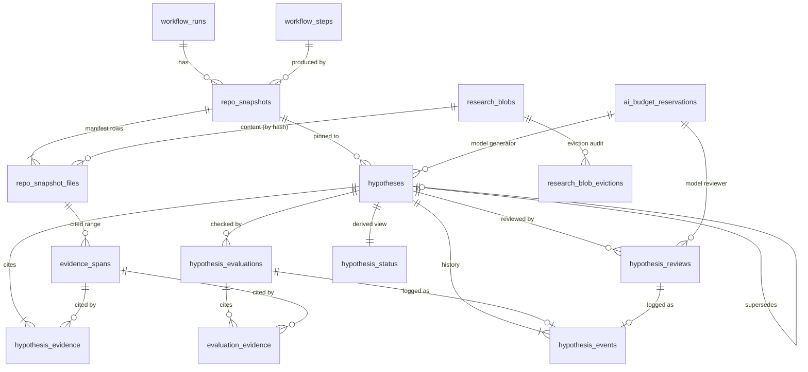
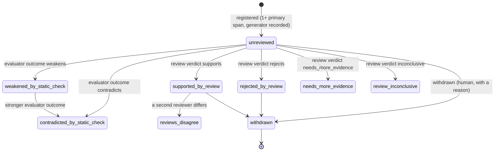

# Research state (Task 5.1): entities, lifecycle and rules

Status: design for migration `0007_research_state.sql`. Everything here is append-only; nothing is deleted except blob bytes through one audited eviction path. No model call, hosted database, deployment or UI is involved.

## 1. Principles
1. **Records are immutable; history is a log; status is derived.** There is no status column anywhere. Current status is a view over append-only events.
2. **Evidence is addressed, not described.** A claim cites `(snapshot, path, line range)`; the database proves that range exists in a content-addressed blob and that its text hashes to the recorded value.
3. **Provenance is typed.** Who generated a claim, who evaluated it, and who reviewed it (and what the reviewer saw) are columns with closed vocabularies, not free text.
4. **Independence is not a boolean.** Reviews record their mode and exactly what the reviewer saw; reports state those facts.
5. **Everything is bounded.** Size, count and length limits are enforced by the database, and cited evidence can never be evicted.
6. **Research state belongs to one workflow run and its producing step, and the database enforces it.** Every record carries `workflow_run_id` (and `produced_by_step_id` where a step wrote it). Composite foreign keys `(parent_id, workflow_run_id)` force a record, its parents and its writing step into the same run, so a record cannot be attached to another run's data whatever the application does. A lease still proves the writer owns its step; the keys prove the row stays inside that step's run.

## 2. Entity relationships

| Table | Holds | Mutable? |
|---|---|---|
| `research_blobs` | file bytes keyed by SHA-256, 1 MiB cap, hash checked by the database | never updated; deleted only by `evict_research_blob` |
| `research_blob_evictions` | audit of every eviction (hash, size, reason, actor) | append-only |
| `repo_snapshots` | one repository at one commit SHA for one run; producing step, `sealed_at`, `sealed_by_step_id`, `manifest_sha256`, counts | one transition: building to sealed, naming the sealing step (of the same run) |
| `repo_snapshot_files` | the manifest: every path is either stored (blob hash) or skipped **with a reason**; classification | insert only, and only while the snapshot is building |
| `evidence_spans` | `(snapshot, path, blob, line_start, line_end, excerpt_sha256)`, verified at insert | append-only |
| `hypotheses` | the claim as generated: family, claim, rationale, checks, generator identity, snapshot | append-only; corrections are new rows (`supersedes_id`) |
| `hypothesis_evidence` | which spans a hypothesis cites, with a role | append-only |
| `hypothesis_evaluations` + `evaluation_evidence` | deterministic evaluator outcomes (`supports`, `weakens`, `contradicts`, `inconclusive`) and the spans they rely on; each carries its own `workflow_run_id` and a mandatory `produced_by_step_id`, tied by composite keys to the hypothesis and step | append-only |
| `hypothesis_reviews` | model or human review: mode, `reviewer_saw`, input hash, verdict | append-only |
| `hypothesis_events` | the authoritative history, in order (`seq`) | append-only |
| `hypothesis_status` (view) | current status, derived | not a table |

## 3. Snapshots, blobs and the manifest
- A **blob** is stored once, keyed by the SHA-256 of its bytes. The database recomputes the hash on insert (`CHECK`), caps it at **1 MiB**, and never allows an update.
- A **snapshot** is created `building`, receives manifest rows, then is **sealed**. Sealing is computed by the database, not supplied by the caller: it counts files, sums stored bytes, enforces limits and computes the manifest hash. After sealing no row can be added or changed.
- The **manifest hash** is `sha256` over the lines `path TAB (blob_sha256 | "skipped:" reason) LF`, ordered by path in **byte order** (UTF-8 bytes, `COLLATE "C"`). The application recomputes it the same way and refuses a mismatch.
- Every file is accounted for: stored (`blob_sha256` set) or skipped (`skip_reason` set: `binary`, `oversize`, `symlink`, `submodule`, `excluded_by_policy`, `unreadable_encoding`, `limit_reached`). Silent dropping is not representable. Classification (`source`, `test`, `vendored`, `generated`, `docs`, `config`, `other`) is recorded for stored and skipped files alike.
- Paths are validated (no leading `/`, no `.` or `..` segments, no empty segments, no tabs or newlines).

## 4. Evidence spans and how they resolve
A span is `(snapshot_id, path, blob_sha256, line_start, line_end, excerpt_sha256)`.
- **Line definition (shared by SQL and TypeScript):** decode the blob as UTF-8 (invalid UTF-8 cannot be cited), split on `\n` only (a `\r` stays in the text), and ignore one final empty element when the text ends with a newline. Lines are numbered from 1; the excerpt is the selected lines joined with `\n`.
- **At insert** the database checks that the snapshot is sealed, that `(snapshot, path, blob)` exists in the manifest (composite foreign key, so a span can only cite a stored file of that snapshot), that the range exists, that it is at most **400 lines**, and that `sha256(excerpt)` equals `excerpt_sha256`.
- **Resolution later:** `verify_evidence_span(id)` returns `ok`, `evicted` (the blob has been removed), `range_error` or `mismatch`. `verify_repo_snapshot(id)` re-hashes every stored blob and recomputes the manifest hash, reporting missing and mismatched blobs. Anything other than `ok` fails closed in the dossier.
- A cited blob **cannot be evicted**, so a span never silently stops resolving.

## 5. Hypothesis lifecycle

1. **Creation.** In one transaction: the hypothesis row (pinned to a sealed snapshot, generator kind/id/version recorded), 1 to 20 evidence links (at least one `primary`, every span in the same snapshot). A deferred check fails the transaction at commit otherwise. A trigger appends the `registered` event. A `model` generator must carry a budget-gateway reservation id; the other kinds must not.
2. **Evaluation (deterministic).** Zero or more records from named evaluators with a version, an outcome and the spans relied on. `inconclusive` (abstaining) needs a rationale but no spans; `supports`, `weakens` and `contradicts` need at least one cited span. An evaluation can never be a model or human act (`actor_kind` is fixed to `deterministic_rule`); it is never a review.
3. **Review (model or human).** See section 6.
4. **Withdrawal.** A human appends a `withdrawn` event with a reason. A withdrawn hypothesis stays in history.
5. **Correction.** A superseding hypothesis is a new row with `supersedes_id`; the old record is never edited.

### Derived status (view `hypothesis_status`)
Computed per hypothesis from the event order, with no stored state:
1. `withdrawn` if a withdrawal event exists.
2. Otherwise, if any review exists, take **each reviewer's latest** verdict: if reviewers' latest verdicts differ, `reviews_disagree`; else `supported_by_review`, `rejected_by_review`, `needs_more_evidence` or `review_inconclusive`.
3. Otherwise, from the **latest outcome of each evaluator**: `contradicted_by_static_check` if any contradicts, else `weakened_by_static_check` if any weakens, else `unreviewed`.
The view also exposes `static_outcome` (`contradicts` > `weakens` > `supports` > `inconclusive` > `none`), evaluation and review counts by mode, and `static_conflicts_with_review` (a review supports while a static evaluator weakens or contradicts), so a reviewer's judgement is never presented as erasing contrary static evidence.
**There is no `verified` status.** `supported_by_review` means a reviewer judged the hypothesis worth pursuing, not that a vulnerability exists. Verification belongs to later stages (scoped testing and findings) and is out of scope here.

## 6. Reviews: mode and what the reviewer saw
`hypothesis_reviews` records `reviewer_kind` (`model` or `human`), `reviewer_id`, `review_mode`, `reviewer_saw`, `input_sha256` (hash of the exact input shown), the verdict and a rationale.
- `reviewer_saw` is a closed set of six booleans: `claim`, `evidence_spans`, `generator_rationale`, `generator_identity`, `prior_evaluations`, `prior_reviews`. Missing keys, extra keys and non-boolean values are rejected.
- **`blinded_independent_assessment`** (model or human): must have seen the claim and the spans, and must **not** have seen `generator_rationale`, `generator_identity`, `prior_evaluations` or `prior_reviews`. The reviewer must not be the same actor (kind and id) as the generator.
- **`disclosed_adjudication`**: human only. May have seen anything. It is recorded as what it is and never counted as a blinded assessment.
- A `model` review requires `provider`, `model`, `prompt_version` and a gateway **reservation id**; a human review must carry none of them. (The gateway is not wired yet, so no model review can be created in practice until it is.)
- The database stores **facts**; no column says "independent". Reports render the facts (mode, what was seen, distinct from the generator or not).

## 7. Events: the authoritative history
`hypothesis_events(seq, hypothesis_id, event_type, evaluation_id, review_id, actor_kind, actor_id, reason, created_at)`, `event_type` in `registered`, `evaluation_recorded`, `review_recorded`, `withdrawn`.
- Events for the first three types are created **by triggers** when the underlying record is inserted, so a record cannot exist without its event, and a direct insert of those types is rejected (checked with `pg_trigger_depth()`). Only `withdrawn` is inserted directly.
- One `registered` event per hypothesis; one event per evaluation and per review; at most one `withdrawn`.
- `seq` gives a total order. The view uses it for "latest".

## 8. Limits and retention
| Item | Limit | Enforced by |
|---|---|---|
| One blob | 1 MiB (the acquisition step will apply a stricter default, 256 KiB per file) | `CHECK` |
| Files per snapshot | 20,000 manifest rows | seal trigger |
| Stored bytes per snapshot | 64 MiB | seal trigger |
| Lines per evidence span | 400 | `CHECK` |
| Spans per hypothesis | 20 | trigger |
| Claim / rationale length | 2,000 / 8,000 characters | `CHECK` |
| Path length | 1,024 | `CHECK` |

**Retention.** Manifests, spans, hypotheses, evaluations, reviews and events are never deleted. Blob bytes may be removed only by `evict_research_blob(hash, reason, actor)`, which refuses any blob cited by an evidence span, records the eviction in `research_blob_evictions`, and leaves the manifest intact so reports say "evicted" honestly. Time-based eviction policy (which blobs, how old) is an operational decision made in a later PR; this one supplies the mechanism and the limits. `research_storage_stats` reports blob counts and bytes so growth is visible. On a small hosted database (Fly's Developer plan allows 5 GB) these limits are what keep storage bounded.

## 9. How it connects to the existing workflow queue
**Provenance rule.** Every record has `workflow_run_id`. Records written by a step also have `produced_by_step_id` (mandatory for snapshots, manifest rows, evaluations and evaluation evidence; optional for spans, hypotheses, links and reviews, which a human may create through the API later). Composite foreign keys tie each record to the same run as:
- its writing step: `(produced_by_step_id, workflow_run_id)` to `workflow_steps(id, workflow_run_id)`;
- its parents: manifest rows and spans to their snapshot; hypotheses to their snapshot and to the hypothesis they supersede; evidence links to their hypothesis and span; evaluations to their hypothesis; evaluation evidence to its evaluation and span; reviews and events to their hypothesis (events also to the evaluation or review they log);
- the sealing step of a snapshot (`sealed_by_step_id`), which the seal trigger requires.
A test reads these keys from the database catalog and pins them, because several constraints overlap at runtime (for example the event log would also reject an evaluation carrying the wrong run) and a single key could otherwise be removed unnoticed.

**Leases.** `ResearchStore` repeats the existing lease check (current owner, unexpired, `running`) in the same transaction as each write, and takes the run from the step. Together with the keys, a worker holding a lease for run B cannot write evidence, hypotheses, evaluations, reviews or seals against run A's records. Human reviews and withdrawals are not lease-bound; they are recorded in the hypothesis's own run and attributed to the operator.

**Step outputs shrink to pointers** (snapshot id, hypothesis ids, hashes). The new `repository_research` workflow type (PR 5.2) will use them; the existing `link_or_idea_intake` workflow and its `source_snapshots` are untouched and keep working. `findings`, `finding_evidence` and `verification_reviews` stay for later: a finding will be promoted from reviewed hypotheses by a future migration. They are not changed here.

### Retries
A step can be retried, so writes must be idempotent *and* must never turn a changed retry into a silent success.
- **Manifest rows.** A row that already exists must match the requested row exactly (blob, git id, size, classification, skip reason). An identical retry is a no-op, even after sealing; any difference is a `ResearchConflictError`, and the request is applied atomically. A path listed twice with different content in one request is rejected.
- **Snapshots.** A retry for the same run, repository and commit must carry the same ref name and acquisition report, or it is a conflict.
- **Hypotheses.** Identity is the snapshot, family, claim text, generator (kind, id, version) and the set of cited spans. A retry of an identity must repeat the stored record in full: rationale, required checks, alternative explanations, supersession, generator reservation and evidence roles. Identical returns the existing hypothesis (`created: false`); anything else is a conflict, never a silent return of the old record. To state something different, change the claim text, family, generator version or evidence, which is a new identity and a new hypothesis.

## 10. As implemented in PR 5.1
- Migration `db/migrations/0007_research_state.sql`; TypeScript access layer `apps/api/src/research-state.ts` (`ResearchStore`: hashing, line semantics, lease-checked writes, `resolveSpan`, `verifySpan`, `verifySnapshot`).
- Verification: unit tests for hashing and line semantics, and real-Postgres tests (`npm run test:integration`) for the rules above, including table-driven status derivation and mutation checks of each rule. The same line definition is checked against the SQL one over awkward texts (CRLF, trailing newlines, empty text, non-ASCII).
- Run provenance, retry comparison and the catalog contract test were added after review (`research-state-provenance.integration.test.ts`).
- Nothing creates these records yet: acquisition (5.2), specialists (5.5), the review endpoint (5.6) and the dossier (5.7) are later PRs, and no existing stage was changed.
- Eviction is a mechanism, not a policy: no age-based eviction runs.
- `TRUNCATE` is not intercepted by the append-only triggers, as with the existing append-only tables.
- A review's `reviewer_saw` is what the reviewing component declares. A test records the consequence of a hole we cannot close in SQL: a user who can set the eviction flag can delete a cited blob outside the audited function; verification then reports the span as `evicted` and the dossier must refuse it.

## 11. What these protections do and do not do
They stop application bugs and careless writes: wrong hashes, edits, silent drops, dangling spans, a record without history, a model claim without a reservation, a blinded review that saw the rationale. They do **not** defend against someone with owner-level SQL access, who can disable triggers (as with the existing append-only tables); that needs database-role separation and external audit, which is deployment work. Self-reported `reviewer_saw` is a record of what the reviewing component declares, not proof; it becomes checkable only when the review input is produced and hashed by our own code (the `input_sha256` field exists for that).

## 12. Task 5.2 and this schema
Repository acquisition (`docs/repository-acquisition.md`) is the first writer of `repo_snapshots`, `repo_snapshot_files` and `research_blobs`. It uses the schema unchanged (no migration). Notes that came out of building it:
- **Snapshot rows cannot be deleted**, so acquisition creates the row only after the whole archive has been validated in memory; a failed validation leaves no row, and an interrupted write leaves a *building* (unsealed, not evidence) snapshot that the retry completes.
- **The retry rule for acquisition reports is by value.** `createSnapshot` compares the report on a retry; it previously compared JSON text in key order, which PostgreSQL `jsonb` does not preserve. It now compares with keys sorted recursively (`canonicalJson`), so equal reports are equal and changed reports still conflict.
- **Paths:** the acquisition validates paths slightly more strictly than the database CHECK (a trailing slash, and lone surrogates, which the `pg` driver would silently rewrite to U+FFFD so that the stored path would differ from the one given). An integration test pins exactly these two differences and the property that anything the acquisition accepts the database accepts.
- **Manifest rows for skipped files** carry the git object id and size, so a skipped file is still verifiable against its git identity. Submodules carry size 0 and no git id (a commit id is not a blob id); their pinned commit is in the acquisition report.
